<!-- Editable source for Enrollment-System-Complete-Guide.docx. Source inspection: 20 October 2026. -->

# 1. What the system does

The BPC Enrollment Portal coordinates student accounts, academic catalogs, enrollment records, grades, clearance review, and preparation for another term. It gives administrators broad system control, registrars academic operating tools, and students access to their own academic information and clearance requests.

The central record is an enrollment for one student in one school year and semester. That enrollment owns the curriculum assignment, year level, section, subject attempts, grades, clearance flag, follow-up timestamps, and lifecycle status. A student can have many historical enrollments but has one explicit current-enrollment link. Most current-work screens follow that link rather than guessing from the latest date.

## 1.1 The full student journey

1. An administrator or registrar creates the student's account and personal record. The system assigns a student number and requests a setup email.
2. The student follows the email link and chooses a password. Staff can create the first enrollment before this setup finishes, but grade processing later requires completed setup.
3. Staff chooses a program and its usable published curriculum, reviews the term, selects subjects, and saves the enrollment.
4. Staff enters and saves grades. Those values remain provisional until staff finalizes them.
5. After finalization, the student checks the released results and submits the signed clearance image for the current term.
6. The server checks the template, office marks, writing presence, and Gemini-transcribed identity. Eligible identity matches and identity-review cases become saved ready submissions; mismatches remain blocked.
7. The student explicitly requests enrollment review. Staff reviews the original document and either rejects it with a reason or verifies it. Identity-review cases require explicit staff identity confirmation.
8. Verification completes the current enrollment's clearance requirement. Current failed grades additionally require a completed Registrar follow-up before another ordinary enrollment.
9. Staff opens the next-term editor, reviews calculated defaults, prerequisites, and outstanding subjects, and saves a new enrollment. Requested final-year documents must be verified before ordinary final-semester enrollment. The old enrollment remains in staff-accessible history.

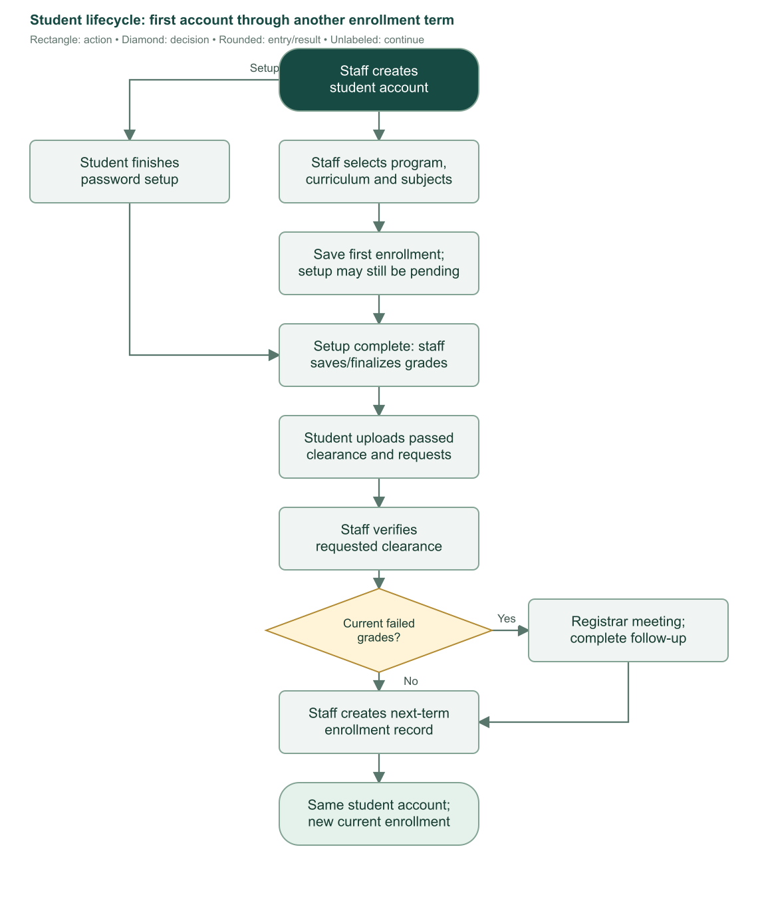

## 1.2 Records that sound similar but mean different things

| Term                 | Meaning                                                                                                                                                        |
| -------------------- | -------------------------------------------------------------------------------------------------------------------------------------------------------------- |
| User account         | Authentication identity, name, email, role, setup state, access state, and security settings.                                                                  |
| Student record       | Student number, personal details, linked user, and current-enrollment pointer.                                                                                 |
| Program              | A course/program catalog entry with an active status and optional selected curriculum.                                                                         |
| Curriculum           | A program-specific plan containing subjects assigned to years and semesters, with units and publication state.                                                 |
| Enrollment           | One student's actual term registration. It contains its own class details and selected curriculum.                                                             |
| Enrollment subject   | One subject attempt in an enrollment. It stores subject snapshots, units, and a draft or released grade.                                                       |
| Clearance submission | One currently saved image/report for an enrollment, with request and review state.                                                                             |
| Enrollment request   | Student explicitly submits an eligible saved clearance for staff review; identity may be matched or awaiting human review. This does not create an enrollment. |
| Completed enrollment | Term has finalized grades and verified clearance. Failed-grade follow-up may still block the next enrollment.                                                  |
| Notification         | A saved account or academic event. It is not proof that an email reached the recipient's inbox.                                                                |

## 1.3 Scope and evidence

This guide describes implemented behavior in the checked-out source on 20 October 2026, baseline `ee5eb42` plus the current uncommitted reopening/clearance changes. It includes changes since the original `d4b7859` edition: current-only student enrollment pages, staff-only curriculum access, Gemini handwriting and manual identity review, required academic documents, and subject prerequisites. Reopening now preserves clearance, while school-year/semester corrections invalidate it. This guide does not inspect a live institution's operational database or assume every service is configured. Current code takes precedence over older notes.

Chapter 24 explains required documents in full. Chapter 25 provides possible defense questions with suggested answers and demonstration evidence. These answers describe implemented behavior; they do not invent accuracy, performance, user-satisfaction, or legal-compliance results.

Flowcharts show major checks and branches. The accompanying procedures specify smaller validation rules, transactions, concurrency protections, and exceptions. A stopped branch means the action is rejected or held until its stated requirement is resolved. Canceling a confirmation leaves the saved data unchanged unless a preceding step has already saved a separate record.

Sources: S01, S02, S07–S16.

# 2. Accounts, responsibilities, and permission boundaries

There are exactly three application roles: `admin`, `registrar`, and `student`. There is no separate applicant, instructor, cashier, office approver, parent, or department account role in the current implementation. Staff enters grades and reviews office clearance evidence through the academic screens.

## 2.1 Permission matrix

| Capability                                        | Administrator                                                  | Registrar                               | Student                                        |
| ------------------------------------------------- | -------------------------------------------------------------- | --------------------------------------- | ---------------------------------------------- |
| Open dashboard and own profile/security           | Yes                                                            | Yes                                     | Yes                                            |
| Manage administrator accounts                     | Create, edit, disable/enable, delete, revoke sessions          | No                                      | No                                             |
| Manage registrar accounts                         | Create, edit, disable/enable, delete, revoke sessions          | No account-management screen            | No                                             |
| Create/edit student accounts and personal details | Yes                                                            | Yes                                     | No                                             |
| Delete a student                                  | Only unfinished setup with no current or historical enrollment | Same rule                               | No                                             |
| Revoke student sessions                           | Yes                                                            | Yes                                     | No staff session controls                      |
| Create first/subsequent enrollments               | Yes                                                            | Yes                                     | No; submits clearance review request only      |
| Edit/finalize grades                              | Current and historical, when allowed by lifecycle              | Current only, when allowed by lifecycle | View released own grades only                  |
| Correct an enrollment                             | Current/historical enrolled, unfinalized                       | Current enrolled, unfinalized           | No                                             |
| Void an incorrect enrollment                      | Current/historical, unfinalized, not already voided            | Current only, same lifecycle checks     | No                                             |
| Reopen finalized grades                           | Yes, with reason                                               | No                                      | No                                             |
| Review/reject/verify clearance                    | Yes                                                            | Yes                                     | Upload/request own eligible current enrollment |
| Send meeting request and complete follow-up       | Yes, with academic checks                                      | Yes, with academic checks               | Receives notice; cannot mark meeting completed |
| Drop an enrollment                                | Current enrolled record only                                   | Same                                    | No                                             |
| Programs, subjects, curricula                     | Manage                                                         | View                                    | No curriculum/catalog pages                    |
| Required academic documents                       | Request and review                                             | Request and review                      | Upload own requested copies; cannot verify     |
| Masterlist and reports                            | View, export, print                                            | View, export, print                     | No                                             |
| Notifications                                     | All recorded events                                            | Events attributed to that registrar     | Events addressed to own account                |
| Configure email, clearance template, storage      | Yes                                                            | No                                      | No                                             |
| Download COR                                      | Eligible student enrollment                                    | Eligible student enrollment             | Own eligible enrollment only                   |

Administrator self-protection blocks deleting or disabling the currently signed-in administrator account. It does not turn administrators into unrestricted editors of finalized academic records: even an administrator must explicitly reopen finalized grades before changing them.

The sidebar hides unavailable sections, but hiding a link is only a usability feature. Server loaders, remote commands, and download/export endpoints enforce the role and ownership checks. Supplying another student's user ID or enrollment ID does not grant a student access to that record.

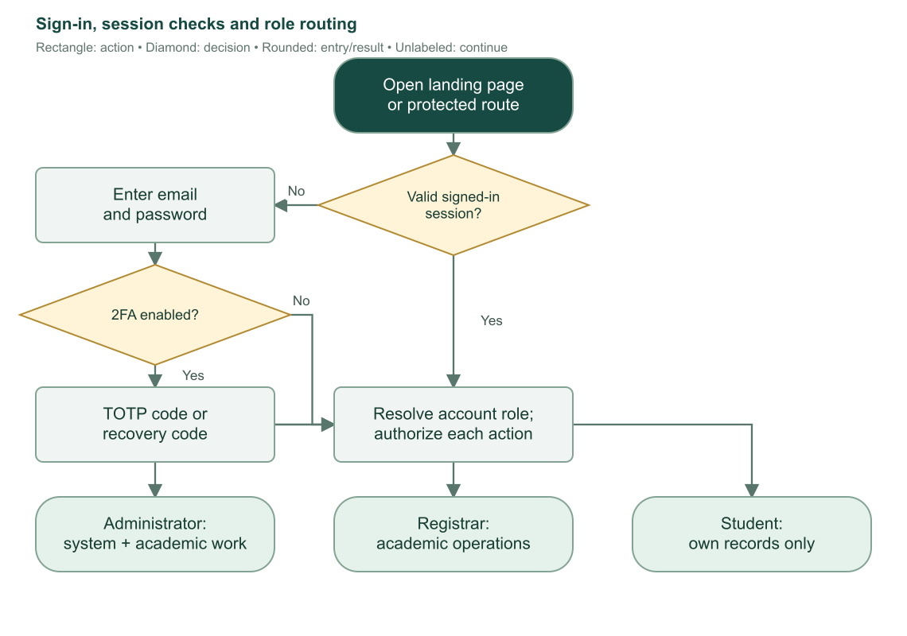

## 2.2 Administrator responsibility

The administrator owns staff access, academic catalog maintenance, publication of curricula, outgoing email configuration, clearance form configuration, storage administration, and academic exceptions. Administrators can perform registrar work, inspect historical academic records, and reopen finalized records with a recorded reason.

Administrators should distinguish operational fixes from historical corrections. Renaming a catalog subject does not rewrite saved subject snapshots. Disabling a registrar prevents access while preserving history. Voiding an enrollment preserves evidence of an incorrect record rather than deleting it.

## 2.3 Registrar responsibility

The registrar manages student information and the term workflow: enrollment, grade drafts, finalization, clearance review, meeting requests, follow-up completion, and current-enrollment corrections. Registrars use the masterlist and reports to prepare operational outputs. They can view catalog plans but cannot maintain those catalogs or system settings.

A registrar cannot reopen finalized grades or edit historical grades. Those cases require an administrator. The resend-setup backend command permits registrar targets of student or registrar roles; the normal registrar navigation still exposes student management rather than a registrar account-management page.

## 2.4 Student responsibility

The student completes setup, protects account access, reviews current enrollment and released grades, uploads the correct current-term clearance and requested academic documents, explicitly requests clearance review, reads notices, and follows up with staff. Students cannot select/save enrollment subjects, enter grades, approve documents/clearance, or mark a meeting completed. Historical enrollment browsing and curriculum pages are no longer student-facing; staff retains historical academic records.

Sources: S01–S04, S08–S15.

# 3. Shared workspace and everyday controls

## 3.1 Navigation and common layout

The public landing page explains the portal and links to sign-in or the dashboard. It remains public even when the visitor already has a session. The protected workspace uses a sidebar, top bar, breadcrumbs, page title, and detail-page Back controls.

The top bar shows the user's name/role, profile link, notification bell, theme switch, and a mobile sidebar control. The notification badge follows the same server visibility rules as the inbox. Only student recipients have unread counts; counts above 99 display as `99+`.

Light/dark preference is stored in a `theme` cookie for one year. Missing or invalid theme values resolve to light. Theme changes affect presentation, not account permissions or academic state.

## 3.2 Search and filters

Student and staff directories, catalogs, and academic outputs provide search or filter controls appropriate to their records. List filters live in URL query parameters, so returning to a filtered URL reproduces its scope. Applying new search/filter values normally returns a paginated list to its first page.

Shared filters derive their control type from validation schemas. Text filters use contains matching. Boolean and enum filters use explicit choices. Numeric/date filters can expose minimum and maximum bounds; the server rejects a minimum greater than the maximum. Dates are interpreted using Manila calendar-day boundaries, and an end date includes that entire day.

Searchable selectors filter options by name/code. Keyboard navigation and selection are supported. Duplicate subjects already present in a draft are disabled in the selector. Inline create actions, where exposed to authorized administrators, create a catalog record; they do not bypass the surrounding curriculum or enrollment save.

## 3.3 Pagination and empty results

Shared directory/catalog tables use 10 records per page, previous/next buttons, visible page numbers, and a jump-to-page control. Invalid or out-of-range page values are normalized by the relevant loader. Empty results show an explanation and suggest adjusting search or filters.

Notifications use 20 records per page. The masterlist uses 50-row lazy batches rather than the shared 10-row pagination. The storage explorer and private test files use storage continuation tokens with up to 100 entries per list request. CSV exports retrieve the complete matching result rather than only the visible page.

## 3.4 Confirmations, saved state, and errors

Confirmations guard actions such as finalization, dropping, deletion, changing an account email, replacing an edited subject list, and discarding unsaved work. Loading states block duplicate submissions. Successful account/enrollment forms remember that the record was saved, so a later navigation failure does not invite an accidental duplicate save.

An unsaved draft and a saved record are different. Canceling a form discards local edits; it does not remove an account already created before opening its enrollment form. Email delivery is another separate outcome: a saved account or academic change can survive an unsuccessful outgoing email attempt.

Authored client errors explain invalid inputs, forbidden actions, missing records, and stale forms. Unknown/provider/server failures use safe public messages. Diagnostic details remain server-side; storage/email credentials and raw provider errors are not returned as page data.

Sources: S02, S04, S05, S17, S20, S22, S26.

# 4. Invitations, sign-in, password recovery, and two-factor security

## 4.1 Staff-provisioned accounts

Public sign-up is disabled. Staff creates accounts through authorized account screens. New accounts receive a password-setup link rather than a staff-chosen initial password. The backend function called `resendMagicLink` actually requests a password-reset/setup link; it does not implement passwordless sign-in.

Setup and reset links expire after 24 hours. The account email template depends on whether a credential password already exists: new accounts receive setup language, existing password accounts receive reset language. Saved account notifications contain safe prose and never the one-use link or token.

## 4.2 First-login and password-reset procedure

1. Open the invitation's `/first-login` link, or the recovery email's `/reset-password` link.
2. The page requires a reset token in the URL. Missing or expired tokens require a new link through staff resend or Forgot password.
3. Enter a new password with at least eight characters and enter the same confirmation. Authentication enforces its password bounds; the signed-in change-password form explicitly allows 8–128 characters.
4. The server obtains the target user from an unexpired reset-token record. It does not trust a browser-supplied user identity.
5. Authentication consumes the token, saves the new password, and revokes old sessions.
6. The server attempts automatic sign-in. If sign-in fails or two-factor verification is required, the password remains saved and the user is told to sign in normally.
7. After successful sign-in, setup completion requires an actual credential password and sets `setupComplete=true` and `emailVerified=true`.
8. The user opens the dashboard. If setup completion needs retrying, the page retains its signed-in state so it does not reuse a consumed reset token.

The application does not impose a universal setup-complete guard on every protected page. Specific operations enforce setup where needed. For example, staff may create a first enrollment before setup finishes, while grade editing/finalization and student clearance require completed setup.

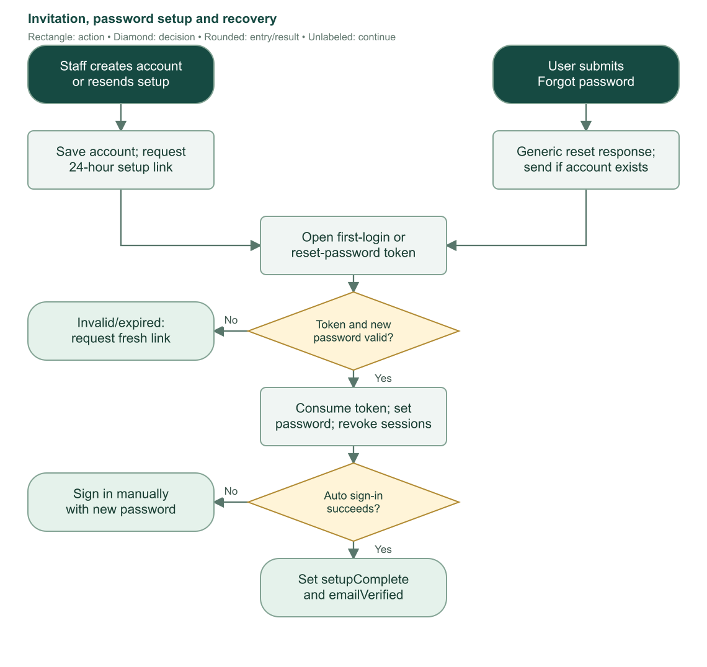

## 4.3 Normal sign-in and sign-out

The login page accepts email and password. Busy controls prevent duplicate sign-in requests. A successful password response either opens the dashboard or presents the two-factor challenge. A signed-in visitor opening `/login` is redirected to the dashboard.

The two-factor challenge accepts a six-digit authenticator code or a recovery code. The login UI lets the user switch modes or return to sign-in. It uses `trustDevice:false`, so this UI does not establish a trusted-device bypass. Recovery codes are single-use.

The sidebar's Log out action asks for confirmation. Confirming signs out and returns to `/login`; canceling retains the current session. Staff session revocation, email changes, password recovery, and disabling a staff account can also invalidate sessions.

## 4.4 Forgot password

The public Forgot password page validates an email address and requests a reset link. Its generic response protects account privacy and does not prove an account exists or that a provider accepted delivery. Staff-initiated invitations have separate request-scoped delivery tracking and can explicitly report delivery failure.

A consumed token cannot be reused. If changing the password succeeds but automatic sign-in fails, use the new password on the normal login page. Do not repeat the consumed reset URL.

## 4.5 Change password while signed in

All roles can open Settings > Security for their own account. Enter the current password, a new password of 8–128 characters, and a matching confirmation. The application calls authentication with `revokeOtherSessions:true`. Success clears the form and signs out other sessions while preserving the current password-change session as handled by authentication.

## 4.6 Enable and disable two-factor authentication

1. Open Settings > Security and enter the current password to start authenticator setup.
2. The application requests TOTP setup and displays a QR code, optional manual key, and recovery codes.
3. Add the secret to an authenticator app. Save the recovery codes outside the browser session.
4. Select the acknowledgment that recovery codes were saved.
5. Enter a six-digit authenticator code and verify it. Two-factor protection is enabled only after successful verification.
6. The application clears setup secrets from client state and refreshes the account's factor status.
7. Canceling the setup clears the local setup display; it does not complete verification.
8. To disable two-factor authentication, enter the current password and confirm through the disable operation. Account status refreshes after success.

The profile/security page loads only the current user's relevant state. Stored QR secrets, recovery codes, passwords, reset tokens, and environment credentials are intentionally absent from this guide.

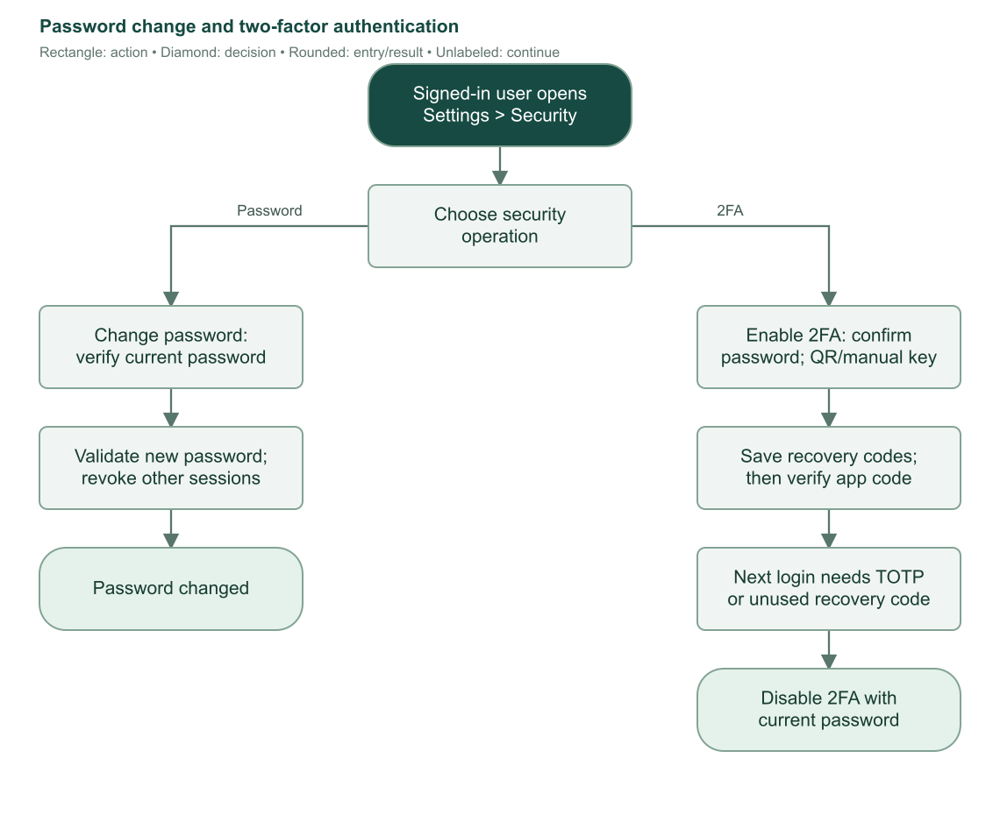

Sources: S03, S04, S06.

# 5. Creating, editing, and controlling accounts

## 5.1 Create a student

Administrators and registrars open Students and choose Add Student. The dialog collects personal information and offers immediate enrollment or enrollment later. The default create-and-enroll path opens the enrollment editor after successful account creation.

**Import CSV** on the Students page creates student accounts in batches of up to 100 rows / 256 KB. Download the template, fill first_name, last_name, email, birth_date, sex, contact_number and address; middle_name is optional. Dates use YYYY-MM-DD, sex is female/male, and phone columns should be kept as text to preserve leading zeros. Quoted commas, escaped quotes and multiline addresses are supported.

Preview validates every row with the same creation rules, detects duplicate emails within the file, and rejects existing account emails. The server repeats validation when importing; validation errors create no accounts. Student numbers are generated automatically, enrollment remains unset, and the existing account-setup invitation flow runs for each student. Mail failures retain the created account and show a resend warning. Runtime failures may leave earlier rows created; results identify created, failed and unattempted rows. Review the student list before retrying after a lost response. Existing accounts are never overwritten.

| Field                  | Current rule                                                                                        |
| ---------------------- | --------------------------------------------------------------------------------------------------- |
| First name / last name | Required; trimmed; each 1–100 characters.                                                           |
| Middle name            | Optional; trimmed; maximum 100; stored as empty text when omitted.                                  |
| Email                  | Required valid email; trimmed/lowercased; unique across every account role.                         |
| Address                | Required trimmed text; maximum 500 characters.                                                      |
| Contact number         | Required; exactly 11 digits on creation; spaces/hyphens allowed; maximum 30 characters.             |
| Birth date             | Valid calendar date in `YYYY-MM-DD`; student must be 17 or older on creation, based on Manila date. |
| Sex                    | Current stored options are `female` and `male`.                                                     |
| Enrollment timing      | Create and enroll now, or save the student and enroll later.                                        |

The display name is composed from the nonempty name parts. Program, year level, semester, school year, section, and subject selection are entered during enrollment, not during student-account creation.

The server first validates the actor and duplicate email. Duplicate checks are case-insensitive and identify the existing role in the error. It creates the authentication user, then allocates the student number and personal record in a database transaction.

Student numbers use `MA-YYYYMM-NNNNNN`, for example `MA-202610-000001`. The month/year comes from Asia/Manila. The sequence starts at one each month and supports up to 999999 numbers in that month. Deleting an eligible unfinished student does not roll the sequence back or recycle its number.

If saving the student record fails after authentication-user creation, the server attempts to remove that newly created auth user. If cleanup also fails, staff receives an instruction to contact an administrator before retrying. This prevents treating a partially created account as a clean new attempt.

After the account is saved, the system requests its setup email. A delivery failure preserves the account and returns an explicit invitation-failure result. Staff can resend from the saved account rather than create it again.

## 5.2 Create administrator and registrar accounts

Only administrators can create staff accounts. The Administrators and Registrars screens share an administrator-only account-management interface, with the requested role fixed by the selected screen. Enter first name, optional middle name, last name, and email. The same name rules and globally unique email rule apply.

Staff account creation and invitation delivery are separate. The list refreshes after creation even when email fails. Setup status and access status are displayed separately: the interface's setup/Verified badge reflects `setupComplete`; Enabled/Disabled reflects the banned flag.

Staff lists support search by name, email, or internal account ID, schema-based filters, and 10-record pages. The student-facing student number is a different identifier from the internal user/account ID.

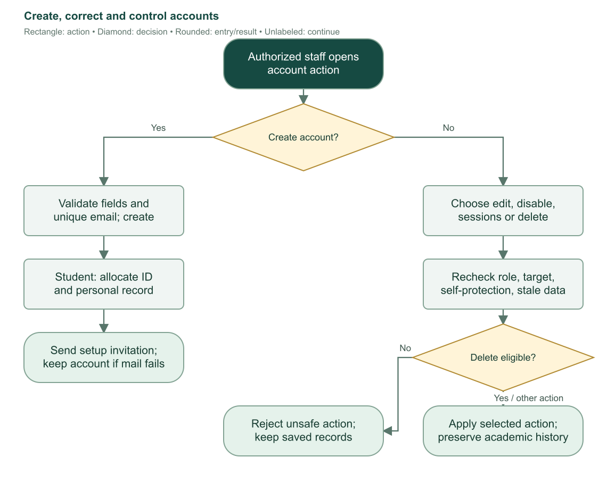

## 5.3 Edit saved accounts

Administrators may edit administrator and registrar names/emails. Administrators and registrars may edit student names, email, address, contact number, birth date, and sex. Students cannot edit their personal record through the read-only Profile page.

Editors send the original field values with the desired new values. The server re-reads the record inside a transaction and compares the originals. If another operator changed an editable value, the save fails with a stale-data conflict rather than silently overwriting the newer change. Reload the record and reapply the intended correction.

User-name changes and student demographic changes save atomically. The student number remains unchanged. Ordinary name/contact/demographic edits preserve credential data, setup status, and academic history.

Changing an email has additional consequences. The UI requests confirmation; the transaction resets `emailVerified=false`, deletes the account's sessions, and invalidates outstanding setup/reset tokens. It preserves `setupComplete` and does not automatically send a new invitation. The existing password remains the account's password. Staff should use the available resend/reset path when a new link is needed.

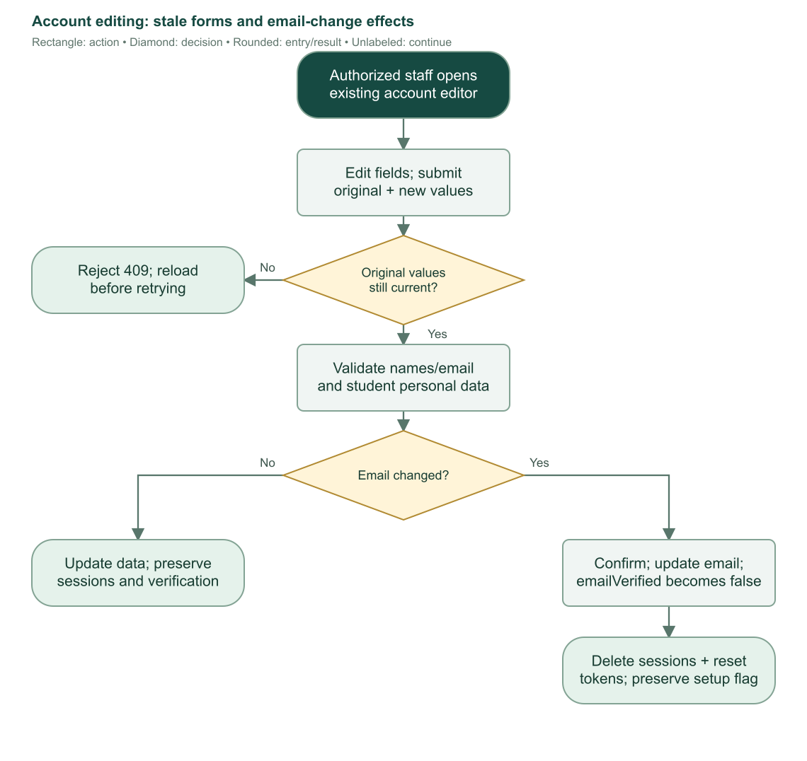

## 5.4 Disable/enable, revoke sessions, and delete

| Action                         | Effect and eligibility                                                                                                                                                                           |
| ------------------------------ | ------------------------------------------------------------------------------------------------------------------------------------------------------------------------------------------------ |
| Disable staff account          | Administrator only; confirms loss of access; bans target, revokes sessions, preserves account and activity. Current admin cannot disable self. No equivalent student-disable control is exposed. |
| Enable staff account           | Administrator only; removes ban so normal authentication can resume. It does not recreate a deleted account.                                                                                     |
| Revoke sessions                | Admin can target students/registrars/admins; registrar can target students only. Signs target out without changing password, account status, or enrollment history.                              |
| Delete student                 | Admin/registrar only while setup is unfinished, current pointer is absent, and no enrollment history exists. Dropped or voided history still prevents deletion.                                  |
| Delete administrator/registrar | Administrator only; permanent removal of access, credentials, sessions, factor data, and reset tokens. Current admin cannot delete self. Academic records and student notifications remain.      |

Deletion checks run again inside an immediate transaction. Linked auth data cascades as defined by the database. Academic author references become null when their staff account disappears; retained actor-name/audit snapshots preserve human-readable history where implemented.

Resending setup is an email action, not account recreation. It should follow the saved account's identity and current email. Failed email delivery does not turn an already-created account into an unsaved account.

Sources: S03, S06, S07, S24.

# 6. Administrator operating guide

## 6.1 Initial preparation

1. Sign in using the administrator account provisioned during setup. Set an operational password and configure two-factor authentication.
2. Check Settings > Email before creating real users who need setup invitations.
3. Review programs, subjects, prerequisite links, and supplied sample curricula. Replace demonstration academic rules with approved institutional rules before operational use.
4. Activate the intended published curriculum for each active program. A program without a usable selected curriculum cannot support ordinary enrollment.
5. Configure Garage storage, the server-side Gemini key, and Settings > Clearance. Save a blank reference, printed areas, each required office checkbox/signature region, and student-name/number writing areas.
6. Create registrar accounts. Confirm invitation delivery outcomes and help them complete setup.
7. Use the dashboard's account/catalog health panels and the role-specific worklists to identify setup or configuration gaps.

## 6.2 Recurring work

An administrator can perform every ordinary registrar workflow. In addition, the administrator maintains account access, creates catalog revisions, configures email/storage/clearance, and handles historical academic exceptions. Opening a dashboard or report is read-only; actual state changes require their dedicated controls.

When a curriculum changes, create a new draft and activate it. Published curricula are not edited in place. When a finalized grade is wrong, reopen the enrollment with a reason, correct and finalize the grades again. Existing clearance and its verification remain valid for the same term. When a staff account should be suspended temporarily, disable it rather than permanently delete it.

## 6.3 Exception ownership

| Situation                                       | Administrator action                                                                                                       |
| ----------------------------------------------- | -------------------------------------------------------------------------------------------------------------------------- |
| Registrar cannot edit old enrollment            | Open historical record as admin; obey grade/lifecycle locks.                                                               |
| Finalized grade needs correction                | Reopen with reason; review provisional grades; finalize again.                                                             |
| Wrong active curriculum                         | Activate the correct plan; existing enrollment references remain historical.                                               |
| Setup email failed                              | Check provider settings; resend for the existing account.                                                                  |
| Student clearance repeatedly fails correct form | Inspect saved template/office boxes and report evidence; correct configuration and ask for fresh submission.               |
| Raw clearance file is missing                   | Inspect Garage and referenced object; restoring/replacing storage is an operational repair, not an automatic database fix. |
| Capacity display is too small                   | Review physical disk and Garage layout; only confirmed increases are supported by the UI.                                  |
| Staff account must be removed                   | Check self-protection; confirm permanent delete; academic history remains.                                                 |

Sources: S02, S07–S16, S21–S25.

# 7. Registrar operating guide

## 7.1 Student admission and first enrollment

Open Students, search for the person before creating another account, and check matching student number/email where available. Create the personal record or correct existing information. If the invitation fails, retain the saved student and resend later. First enrollment can proceed while the student completes setup.

Open Enroll Student, choose the program, review its selected curriculum, and check the school year, semester, year level, and section. Review each subject and unit count. Add or remove subjects explicitly; changing the displayed term does not silently replace an already-edited list. Confirm and save. Check the separate confirmation-email outcome.

## 7.2 End-of-term academic work

1. Use Dashboard or Students worklist filters to find accounts with unfinished setup and enrollments awaiting grades.
2. Obtain the student's completed account setup before grade editing/finalization.
3. Save draft grades, review all subject outcomes and blanks, and finalize only the saved values intended for release.
4. For failed/INC subjects, use the meeting-request action where appropriate. A sent request alone does not satisfy the failed-grade follow-up gate.
5. Review the Enrollment requests queue after students save eligible matched/reviewable clearances and explicitly request review.
6. Inspect the original image and saved findings. Identity-review cases require explicit confirmation of both name and number. Verify valid requests or reject with a useful reason.
7. After the actual meeting, mark follow-up completed. This records staff confirmation; the system does not perform or schedule the meeting.
8. Use Next term worklist and the enrollment editor to create new enrollment records for eligible students.

## 7.3 Cases requiring administrator involvement

Registrars cannot edit historical grades, reopen finalized grades, manage staff accounts, publish curricula, or configure email, clearance forms, or storage. A valid current record can still be blocked by incomplete setup, finalized grades, dropped/voided status, a stale revision, or an active meeting-send claim. Those conditions should be resolved at their responsible workflow instead of bypassed.

Masterlist and report filters use the selected term's historical enrollment assignments. Do not substitute the Students directory's current class display when preparing a past-term roster.

Sources: S07–S20.

# 8. Student operating guide

## 8.1 Setup and current enrollment

Contact staff to create the account and supply personal details. Follow the invitation to choose a password. Students cannot self-register or create their own first enrollment. After staff saves an enrollment, Dashboard and Enrollment show the current term, subjects, units, and released outcomes. An account without a current enrollment shows the appropriate message and needs staff assistance.

The Enrollment page now returns and displays only the explicit current enrollment. Historical filters and history browsing were removed from that page. Past records remain in the database for staff history and reports; the student dashboard still uses own historical records for unresolved-meeting and dropped-history notices. Some older dashboard link labels mention history, but the destination is current-only.

Students no longer have a Curriculum sidebar item or access to curriculum list/detail routes, including their formerly assigned plan. Those loaders are staff-only. Curriculum assignment remains part of the enrollment's underlying data and enrolled-subject context.

## 8.2 Grades and COR

Saved provisional grades remain Pending and are masked on student-facing server data until finalization. Finalized grades of 1.00–3.00 pass; above 3.00 fail; finalized blanks are INC. Students cannot edit or release them.

The current enrollment card offers an eligible Certificate of Registration. The server still permits an owning student to download their own historical enrolled/completed record when its ID is available; removing history browsing did not change that endpoint's ownership rule. COR requires subjects, not grade finalization, and rejects dropped/voided records.

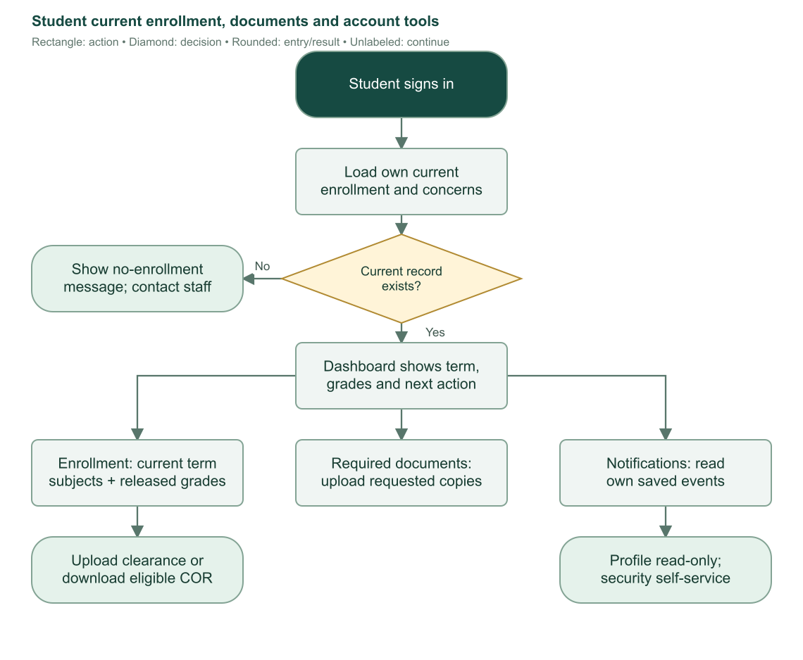

## 8.3 Clearance upload and explicit request

After current grades are finalized, open clearance in Enrollment. Choose a clear JPEG, PNG, or WebP photo/scan of the correct current-term form, at most 10 MiB. Production clearance does not accept PDF. Inspect the suggested outline; use enhanced detection or adjust/draw corners manually as needed.

Check and save clearance runs server template, office-mark, and writing-presence checks, then Gemini name/number transcription when those local checks pass. A template/office review, missing writing, or identity mismatch does not save a new submission. An eligible identity match or identity Needs review result can be saved as ready.

Ready is not yet a staff request. Explicitly request enrollment review. Near the final curriculum term, any staff-requested academic documents must at least be uploaded first. An identity-review clearance remains reviewable; staff must confirm both fields against the original before verification. A missing Gemini key or provider failure does not silently approve the image or create an outage fallback submission.

Rejection displays a reason and requires a corrected eligible upload and another request. Verification completes current clearance; staff separately creates the next enrollment after all applicable grade, meeting, document, curriculum, term, and subject-prerequisite checks.

## 8.4 Required academic documents

During semester 1 of the student's final curriculum year, staff can request Form 137, SF10, TOR, or a combination. Only the selected kinds become requirements; the system does not automatically request all three. Upload each requested item in Enrollment > Required documents. PDF, JPEG, PNG, and WebP are accepted up to 10 MiB per item. Combine multiple pages into one PDF where needed.

The global student popup alerts about missing/rejected copies; the dashboard continues showing a notice for copies awaiting verification. Dismissing the popup does not waive a requirement. Uploaded means the copy is waiting for staff, not accepted. Students cannot replace uploaded/verified copies; a rejected copy can be replaced and must be reviewed again.

At the applicable near-final-term clearance request, requested/rejected copies block requesting, while uploaded/verified copies satisfy that upload gate. Ordinary enrollment into the selected curriculum's final year and final semester requires every existing requested item verified. No requested rows means no document block. See Chapter 24 for exact term formulas, exceptions, and persistence across program changes.

## 8.5 Notifications and own account

Notifications contains the student's addressed events and read/unread controls. Academic-document requests and decisions are in-app events; they are not document emails. Reading or dismissing a notice does not verify a document, complete a meeting, or enroll the student.

Arrange actual meetings and resolve INC requirements with the responsible staff. Only staff records completed follow-up. Profile remains read-only; ask staff for demographic/email corrections. Security supports password changes and TOTP management. A changed account email invalidates sessions and old reset/setup links.

Sources: S04, S06, S10–S16, S18–S21, S31–S35.

# 9. Programs, subjects, and curriculum lifecycle

## 9.1 Program catalog

A program stores a unique code, name, optional description, active/inactive status, and optional selected active curriculum. Code must be trimmed and nonblank; name must have at least two characters. Administrators create/edit/delete programs; registrars view them.

An inactive program is unavailable for ordinary new enrollment. Deactivating it preserves existing curricula, enrollment history, and its selected-curriculum reference. Selecting an active curriculum in the program editor uses the same publication/activation rules as the curriculum screen.

Deleting a program is blocked while any curriculum references it. Inactivation is the appropriate catalog state when historical dependencies must remain.

## 9.2 Subject catalog and prerequisites

A subject stores unique code, name, optional description, active status, and optional prerequisite links to other catalog subjects. Units belong to curriculum placements and enrollment attempts, not the catalog itself. Administrators create/edit subjects and rules; registrars can view them.

The subject dialog loads existing subjects independently of the current list's search/page, offers a searchable prerequisite selector, and displays removable selection chips. Multiple prerequisites mean all are required. Inactive prerequisite subjects are allowed by current validation; identity is by stable ID, so code renaming does not break a link.

Rules belong to the global subject, across programs and curricula. Published curriculum snapshots do not freeze prerequisites. Saving new rules affects subsequent enrollment/correction validation but does not automatically reopen, void, or rewrite existing registrations.

Create defaults to no prerequisites. An update with omitted prerequisite IDs preserves rules; an explicit empty list clears them; a supplied list replaces the desired set. The server rejects duplicate/self/nonexistent IDs and direct/indirect cycles. Details and graph save in one immediate transaction, so a rejected cycle also rolls back a simultaneous name/code change.

Deleting a subject required by another is blocked until inbound requirements are removed. Deleting a dependent subject can cascade its outgoing prerequisite links, while curriculum/enrollment references still independently prevent unsafe deletion. Catalog renaming does not rewrite saved curriculum/enrollment name/code snapshots. An inactive enrollment choice remains labeled but is not categorically rejected by active status alone.

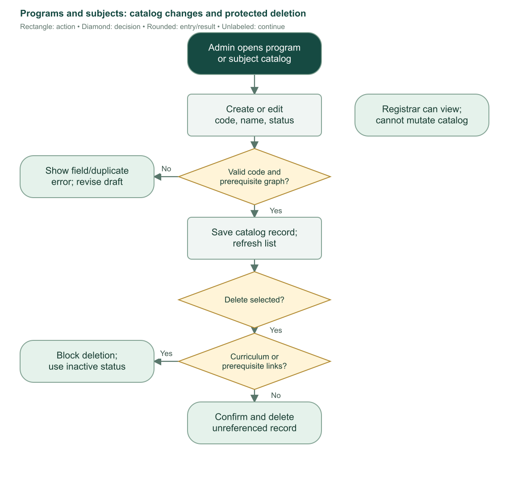

## 9.3 Create and edit a curriculum draft

1. An administrator opens New Curriculum and chooses its program and a name of at least two characters.
2. Set positive integer year-level and semester counts. Defaults are four years and two semesters.
3. Add subjects and assign each to a year level, semester, and positive whole-number units.
4. A subject may appear only once across the entire curriculum. It cannot be duplicated in another term of the same plan.
5. Every placement must fit the curriculum's declared year/semester bounds.
6. Save the draft. An empty draft is permitted, but it cannot be activated without at least one subject.
7. Continue editing while unpublished and unarchived. The saved row list represents the complete desired curriculum, not a partial patch.

Existing placement IDs must belong to that curriculum and retain their subject identity. To replace a subject placement, remove it and add the new one. Draft saves obtain current catalog names/codes and save all changes transactionally.

## 9.4 Activate and publish

Activation requires an active parent program and at least one valid subject placement overall. It does not require a subject in every declared year/semester. Every placement must have valid positive integer fields within the plan's limits.

On first activation, the system refreshes the subject name/code snapshots from the catalog, stamps publication time, unarchives the selected plan, and points the program to it. A previously selected curriculum is archived. Published placements become read-only, preserving the plan used by historical enrollments.

Future ordinary enrollments use the program's selected usable published curriculum. Existing enrollments continue referencing their saved curriculum. Restoring a dropped enrollment in the same program can use its original published plan even after replacement or archiving.

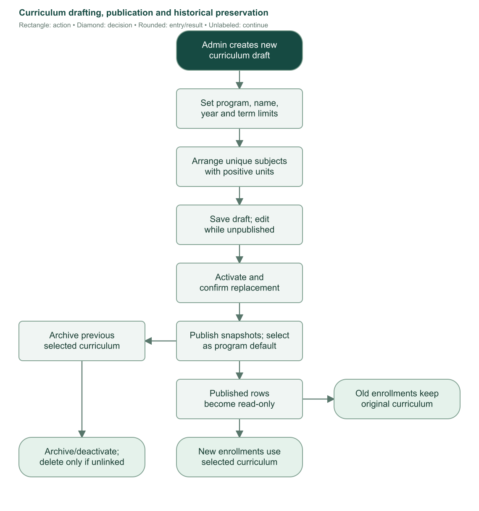

## 9.5 Derived curriculum states

| State/action      | Behavior                                                                                                |
| ----------------- | ------------------------------------------------------------------------------------------------------- |
| Draft             | Never published and not archived; editable.                                                             |
| Active            | Published, not archived, and selected by its program.                                                   |
| Inactive          | Published, unarchived, not currently selected. It remains read-only.                                    |
| Archived          | Has an archive timestamp; cannot be the usable selected plan.                                           |
| Deactivate        | Clears the program's active-curriculum selection.                                                       |
| Archive           | Sets archive timestamp and clears selection when necessary.                                             |
| Restore/unarchive | Removes archive timestamp; does not automatically activate or make a published plan editable.           |
| Delete            | Allowed only when not selected and never referenced by an enrollment, including dropped/voided history. |

The interface's “create a revision” guidance means manually creating another curriculum and activating it. There is no dedicated curriculum-clone or automatic revision-copy command. Published edit routes send the operator back to read-only details. An archived unpublished draft must be restored before editing.

Curriculum details group entries by year/semester in All or Tabbed views and show per-term units, total units, subject counts, and plan metadata.

Sources: S08, S09, S24.

# 10. First enrollment and subject selection

## 10.1 Eligibility and loading

Only administrators and registrars can open the staff enrollment editor. The server requires a real student-role user and a linked student personal record. A current-enrollment pointer must resolve to an enrollment owned by that student; a broken/mismatched link is rejected rather than silently reassigned.

For a first enrollment, defaults are year level 1, semester 1, blank section, and the current Manila calendar year as school-year start. That default is not a configurable institutional academic calendar. Program begins blank unless a valid program query supplies a choice.

Ordinary new enrollment needs an active program with its selected active, published, unarchived curriculum. Missing/inactive program, absent selection, wrong program ownership, or unusable curriculum stops loading with an actionable message. Program changes load that program's curriculum and confirm before discarding changed selections.

## 10.2 What staff can edit

| Editor value/control  | Behavior                                                                                                     |
| --------------------- | ------------------------------------------------------------------------------------------------------------ |
| Program               | Loads allowed curriculum; changed draft requires discard confirmation.                                       |
| School-year start     | Positive integer; identifies the first year of the displayed year pair.                                      |
| Year level / semester | Positive integers within selected curriculum limits. Initial defaults are clamped to those limits.           |
| Section               | Required trimmed text; enrollment can store custom sections. Some student-directory filters expose only A–D. |
| Subject row           | Select a catalog subject; duplicate subject IDs forbidden.                                                   |
| Units                 | Finite positive number; enrollment units can be fractional.                                                  |
| Remove row            | Removes from local draft before save.                                                                        |
| Use term subjects     | Explicitly replaces draft with selected term's plan subjects; confirms replacement if draft changed.         |
| Failed / INC list     | Displays outstanding latest finalized subject concerns and permits explicit retake insertion.                |

Changing year/semester updates the term selection but does not silently replace an existing draft's subjects. Staff decides whether to keep custom rows or use the selected term's prescribed rows. At least one subject is required at enrollment save.

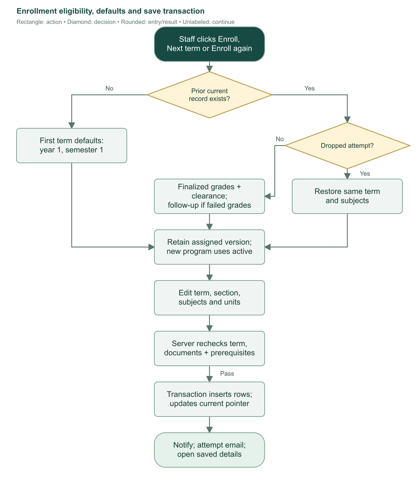

## 10.3 Curriculum versus extra subject rows

A selected subject is marked `curriculum` only if it belongs to the selected curriculum in the chosen year and semester. A subject from a different curriculum term is `extra` for this enrollment, even when it exists somewhere else in that same plan.

Curriculum rows use the published curriculum's subject name/code snapshots. Extra rows use current catalog name/code. Both accept staff-specified positive units. The system saves subject attempt snapshots so future catalog edits do not rewrite the enrollment's historical subject labels or units.

## 10.4 Confirmation and transaction

The confirmation summarizes student, term, year, section, and subject count. Current finalized failed/INC results add an acknowledgment warning. Canceling returns to the draft.

The server rechecks role, student ownership, current pointer, curriculum availability/selection, term chronology, subject existence, units, and duplicates when saving. An old open form cannot bypass changed requirements. A database partial unique index prevents two valid attempts for one student in the same school year and semester; dropped/voided attempts do not occupy that unique slot.

The transaction inserts the enrollment with status `enrolled`, inserts its subject snapshots and acting staff attribution, updates the student's current pointer, and records the enrollment notification. The system then attempts a confirmation email outside the transaction.

Failed email does not undo enrollment. The UI reports that separate result and prevents resubmission once saving succeeded, including when follow-up navigation fails. A saved student account remains saved if the operator cancels this separate enrollment editor.

## 10.5 Exact subject-prerequisite enforcement

For every selected subject, load its current direct prerequisite links and the student's non-dropped/non-voided attempts. Compare school-year start then semester, not year level. Ignore same-term and future attempts. For each required subject, the latest valid earlier-term attempt must have finalized numeric grade 1.00–3.00. All configured requirements must pass.

Missing history is Not completed; an unfinalized attempt is Pending; finalized null is Incomplete; above 3.00 is Failed. A newer earlier-term Pending/Failed/INC supersedes an older pass. A later finalized passing retake restores eligibility. Selecting both prerequisite and dependent in one enrollment cannot create an earlier finalized pass.

This applies to curriculum/extra rows, first enrollment, ordinary next term, dropped reenrollment, and corrections. Both staff roles are bound; there is no prerequisite override. Correction excludes the entire corrected enrollment from satisfying its own prerequisites and uses the corrected target term. The check evaluates direct required subjects; cycle detection is separate and does not mean recursive academic rechecking of every ancestor of an already-passed prerequisite.

The editor recomputes reasons when target school year/semester changes, disables blocked selector choices, explains already-selected blocked rows, and prevents saving. Term defaults, Use term subjects, restoration, and Add all retakes deliberately keep their selected rows rather than silently removing blocked subjects. Staff must remove them or resolve the requirements. The server checks latest rules/history again during save and rejects conflict without partial enrollment/pointer/notification changes.

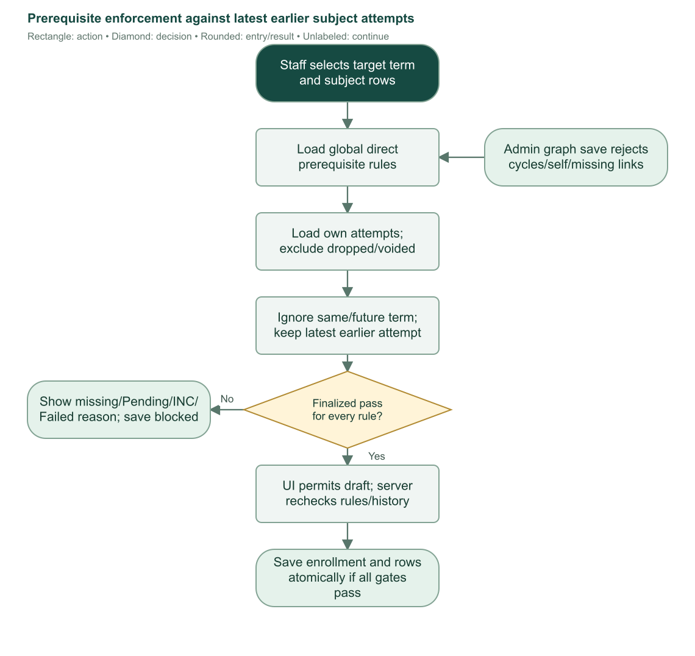

Sources: S07, S10, S18, S24, S34.

# 11. Grade drafts, finalization, and outstanding subjects

## 11.1 Grade meanings

| Saved value and release state             | Meaning                                                                                |
| ----------------------------------------- | -------------------------------------------------------------------------------------- |
| Unfinalized enrollment                    | Student-facing outcome remains Pending; draft numeric values are masked from students. |
| Finalized numeric 1.00–3.00               | Passed.                                                                                |
| Finalized numeric above 3.00 through 5.00 | Failed.                                                                                |
| Finalized null/blank                      | INC, meaning Incomplete.                                                               |
| Dropped/voided attempt                    | Preserved history; excluded from ordinary outstanding-subject calculations.            |

Grades must be finite numeric values from 1 through 5, or null. Numeric display uses two decimals. A draft blank is not yet a released INC. Finalization changes the interpretation of saved nulls without inventing numeric grades.

## 11.2 Permission and edit procedure

Grade editing and finalization require completed student account setup, an enrollment that is neither dropped nor voided, and unfinalized grades. Administrators may act on current or historical records. Registrars may act on the current record only.

1. Open the student's enrollment details and inspect current/historical status and lock explanations.
2. Choose Edit Grades. This creates a local draft rather than changing the database immediately.
3. Enter grades or leave null values. Review subject IDs/names to ensure results attach to the correct attempt.
4. Save the changed rows. Cancel restores the saved values, with discard confirmation when necessary.
5. The server checks every subject row belongs to this enrollment, rejects duplicate row IDs, validates values, and compares each original grade with the database.
6. Revision checks reject concurrent lifecycle changes. All grade updates save together or roll back on conflict.

Saving a grade draft increments enrollment revision but does not publish the grades. If another operator changed a grade or the enrollment state, reload and review before retrying rather than overwriting the new values.

## 11.3 Finalize and release

The operator must finish or cancel active edits before finalization. The subject list must be nonempty, saved grades valid, and the confirmation's reviewed values must match the database's complete subject/grade set. Finalization does not silently save an unsaved draft.

The confirmation identifies blank grades that will be released as INC and explains that corrections need administrator reopening. The server compares the exact reviewed subject IDs/grades, sets `finalizedGrades=true`, increments revision, and records the release notification. Status is completed if clearance was already verified; otherwise it remains enrolled. This also applies after reopening: retained same-term approval makes refinalization complete the enrollment without another clearance upload or verification. The current clearance workflow normally verifies only after finalization.

After commit, the system attempts the grade-release email. Failure does not unfinalize grades or remove the saved notification. Students can then see the released numeric grades and INC results.

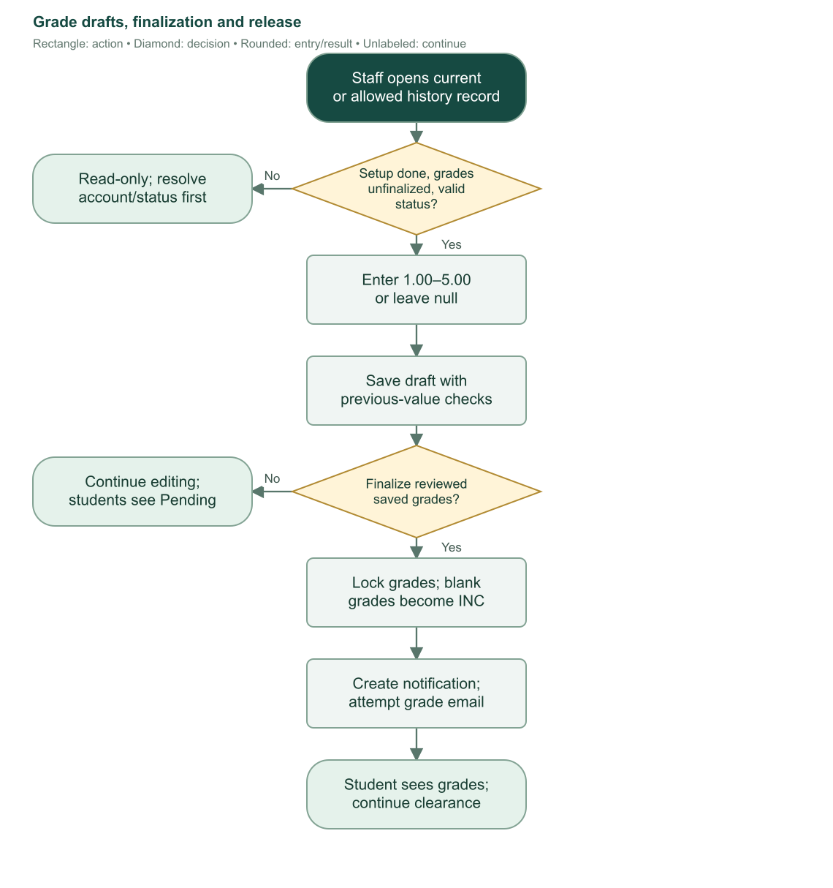

## 11.4 Outstanding failed and INC subjects

The enrollment editor collects finalized non-dropped/non-voided history and determines the latest finalized attempt for each subject ID. Sorting uses school year, semester, enrolled timestamp, and ID in descending order. A more recent passing finalized attempt clears an older failed/INC concern for that subject. A latest failed grade or null remains outstanding.

This is a cross-term list, not merely the previous enrollment's failures. Unlike this latest-finalized retake list, prerequisite eligibility uses the latest valid earlier attempt even when that attempt is unfinalized. The two calculations can therefore display different statuses for different purposes. Staff can inspect the subject, prior term, result, and units, then add one or all outstanding subjects to the draft. Duplicate selections are skipped. Matching selected-term curriculum units take priority; otherwise the prior attempt's units are used. Staff may still edit units or remove the added row before saving.

Retakes are never inserted automatically. The current enrollment's finalized failed/INC results separately drive the confirmation warning and the failed-grade follow-up gate. Completing a meeting does not change the subject grade or remove an outstanding failure.

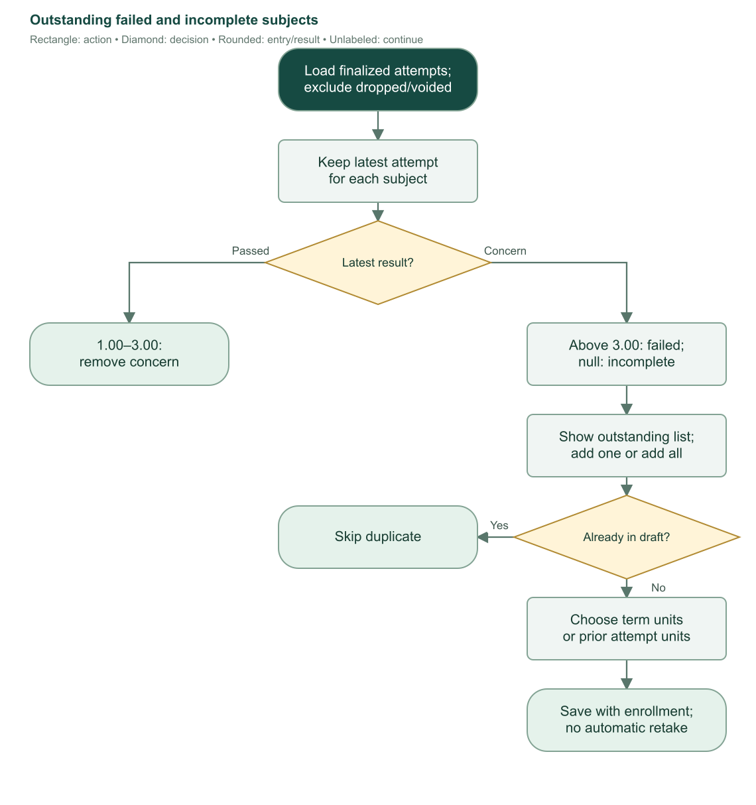

Sources: S10, S11, S24.

# 12. Administrator clearance-template configuration

## 12.1 Current responsibilities

Settings > Clearance is administrator-only. Configure the blank reference image, form outline, permanent printed areas, office Cleared/signature regions, and student-name/number writing regions. Production office names remain configurable. Diagnostic prototype departments are not the production office list.

Garage must be available to save reference objects. When personal information verification is enabled, production handwriting recognition also requires a saved Gemini key. Each saved reference/definition has a UUID revision; upload and request actions reject stale template state.

## 12.2 Reference replacement and four setup steps

Upload a nonempty JPEG, PNG, or WebP blank reference up to 10 MiB. Supported signatures are checked and bytes are saved under a unique Garage key. The expected revision is rechecked before metadata replacement. A replacement resets the definition because old regions may no longer align. Old-object cleanup is best effort after success; safe staging cleanup protects already referenced files on uncertain outcomes.

1. **Outline:** inspect automatic geometric borders, retry geometric detection, or manually draw/adjust the four corners. Anchor fallback described below applies to student/test images with a saved template, not this blank-reference editor.
2. **Printed areas:** review automatic suggestions and add/edit/remove permanent school/form text and term areas. Optional image/logo areas can provide additional evidence.
3. **Offices/signatures:** define each office name, Cleared checkbox, and signature/stamp region. Suggestions must be inspected before saving.
4. **Personal inputs:** define the student-name and student-number writing regions; include a printed number prefix where present. Course/year/section mappings are optional and are not verified by production identity comparison.

The final save validates the combined definition and issues a fresh revision. Generic definition save can omit personal regions, but production upload independently rejects configuration lacking both required name/number regions. Saving an incomplete setup therefore does not establish upload readiness.

## 12.3 Definition validation

| Configuration     | Current rule                                                                                                                                     |
| ----------------- | ------------------------------------------------------------------------------------------------------------------------------------------------ |
| Printed areas     | 4–20, unique UUIDs/labels, boxes inside the rectified form.                                                                                      |
| Area mix          | At least two text areas, exactly one semester area, exactly one academic-year area. Logo/image/structure is optional.                            |
| Expected values   | Text areas need nonempty text. Semester/year come from the current enrollment or explicit diagnostic test inputs.                                |
| Box size          | Width and height each at least 1.5% of form dimensions.                                                                                          |
| Offices           | Up to 30; unique IDs and case-insensitive names. Production requires at least one office and both Cleared/signature boxes for each.              |
| Personal mappings | Up to five, with supported name/number/course/year/section/combined kinds and conflict rules. Production requires studentName and studentNumber. |

There is still no production Not Cleared region. Contradictory marks, genuine office authorization, and signature authenticity remain matters for staff reviewing the original.

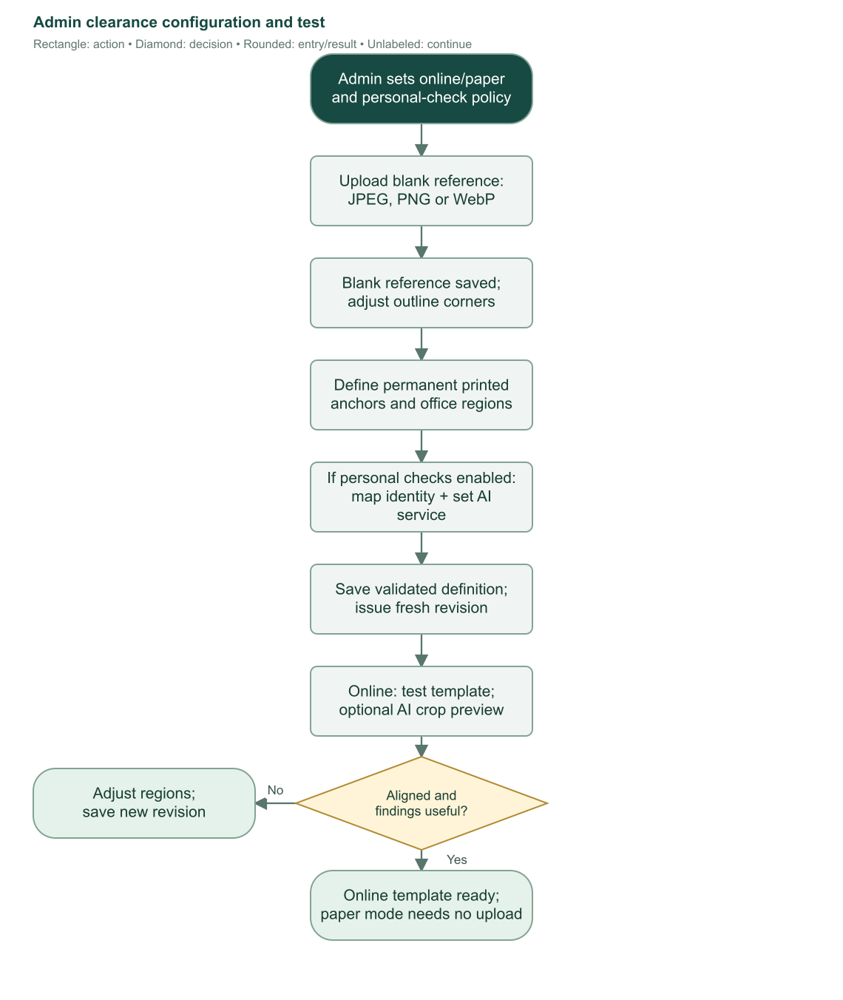

## 12.4 Enhanced outline detection

In student/test image editors, when a geometric border is absent and a saved definition exists, the border editor attempts enhanced detection once for that source. It OCRs permanent printed anchors in the reference and photograph, excludes repeated ambiguous words and handwriting, and estimates the photographed form outline. Retry, cancel, manual drawing, and corner adjustment remain available; a failed attempt keeps current corners. The administrator's blank-reference editor does not supply that template context and its retry remains geometric.

The estimator needs at least six matches across at least four reference lines, upper/lower vertical evidence and horizontal spread, and sufficient coverage across offices. It uses a bounded deterministic RANSAC fit, requires at least 80% inliers within its normalized error threshold, refines the fit, and validates resulting corners. This proposes alignment; it does not certify the student's identity or approve clearance.

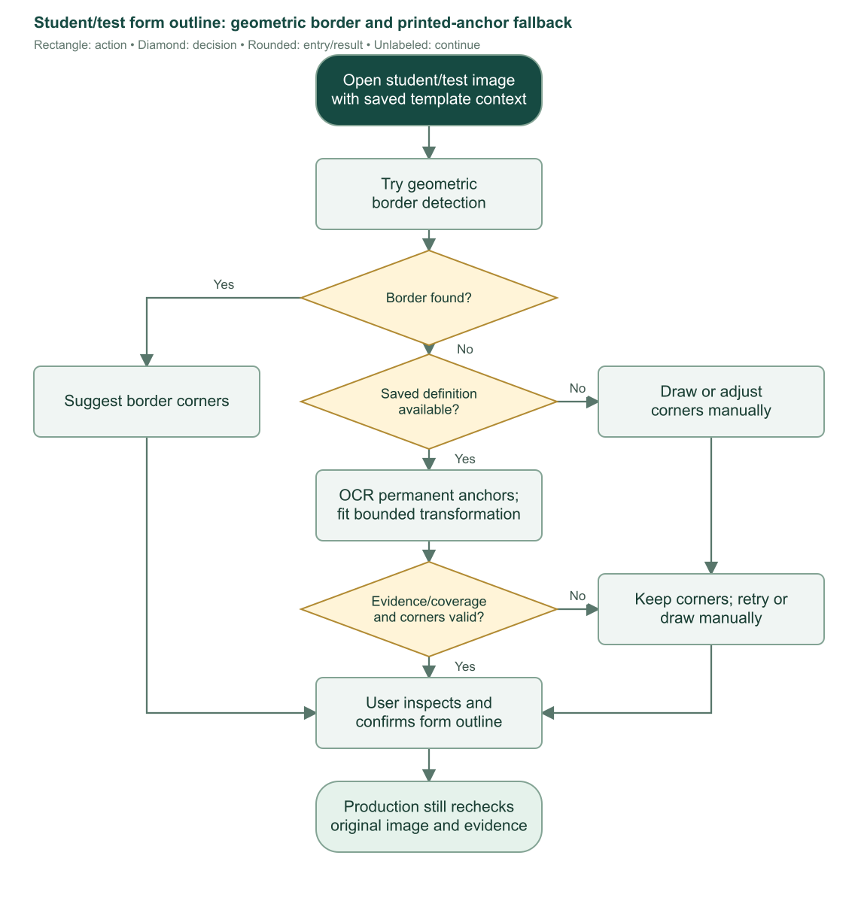

## 12.5 Admin browser test and revisions

The administrator sample test accepts independent expected semester/year and a sample JPEG/PNG/WebP up to 15 MB. By default, the sample stays in the browser and tests saved printed/image template anchors. The optional **Test handwriting with Gemini** checkbox reveals **Read handwriting**: this sends only the saved name/number field crops through the server to Gemini, using the saved key, and displays returned text and warnings. This diagnostic works even when personal verification is disabled, performs no identity comparison, and creates no submission or approval. Office and writing-presence checks are not part of this sample test.

A changed global revision blocks requesting an old ready submission until reupload. An already-requested eligible submission is reviewed against its saved report/definition rather than silently reevaluated against a newer global template. Legacy unverified reports lacking current identity checks need reupload; verified staff approvals remain valid.

Sources: S12–S15, S22, S31, S32.

# 13. Production clearance, Gemini identity, and staff review

## 13.1 Eligibility and input

Only the student uploads their own current enrollment's clearance. Server checks require completed setup, finalized grades, current ownership, and status neither dropped nor voided. Verified records are locked. Current complete requested submissions cannot be replaced while waiting; obsolete unverified reports can be replaced to obtain the current checks.

The form's semester/school year must match the current enrollment, not the coming term. Choose a nonempty JPEG/PNG/WebP up to 10 MiB and inspect the four corners. The browser sends original bytes, enrollment ID/revision, template revision, and normalized corners. Browser findings or entered identity are not trusted approval input.

## 13.2 Authoritative analysis sequence

1. Recheck ownership, lifecycle, configuration, revisions, and required regions on the server.
2. Decode and align the original image against the saved reference.
3. Evaluate printed template text, current term values, and optional visual anchors.
4. If template passes, evaluate each office's Cleared mark and signature/stamp presence.
5. Compare name/number areas with the blank reference to ensure added writing exists in both.
6. If those local checks pass, create two PNG crops from the server-decoded image and send them to Gemini for transcription.
7. Compare transcribed values with authenticated database identity, which was not supplied in the prompt.
8. Save ready only when the report is requestable: local checks pass and identity is match or review. Identity mismatch stays unsaved.
9. The student explicitly requests review. Staff inspects the original; identity-review verification additionally requires explicit identity confirmation.

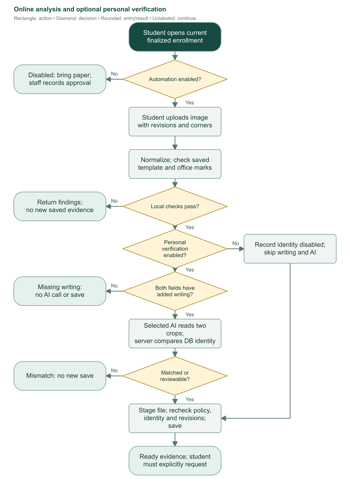

## 13.3 Image preparation and template comparison

Sharp validates actual format against MIME, single-page image, and at most 40 million input pixels. It applies orientation, flattens onto white, converts to grayscale, and resizes inside 2400×2400 without enlargement. Processed minimum dimensions remain 500×400. Corners must be finite within the image, clockwise/convex, and cover more than 5% of normalized image area. Invalid homography is rejected.

Reference and upload are perspective-rectified to the reference aspect ratio, maximum normalized dimension 1800. One production OCR check runs per process; busy attempts receive 429. Tesseract English uses installed local language data and a 120-second worker timeout. Worker cleanup releases the local lock.

| Printed evidence                          | Rule                                                                                                                                                                                       |
| ----------------------------------------- | ------------------------------------------------------------------------------------------------------------------------------------------------------------------------------------------ |
| Ordinary text                             | Search expected normalized wording near the configured box, expanded by 5% form width/3.5% height. Adjacent labels need not invalidate an expected phrase; distant text cannot satisfy it. |
| Confidence                                | Matched phrase uses its relevant word confidence; unreadable, confidence below 65, or ambiguous term values lead to review.                                                                |
| Semester/year                             | Extract the expected term from nearby words and compare with current enrollment; distinct contradictory values require review.                                                             |
| Optional image/structure                  | Otsu black-and-white shape correlation, with local scale/translation tolerance. At least 0.65 passes; below 0.45 fails; the interval between reviews.                                      |
| Blank/insufficient-detail visual evidence | Review; two blank regions cannot establish matching structure.                                                                                                                             |

Template non-pass prevents proceeding to office acceptance and the Gemini identity pipeline. Template review is not the identity-review exception.

## 13.4 Office-mark and writing-presence checks

Each office produces Cleared and signature/stamp checks. Checkbox detection fits four potentially angled printed edges with local translation up to 45% of saved dimensions and slopes up to 0.24. Full/start/end edge coverage must each reach 80%; side lengths stay within 60–140% of saved size. Neighboring office centers bound the search so a nearby checked office does not substitute for a missing frame.

The inset interior is deskewed to 32×32. An uncertain/missing frame reviews. Reference checkbox interior above 1% ink reviews. Cleared passing requires added ink at least 1.2% plus a connected component of at least six pixels spanning at least eight pixels; lesser positive marks review and zero added ink fails.

Signature/stamp presence passes at added ink ratio at least 0.004, reviews strictly above 0.004/3 and below 0.004, and fails at or below 0.004/3. This detects new ink, not signature authenticity or actual office approval.

Name and number have a separate physical writing-presence prerequisite. Aligned reference masking excludes printed glyphs, MA- prefixes, underlines, rules, and specks. Retained plausible strokes must reach at least the greater of 20 pixels and 0.1% of the field area. Both areas must pass before Gemini is called; this check has pass/fail rather than an identity-review fallback. Presence proves strokes exist, not that they are readable or genuine.

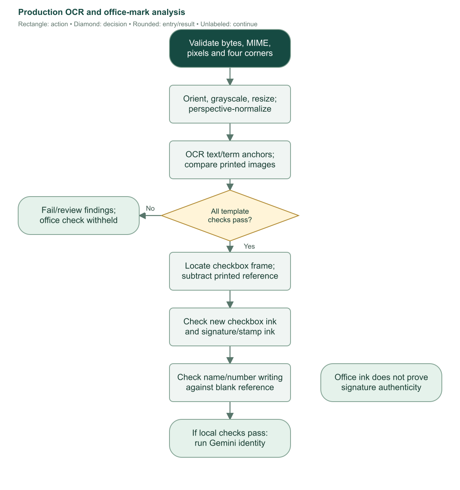

## 13.5 Handwriting AI service, privacy, and outcomes

Administrators can disable personal information verification independently. New uploads then skip writing-presence and Gemini checks, do not require name/number regions, and explicitly record personal verification as disabled. Template and office checks remain mandatory. Saved reports retain the policy used when uploaded; switching this option does not invalidate prior approvals.

The **Automated clearance verification** switch disables online upload and request actions. Students instead receive dashboard and enrollment reminders to submit paper clearance. Registrar/admin must still click **Verify clearance**, explicitly confirm receipt and review, and finalize grades before approval. Paper approvals record staff identity/name and time. Enrollment remains blocked until approval; document, prerequisite and academic follow-up requirements still apply. Paper approval survives same-term reopening/correction and re-enabling automation, while school-year/semester corrections clear it.

The **Test AI connection** button sends two fixed blank PNG samples through the same vision service. It uses the entered unsaved key, or the saved key if blank, and the currently selected model without saving changes or sending student data. Both the connection test and handwriting preview show the provider HTTP code, a recognized status, and an app-authored explanation/action for invalid or blocked keys, permissions, billing, model access, quotas, Google outages, deadlines, or server connectivity. Provider messages are classified privately; raw bodies, keys, project metadata, and student data are never echoed in errors.

Administrators select **Gemini**, **OpenAI / ChatGPT**, or **Ollama** in Settings > Clearance. Selection applies to production handwriting verification and the optional handwriting preview. Connection testing uses unsaved settings without changing the active provider. Gemini remains the default for existing installations.

OpenAI uses a server-side API key stored in `system_settings` and the Responses API with two PNG data URLs, strict JSON schema and `store: false`. Default model is `gpt-4.1-mini`; administrators may enter another image/structured-output model. **Fetch available models** lists model IDs accessible to the entered or saved OpenAI key, without saving settings or changing the selection. The returned list does not establish image/structured-output compatibility; run **Test AI connection** before saving. Changing or removing the entered key clears the fetched choices. ChatGPT subscriptions do not supply API credits. Ollama uses a configured HTTP/HTTPS server origin and vision model (default `http://localhost:11434`, `qwen3-vl:4b`) through `/api/chat` with base64 images, structured output and streaming disabled. The model must already be pulled. The address must be reachable from the application server; localhost refers to that server/container. Provider redirects are rejected. Google/OpenAI credentials are never forwarded to Ollama. Keys are not returned to the browser; blank input preserves a saved key and explicit removal clears it.

Administrators choose a Gemini model in Settings > Clearance. The default is 3.1 Flash-Lite, the lowest-cost newer option verified with the configured key. Legacy 2.5 Flash-Lite is cheaper but may be unavailable to newer projects. The key tester can use an unsaved model selection; production and the sample handwriting preview use the saved model. Model choices are validated against the supported image/JSON model list. Gemini 3 models use minimal thinking; 2.5 models disable thinking through a zero budget. There is no automatic switch to a more expensive model.

Administrators manage the Gemini key in Settings > Clearance. It is stored in system_settings and never returned to the browser. Optional GEMINI_API_KEY is imported only when the saved value is null; removing the key explicitly prevents environment re-import. When Gemini is selected, it sends one direct request to Google using the saved model (default `gemini-3.1-flash-lite`) through `generateContent` containing two base64 PNG field crops: name then student number. Production crops are grayscale; diagnostic browser crops are checked and normalized to grayscale PNGs on the server. It does not send the original whole clearance or expected database identity. The crops themselves contain personal information and leave the server for Google processing; the code does not establish provider retention policy or legal compliance.

Prompt instructions require visible characters only, ignore image instructions/signatures, preserve leading zeros, and read the numeric student-number suffix without fixed/repeated MA- prefixes. Requests use a 1024-token output limit and structured JSON by default. GPT-5 nano (including dated snapshots) uses minimal reasoning effort and a 4096-token limit because reasoning and visible JSON share the output budget. Incomplete, filtered and refused OpenAI responses receive specific safe diagnostics; incomplete text is never accepted. Gemini/Ollama set temperature 0. Gemini thinking settings follow the selected model. Only completed output is parsed (Gemini STOP, OpenAI completed message without refusal, or Ollama done with stop reason); thought parts are ignored, and each trimmed field is at most 200 characters. Invalid/incomplete fields produce warnings rather than guessed values.

The student upload pipeline has a 180-second deadline across reference download, OCR, handwriting and storage. Cancellation is forwarded to OCR, provider and storage work. A stalled AI response body cannot retain the recognition slot; OCR shutdown cannot retain the check slot. Timed-out work cannot commit a new submission, and late accepted staged objects are removed unless referenced by a committed record. Object cleanup waits at most ten seconds. The student browser stops waiting after 210 seconds, clears its spinner and offers **Refresh clearance status** before another upload; an uncertain response is never shown as a pass. The admin handwriting test includes a collapsed **View cropped fields** preview to inspect clipped writing or overlapping signatures.

Student upload service failures show a safe stage explanation and a `CLR-` reference code for setup, reference loading, printed-form/office checks, handwriting, storage, saving, or status refresh. Raw provider and storage errors stay private. An uncertain save or missing response requires **Refresh clearance status** before another upload or enrollment request. Admin diagnostics do not exercise the complete student upload and save pipeline.

One shared recognition request runs per process, with a 60-second timeout. Missing configuration returns 503; a busy request returns 429. Network/provider/unexpected timeout failures fail the new upload safely with a public error. There is no automatic retry, provider switching, or outage-to-manual-review bypass. The user may retry; an already-saved eligible report does not need a new provider call just to request/review it.

| Identity comparison                         | Consequence                                                                                                                                           |
| ------------------------------------------- | ----------------------------------------------------------------------------------------------------------------------------------------------------- |
| Exact numeric number and name not different | Match; name may be close or unreadable. Production still requires added name writing beforehand.                                                      |
| Exact digits without MA-                    | Exact, not a fuzzy exception; one/two leading MA prefixes are ignored and leading zeros preserved. Other arbitrary letter prefixes are not discarded. |
| One-edit-close number                       | Same length with digits/question mark and sufficiently long expected value; supports review rather than exact match.                                  |
| Close name                                  | Normalized strings at least six characters and rounded Levenshtein similarity at least 80%; supports review.                                          |
| Any exact/close field without full match    | Review. An exact name with a different number can therefore enter human review.                                                                       |
| Both unreadable, or model warnings          | Review after local prerequisites pass; not proof of identity.                                                                                         |
| Remaining incompatible evidence             | Mismatch; no new ready submission.                                                                                                                    |

## 13.6 Automatic pass versus requestable evidence

Current reports require office-check version 2, identity-check version 1, writing-presence evidence, and an identity result. `clearancePassed` is the stricter helper requiring identity match without warnings. `clearanceCanSubmit` permits identity match or review after all mandatory local checks pass. Save/request uses the latter. `clearanceNeedsIdentityReview` identifies the requestable reports that still need explicit staff confirmation.

Needs review is a report/UI condition, not an added database submission status. Such an upload is still saved as ready, can become requested, and remains blocked from enrollment progression until staff verifies it. Old unverified incomplete reports need reupload; existing verified approvals remain valid.

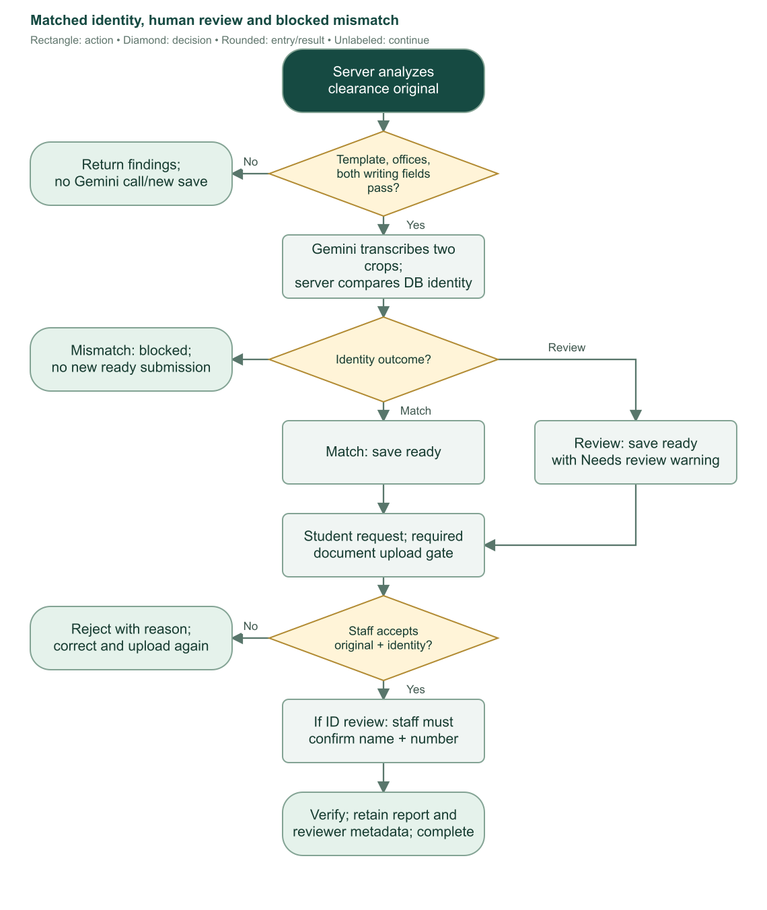

## 13.7 Save, request, verification, and rejection

Eligible images are stored under unique student-clearance Garage keys. The row retains file metadata, template revision/definition, corners, report, and request/review state. One submission per enrollment means replacement updates evidence rather than appending every attempt.

After analysis/object upload, the immediate save transaction rechecks enrollment/template/submission state and also that the student's name/number did not change during analysis. A conflict rejects stale evidence. Safe staging cleanup and best-effort old-object deletion remain separate from database commit.

Explicit student request requires own eligible current enrollment, ready requestable report, current template revision, no verified flag, and any applicable required-document upload gate. Requested/rejected academic-document copies block that near-final-term request; uploaded/verified copies satisfy it. This does not prevent analyzing/saving the clearance image itself.

The staff Enrollment requests queue still lists requested/verified current submissions. Staff opens the original image and findings. Verification requires exact requested ID, request timestamp, requestable saved report, enrollment revision/current/finalized/lifecycle checks. If identity needs review, `identityConfirmed=true` is mandatory. The UI requires staff to check the original and confirm both name and number against the student record.

Successful verification stores verified status, reviewer ID/name/time, retains the original automated report, and updates enrollment clearance/status/revision. The review acknowledgment is enforced in that transaction; there is no separate persisted identity-confirmation column or dedicated identity-audit event. Retained report plus reviewer metadata show that staff accepted reviewable evidence.

Rejection requires the exact current requested file and a 5–1000-character reason. It records reviewer/time/reason, increments revision, and permits a fresh eligible upload/request cycle. Staff should reject rather than confirm evidence they cannot reconcile.

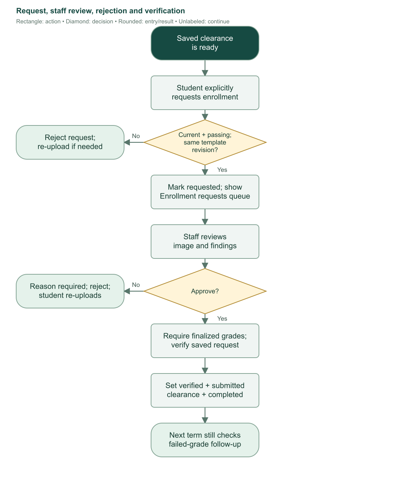

## 13.8 Submission state reference

| State               | Meaning                                                                                                                  |
| ------------------- | ------------------------------------------------------------------------------------------------------------------------ |
| No saved submission | No current eligible evidence saved; blocked analysis does not create another row.                                        |
| ready               | Local checks passed and identity matched or needs review; student may explicitly request when other request gates allow. |
| requested           | Waiting for staff; current complete reports locked against replacement.                                                  |
| verified            | Staff accepted evidence, including explicit identity confirmation when required.                                         |
| rejected            | Staff reason recorded; new eligible upload and request needed.                                                           |
| invalidated         | Dropping or changing the enrollment term invalidated prior evidence; restore eligibility before uploading again.         |

Reopening and same-term corrections preserve the existing clearance file, submission state and verification. Changing the semester or school year clears the enrollment clearance flag and invalidates the saved submission while retaining its file. Dropping also invalidates clearance. Changing the global template blocks requesting old ready evidence; already-requested verification uses saved evidence.

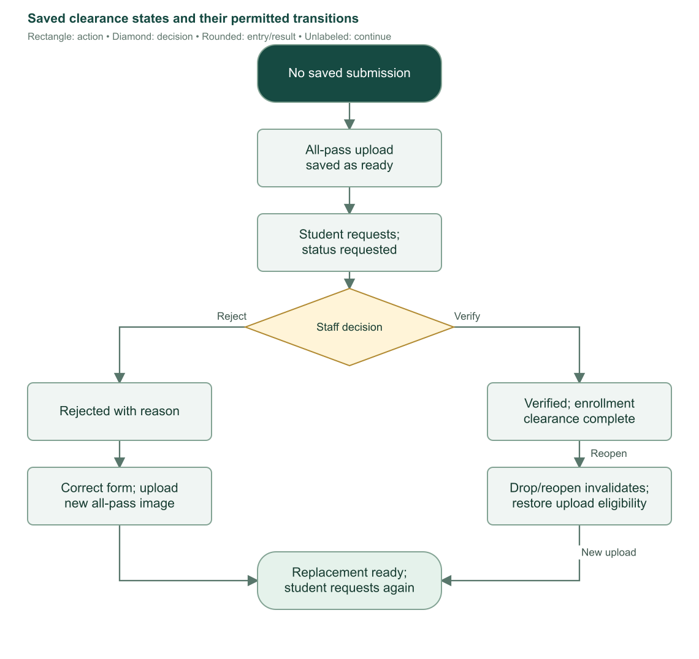

Sources: S11–S15, S22, S24, S31–S33.

# 14. Registrar meetings and next-term enrollment

## 14.1 Sending and completing follow-up

Administrators and registrars can request a meeting for a finalized non-dropped/non-voided enrollment with failed or INC grades. Meeting/follow-up commands are not restricted to current-only records in the way registrar grade editing is. Historical unresolved concerns can appear in follow-up worklists.

Sending a meeting request first claims the send with a started timestamp, avoiding an open transaction during email delivery. An active claim prevents duplicate concurrent sends for 15 minutes. After expiration, the attempt can be retried. An already-sent request cannot be sent repeatedly through the same action.

If delivery fails, the matching claim is cleared and no sent timestamp is recorded. If delivery succeeds, the server stores the sent timestamp, clears the claim, increments revision, and records the meeting notification. If state changed after email acceptance, staff is told the email was sent but state needs refresh rather than being told to blindly resend.

After the real Registrar discussion, staff selects Complete follow-up and confirms completion. The server requires finalized grades and a sent meeting request, rejects repeat completion, and stores `followUpCompletedAt`. This does not change failed/INC grades, remove retake concerns, or verify clearance. There is no appointment calendar, scheduled meeting slot, or attendance capture in this workflow.

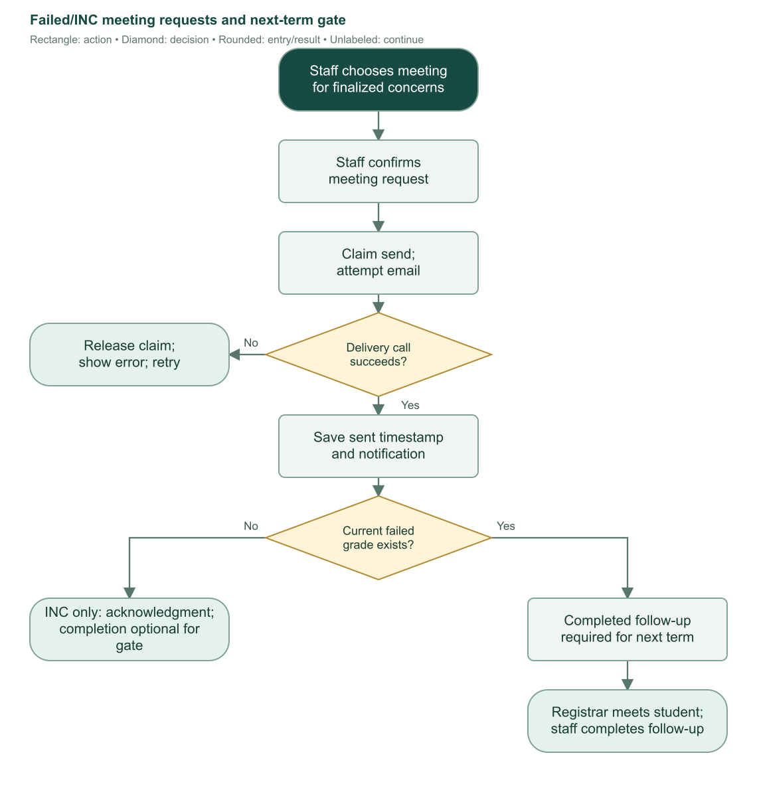

## 14.2 Exact ordinary reenrollment gate

A subsequent ordinary enrollment requires the prior current record's grades finalized and clearance verified. Subject-prerequisite and applicable final-term document checks are additional save requirements, not substitutes for these lifecycle requirements. If that current finalized record contains any failed numeric grade above 3.00, a completed Registrar follow-up is additionally required for both staff roles. Sending the request alone is insufficient.

INC-only results retain the acknowledgment warning but do not force completed follow-up before reenrollment. Historical outstanding concerns can still appear in worklists and retake selection; they are not all converted into the current failed-grade gate.

If an uploaded clearance submission exists for the current enrollment, enrollment save additionally requires it to be verified with a request timestamp. This prevents legacy flags or stale state from bypassing the uploaded-document workflow.

| Current situation                                        | Ordinary next enrollment                                                                              |
| -------------------------------------------------------- | ----------------------------------------------------------------------------------------------------- |
| Grades unfinalized                                       | Blocked.                                                                                              |
| Finalized grades, clearance not verified                 | Blocked.                                                                                              |
| Finalized + verified + no failures                       | Eligible, subject to normal program/term/subject checks.                                              |
| Finalized + verified + INC only                          | Eligible with concern acknowledgment; meeting completion not mandatory.                               |
| Finalized + verified + failures, follow-up not completed | Blocked even if request email was sent.                                                               |
| Finalized + verified + failures, follow-up completed     | Eligible with concern acknowledgment. Failed subjects remain outstanding until resolved academically. |
| Dropped current enrollment                               | Separate Enroll again path; completion and meeting gates bypassed, same-term restoration permitted.   |

## 14.3 Next-term default algorithm

1. Read the previous enrollment and its own curriculum's semester count, even if the next enrollment will use another program.
2. If previous semester is below that count, default semester to previous+1 and keep school-year start and year level.
3. If previous semester reaches/exceeds that count, default semester to 1, school-year start to previous+1, and year level to previous+1.
4. Carry previous program and section as defaults.
5. Load the selected program's currently usable published curriculum for an ordinary new enrollment.
6. Clamp initial editor year/semester defaults to that selected curriculum's declared bounds.
7. Staff reviews defaults, retakes, prerequisites, subject selection, units, and section; applicable requested final-term documents must be verified before saving.
8. The server requires a later school-year/semester tuple for ordinary progression and rechecks all eligibility at save.

For a two-semester plan: year 1, semester 1, SY 2026–2027 defaults next to year 1, semester 2, same SY. After semester 2, defaults become year 2, semester 1, SY 2027–2028. The school-year start is not recalculated from today's date for that ordinary rollover.

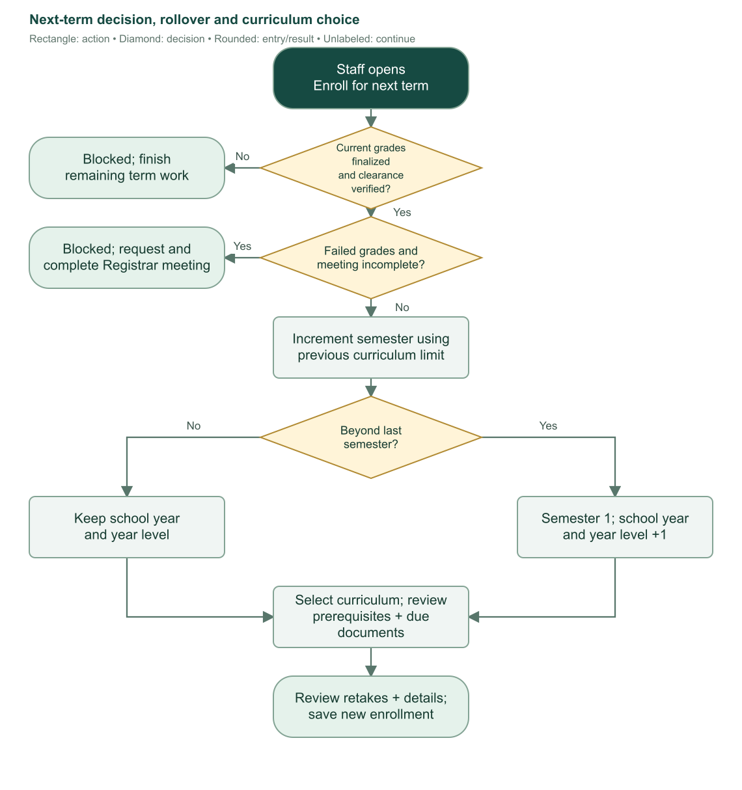

## 14.4 Important progression limits

Defaults remain editable; they are not an automatic institution-approved academic plan. There is no graduation/program-completion branch after the final curriculum year. The implementation calculates another year and the editor clamps it to configured bounds. Staff must handle program completion according to institutional process rather than assume the portal graduates a student automatically.

Reenrollment always creates a new enrollment ID and replaces the student's current pointer. It does not overwrite the previous term or copy its grades into the new subject attempts.

Sources: S10, S11, S15, S16.

# 15. Corrections, voiding, reopening, and dropping

## 15.1 Choose the action by meaning

| Action             | Intended meaning                                                                             |
| ------------------ | -------------------------------------------------------------------------------------------- |
| Correct enrollment | Fix incorrect term/class/subject details in a permitted unfinalized enrolled record.         |
| Void enrollment    | Mark an incorrectly entered enrollment attempt as invalid while preserving evidence.         |
| Reopen enrollment  | Administrator unlocks a finalized enrolled/completed record for grade review and correction. |
| Drop enrollment    | Record an actual withdrawal from the current enrolled term.                                  |

Corrections, voiding, and reopening require a trimmed reason of 5–1000 characters, exact revision, and their role/lifecycle checks. An active meeting email claim blocks these changes for its 15-minute window so an in-progress send cannot race the record transition.

## 15.2 Correct details and subject selection

Administrators may correct current/historical enrolled, unfinalized records; registrars current only. Corrections can change program, school year/semester, year level, section, and the subject set.

The same program preserves the existing curriculum, including its historical published plan, and permits the responsible correction path for an inactive program. A changed program must resolve an appropriate allowed curriculum. The corrected term cannot duplicate another valid attempt or cross earlier/later valid-enrollment chronology.

Matching subject IDs retain their enrollment-subject IDs, draft grades, and original staff attribution. Their snapshot/source/units may update. New subjects receive new rows and acting staff attribution. Removed rows disappear from the active subject list, but the before/after audit retains them and their grades. Removing a numeric graded row requires an additional acknowledgment.

Correction also revalidates current global prerequisite rules using the corrected term and excluding this enrollment. Required-document final-term gating is explicitly exempt in the correction editor and server path; it must not be described as enforced for corrections. Saving resets meeting/follow-up timestamps, increments revision, and writes the audit plus notification in the same transaction. Same-term corrections preserve clearance and its approval. Changing school year or semester clears approval and invalidates the submission without deleting its file. Email is attempted afterward.

## 15.3 Void an incorrect attempt

The record must be unfinalized and not already voided. Admin may void current/historical; registrar current only. Subjects and grades remain saved, status becomes voided, and the record stops occupying the valid-term uniqueness slot.

If the voided enrollment was current, the system selects the latest nonvoided enrollment by term/timestamp/ID as the replacement pointer, or null if none exists. A dropped record can become that replacement. Voiding therefore needs careful review of the resulting current academic state.

Reports, masterlists, ordinary current-work views, and outstanding calculations exclude voided attempts where their defined scope requires it. Enrollment history/audit preserves the evidence.

## 15.4 Reopen finalized grades

Only an administrator can reopen. The enrollment must be finalized and have enrolled/completed status. Current and historical records are supported.

Reopening retains saved grades but makes them provisional again. It sets finalization false, status enrolled, clears meeting/follow-up timestamps, and increments revision. Existing clearance files, findings, submission state and verification are preserved. Student-facing loaders mask those grades until refinalization.

Staff must review and finalize grades again. An already verified clearance for that term does not require another upload or verification. Unverified, rejected or invalidated evidence retains its existing status; reopening does not approve it. A reopened historical record is not automatically the student's current enrollment; current-only clearance rules continue to apply.

Preserved clearance does not remove the grade-finalization gate. While reopened grades are draft, students see Pending and ordinary next enrollment remains blocked. Refinalizing sets the record back to completed when its retained clearance flag is true; otherwise it stays enrolled awaiting the existing clearance workflow. Failed-grade follow-up was reset, so a required meeting must be requested/completed again if the released grades still contain failures.

The correction's term-change check compares only school-year start and semester. Program, year level, section, subject-list, or unit changes alone do not invalidate clearance when those two term values remain unchanged. Staff still follows every other correction, prerequisite, and chronology restriction.

| Action or starting state                                  | Clearance effect and next step                                                                                                                                                                          |
| --------------------------------------------------------- | ------------------------------------------------------------------------------------------------------------------------------------------------------------------------------------------------------- |
| Reopen with verified clearance                            | Preserve file, findings, submission state, request/reviewer metadata, and approval. Re-finalize grades; no duplicate clearance approval for the unchanged term.                                         |
| Reopen with ready/requested/rejected/invalidated evidence | Preserve its current state without granting approval. Clearance upload/request/review operations still require finalized grades and their normal eligibility.                                           |
| Reopen with no submission                                 | Do not create a clearance record or grant approval.                                                                                                                                                     |
| Correct without changing school-year start or semester    | Preserve existing submission and clearance flag, including when program/class/subjects change. Meeting/follow-up timestamps still reset.                                                                |
| Correct school-year start or semester                     | Set clearance flag false and saved submission invalidated; retain original file/findings/reviewer metadata as evidence. After grade finalization, obtain new eligible clearance for the corrected term. |
| Refinalize after reopening                                | Completed if retained clearance flag is true; enrolled otherwise. Next enrollment must still satisfy meetings, documents, prerequisites, and other save checks.                                         |

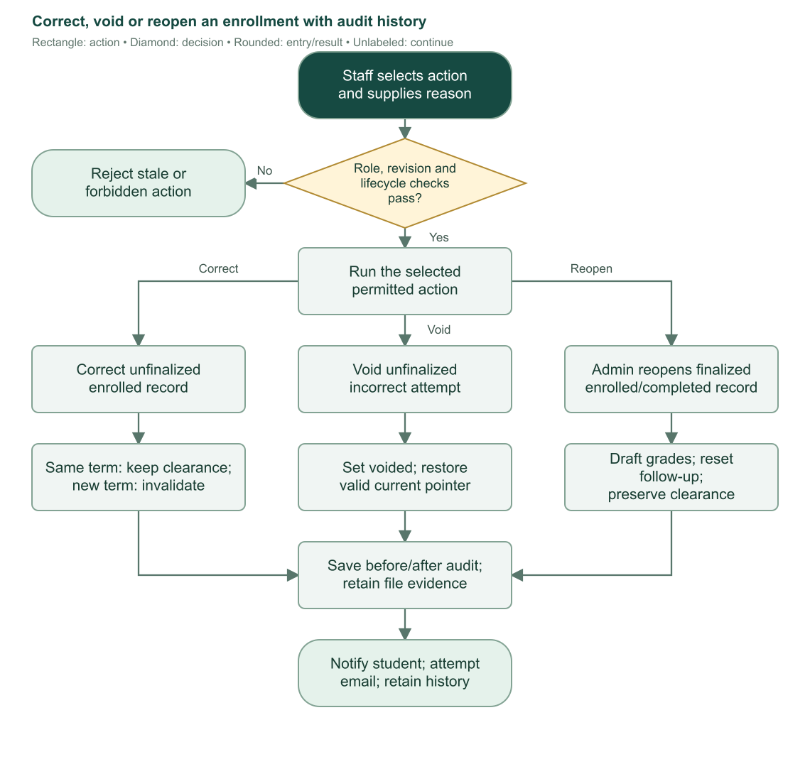

## 15.5 Audit trail

Each correction/void/reopen records actor ID, retained actor name, action, reason, timestamp, and before/after snapshots of the enrollment and subject set. The staff history expands those snapshots for inspection. Student notifications and change emails explain the event and reason.

Deleting the acting staff account does not delete student academic records. Nullable author links can become null, while retained audit names and before/after values preserve relevant evidence. The audit is not a comprehensive log of every draft keystroke or every general user action; it specifically records these enrollment correction actions.

## 15.6 Drop and enroll again

Admin/registrar may drop the current enrollment only while status is enrolled. A finalized but not completed enrollment can still be dropped. A completed or historical record does not expose the same drop path.

After confirmation, the server checks revision and any active meeting-send claim, invalidates clearance, sets status dropped and `droppedAt`, increments revision, and records the notification. It keeps current pointer, subjects, grades, and historical evidence; email follows after commit.

Enroll again restores the same school year, semester, year, program, section, selected subjects, and custom units as defaults. For the same program it may use the original published curriculum even if archived/replaced; the program generally must still be active. This path bypasses the prior completion/meeting gate and permits the same term, but not an earlier term.

Saving creates a new enrollment attempt and changes the current pointer. The dropped attempt remains. Do not use drop to erase an incorrectly entered record; void expresses that different meaning.

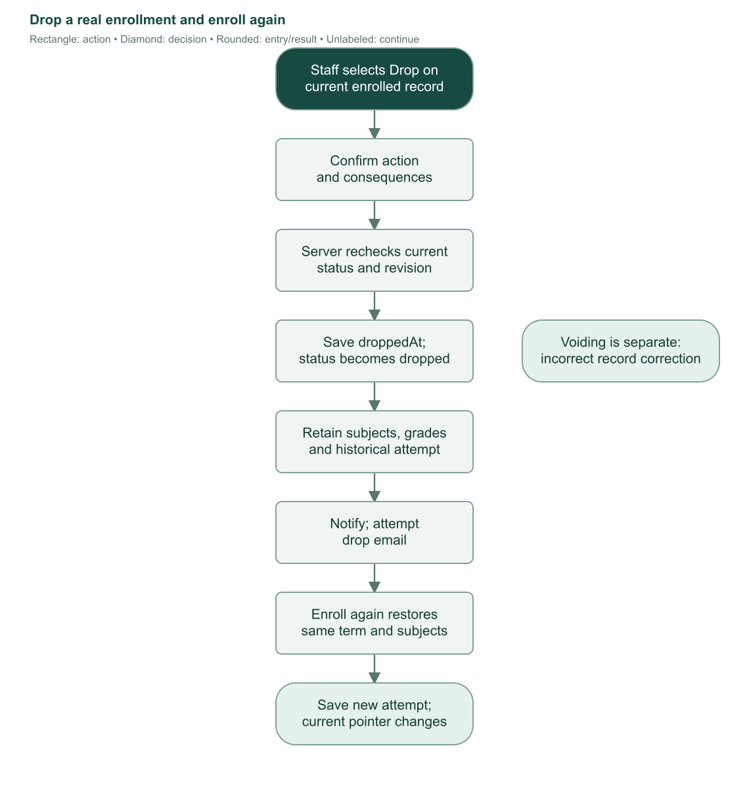

Sources: S10, S11, S16, S24.

# 16. Dashboards and staff worklists

## 16.1 Staff dashboard

Both staff roles see totals and work queues derived from explicit current-enrollment links, excluding voided current rows. Summary metrics include student accounts, current enrolled/completed/dropped counts, no-current-enrollment count, grades awaiting finalization, clearance pending, next-term ready, and unfinished setup.

| Worklist      | Selection rule                                                                                                                      |
| ------------- | ----------------------------------------------------------------------------------------------------------------------------------- |
| Grades        | Current enrolled record, grades unfinalized, student setup complete.                                                                |
| Clearance     | Current enrolled record, grades finalized, clearance flag false. This is broader than the explicit requested-submission queue.      |
| Account setup | Student setup incomplete, even without enrollment.                                                                                  |
| Next term     | Current completed record with finalized grades, verified clearance, and no unresolved mandatory failed-grade follow-up.             |
| Follow-ups    | Finalized non-dropped/non-voided terms with failures/INC and no completed follow-up; can include history and already-sent requests. |

Next term worklist readiness still uses the grade/clearance/follow-up conditions above. It does not include required-document verification or the eligibility of a future selected subject set. A ready card is not a guarantee that final enrollment save will pass every newer gate. Queue counts cover all matching records; previews show six older terms for action. Worklist links open scoped student views rather than changing data automatically.

Other panels show current enrolled students by program, released grade outcomes on current non-dropped terms, six Manila calendar months of newly created nonvoided enrollment records, and six recent nonvoided enrollments. Monthly enrollment activity includes dropped attempts and is not a count of only currently active students.

Administrators additionally see registrar counts/setup gaps, program totals/active programs missing usable curricula, curriculum totals/drafts, and subject totals/active counts. Registrars do not receive that administrator health object.

## 16.2 Student dashboard

The student sees their own current program, year, section, term, status, subject rows, units, and released outcomes, plus five recent notifications and unread count. Draft values are masked server-side, not merely hidden by CSS.

Next-action messages distinguish no enrollment, pending grade release, clearance upload/review, dropped-term reenrollment, unresolved sent meeting requests, INC requirements, and failed-grade Registrar advice. Historical unresolved follow-ups and dropped-history notices can remain relevant after another enrollment. Counts do not treat provisional grades as released passes/failures.

The dashboard is informational. It does not release grades, send meeting emails, verify a clearance, or create another enrollment merely because a card displays a ready/pending state.

Sources: S17, S18, S24.

# 17. Masterlist and academic reports

## 17.1 Masterlist scope and loading

Administrators/registrars choose school year, semester, program, optional year level, and section. The page defaults to the most recent eligible stored year/semester; with no records its fallback uses the runtime current year and semester 1. Program is searchable. Sections include A–D plus stored custom sections. Invalid values are rejected on the server.

Masterlist includes enrolled/completed records only. Dropped and voided attempts are excluded. A selected historical term uses that enrollment's program/year/section, independently of the student's current pointer. Names/email come from the current user record, so later personal-name corrections can appear in historical-term output.

Rows sort by surname, given name, middle name, then student number. The table starts with 50 rows and loads more using an intersection observer, with Load more/Retry fallback controls. Rows are deduplicated by identity and obsolete requests are canceled when the table scope is torn down.

## 17.2 Masterlist CSV

Export checks staff permissions again and exports all matching rows, not the loaded batches. It includes a title line such as `BSIS 2A ENROLLEES - SEMESTER 1 SY 2026-2027`, a blank line, and these columns: No., Student ID, Surname, Given Name, Middle Name. It is not an export of every visible contact/class column.

Filename uses `masterlist-{start}-{end}-semester-{n}.csv`. Export is disabled while filters are pending/failed to avoid downloading the wrong scope. JSON and CSV responses are private/no-store.

## 17.3 Reports and inclusion rules

Reports is a separate read-only staff screen with report type, school year, semester, optional program, year level, and section. Changing filters automatically refreshes results; rapid changes are grouped. Failed refresh offers Retry, and export/print wait until the generated scope is current.

All report/filter-option queries exclude voided enrollments. Defaults use the latest nonvoided term or current Manila year when empty. Selected academic values come from the term record, while names come from current user records.

| Report                     | Contents and interpretation                                                                                                                                                              |
| -------------------------- | ---------------------------------------------------------------------------------------------------------------------------------------------------------------------------------------- |
| Enrollment summary         | Groups program/year/section. Shows enrolled, completed, dropped, enrollment-record totals, and distinct students. Includes dropped attempts. Record counts and person counts can differ. |
| Grade report               | One subject attempt per row: student, class, code/name, units, grade, outcome, release state. Excludes dropped. Draft outcome remains Pending; finalized null is INC.                    |
| Students needing attention | Student/class plus failure/INC counts, follow-up state, and reasons. Includes unfinalized grades, failures, INC, pending follow-up, or unverified clearance. Excludes dropped.           |
| Enrollment completion      | Finalization, clearance, follow-up, and next-term state. Historical records are labeled Historical enrollment instead of being presented as current readiness.                           |
| Dropped enrollments        | Dropped attempts with dropped timestamp or Not recorded and current/historical indicator.                                                                                                |

Follow-up labels are Completed when completed timestamp exists; otherwise Requested/Not requested for finalized concerns, or Not required without concerns. Only failed grades make completed follow-up a mandatory next-term gate. INC alone can still appear as a follow-up concern.

Completion-report readiness likewise reflects its existing grade/clearance/follow-up rules; future prerequisite choices and required-document verification are checked by their responsible enrollment workflow. Overview cards count the full filtered scope's distinct students and enrolled/completed/dropped records. A report table that excludes dropped rows can therefore differ from the scope's summary cards without indicating a data error.

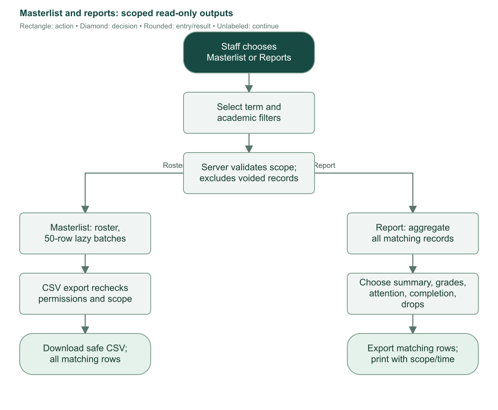

## 17.4 Report exports and printing

Download CSV includes all generated matching rows and column headers. Filename uses `{kind}-{start}-{end}-semester-{n}.csv`. CSV output has a UTF-8 BOM, quoted cells, doubled internal quotes, CRLF row endings, and spreadsheet formula protection for dangerous leading characters.

Print / PDF invokes browser printing of the complete generated report, with selected scope and a Manila timestamp. Workspace controls are hidden. The user can choose Save as PDF in the print dialog. This is distinct from the dedicated server-generated COR PDF; there is no separate server report-PDF endpoint.

Generating, exporting, or printing reports does not modify academic records. Page/download endpoints enforce role checks even when a user attempts their URLs directly.

Sources: S19, S20, S26.

# 18. Notifications and outgoing email

## 18.1 Saved event types

The system records account setup, password reset, enrollment confirmation, grade finalization, meeting request, dropped/corrected/voided/reopened enrollment events, plus documents_requested, document_verified, and document_rejected. The document event types extend the in-app list without extending outgoing email types. The notification record stores recipient, optional actor, optional enrollment, event type, safe title/message, creation time, and read time.

Most academic actions write the notification in the same transaction as the state change, then attempt email after commit. A meeting request is different: its event and sent timestamp are recorded after the email send succeeds. Account notices contain safe setup/reset language rather than one-time links or tokens.

Clearance request/review states are displayed by their queue and enrollment workflow; the current event-type list does not define a separate clearance-request/verification email notification type. Opening Notifications does not manufacture those events or backfill older academic history.

## 18.2 Visibility and read controls

| Viewer        | Events visible                                          | Read/unread behavior                                                      |
| ------------- | ------------------------------------------------------- | ------------------------------------------------------------------------- |
| Student       | Only records whose recipient is that student's user ID. | Own unread count, unread filter, mark one read, mark all own unread read. |
| Registrar     | Only records whose actor ID is the current registrar.   | Activity view; no recipient unread count or mark-read controls.           |
| Administrator | All recorded events.                                    | Activity view; no student inbox read mutation.                            |

The inbox searches title, message, and recipient name and filters by event type. Student views additionally offer all/unread. Results use 20-record pages ordered newest timestamp then ID. Marking one inaccessible notification returns not found; mark all applies only to the current student's unread addressed events. Existing read timestamps are preserved.

Document requests/decisions record in-app notifications atomically; uploads do not generate notifications or email. There is no document email delivery path. A registrar can see an attributed event independently of whether an associated email exists or succeeds, because visibility follows actor attribution. Students see their saved addressed events independently of inbox delivery. Unknown roles are rejected.

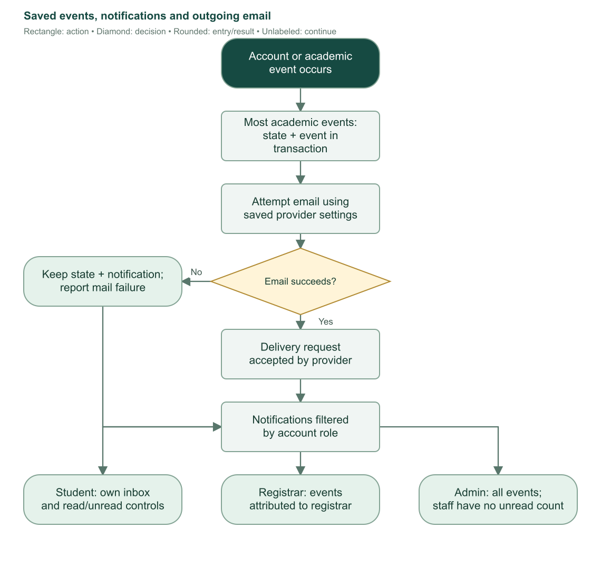

## 18.3 Email configuration

Only administrators can open Settings > Email. Settings are stored in singleton row 1. Loaders return the nonsecret settings and booleans indicating whether SMTP password/Resend key exists; they never return saved secret values to the form.

Choose SMTP or Resend. Both require a valid sender email and nonempty sender name without newline characters. SMTP additionally needs a host without whitespace/slash/colon, an integer port from 1 through 65535, and a new or already-saved password. Resend needs a new or already-saved API key.

Blank secret inputs preserve previously saved secrets. Switching providers retains the other provider's saved secret. There is no explicit clear-secret operation in this form. Save commits settings; Cancel restores the last loaded/saved form values. Saving configuration does not send a test message.

The UI includes provider guidance such as Resend verified domain/subdomain requirements and Gmail application-password use. These are configuration help text; the actual sender must match the institution's configured provider account.

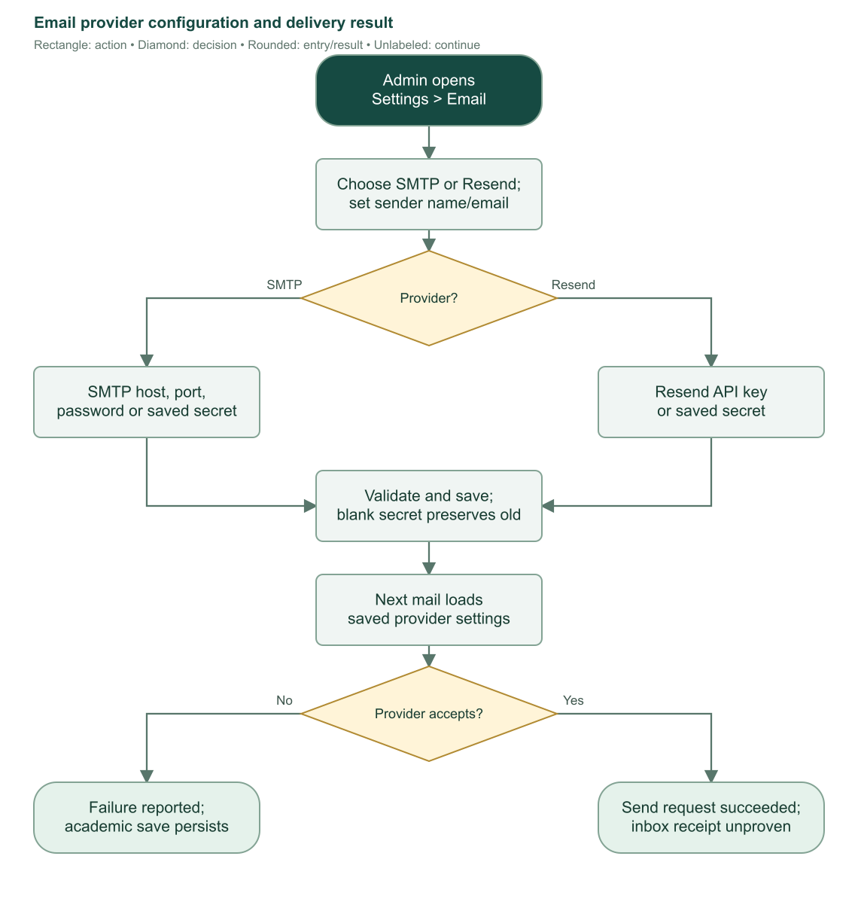

## 18.4 Delivery behavior and failure interpretation

Every email loads the current saved provider settings. SMTP authenticates using sender email/password, uses secure mode at port 465, requires TLS, and treats a nonempty accepted-recipient result as send success. Resend requires a response without API error and with a returned message ID.

Templates produce HTML and plain text. Lifecycle messages contain relevant student/term/program context and portal links; correction/void/reopen messages include the reason. Setup/reset links are one-use and expire after 24 hours. Email-generated safe notifications omit those secret links.

Provider request success does not prove the recipient received or read the email. An academic save and an email send are not one distributed transaction. Staff should read the separate success/failure message and resend through the correct account or follow-up path where supported, without recreating academic records.

Sources: S06, S11, S16, S21, S23.

# 19. Certificate of Registration (COR)

## 19.1 Eligibility and download

Administrators/registrars may download a qualifying student's enrollment COR. Students may download only their own. The server checks ownership before reporting status details, preventing another student from probing an enrollment ID for private information.

The enrollment must have status enrolled or completed and at least one subject. Grade finalization is not required. Dropped/voided records are rejected. The endpoint is `/user/enrollment/{enrollmentId}/cor`, even when staff follows a download button from a student detail page.

The server reads the enrollment and subject snapshots consistently within a transaction. Subjects sort by saved code/ID. It uses saved subject labels/units but current student demographic and program-name records. The certificate does not publish grades.

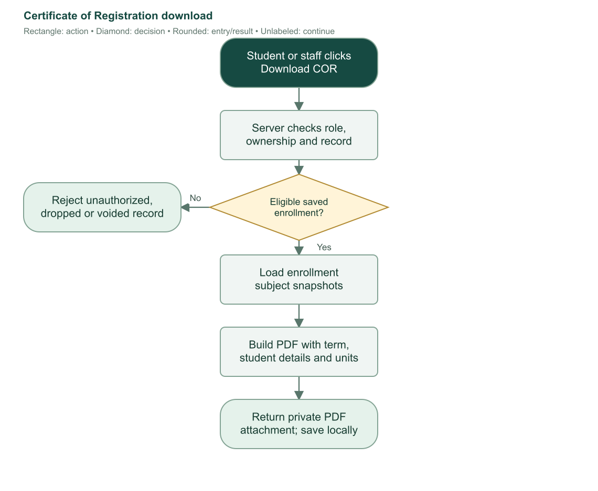

## 19.2 PDF contents

The Letter-size PDF identifies Bulacan Polytechnic College, Malolos Campus, school year/semester, student number/name, course-year-section, program, sex, birth date, address, email, contact number, enrollment status, and campus. It lists subject code, title, units, and total units, plus the implemented funding notice, Manila generation timestamp, and page counts.

Long values wrap and paginate; table headings repeat as needed. The attachment filename follows `COR-{studentId}-{schoolYearStart}-semester-{semester}.pdf`. Responses are private/no-store and include no-sniff behavior. Saving the PDF locally does not change the enrollment.

Repository example PDFs demonstrate rendering, not real student approval or a live certificate registry. This COR download is different from Reports > Print / PDF, which uses browser printing rather than the dedicated certificate generator.

Sources: S10, S20, S27.

# 20. Storage administration and private files

## 20.1 Storage purpose and separation

SQLite stores structured records, references, states, reports, and revisions. Garage stores original/reference file bytes in S3-compatible bucket `bpc`. A successful database backup alone does not contain those images; a storage-only backup lacks the relationships and review state.

Production clearance references and student images use their production prefixes, distinct from diagnostic per-user file prefixes. Administrator explorer uploads can target any browsed folder, including those production prefixes; no separate enforced administrator-upload prefix exists. Access remains mediated by the corresponding server endpoint and permissions.

## 20.2 Startup provisioning

When both Garage admin endpoint and token are absent, initialization skips Garage setup. Partially supplied configuration or operational failure causes initialization to fail with a safe error. Builds do not contact Garage.

Configured admin startup ensures a usable cluster layout and finds/creates `bpc`. When `GARAGE_API_ENDPOINT` is also set, it obtains an active app S3 key and grants bucket read/write without owner permission. It records key identity/stable name privately and holds the S3 secret in server memory rather than returning it to browsers or storing that secret in SQLite.

A fresh supported single-node layout gets decimal 10 GB placement capacity in zone `dc1`, with a bootstrap tag and layout version 1. Existing initialized layouts keep their configuration. Multiple nodes, unrelated staged changes, or unsuitable fresh state require manual Garage administration. Automatic bootstrap does not create hardware or reserve disk space.

A database lease per normalized endpoint serializes provisioning/capacity work across app processes. It uses a 120-second lease, a bounded acquisition deadline, ownership assertions, and final release. Partially completed setup can resume without intentionally replacing an already created key.

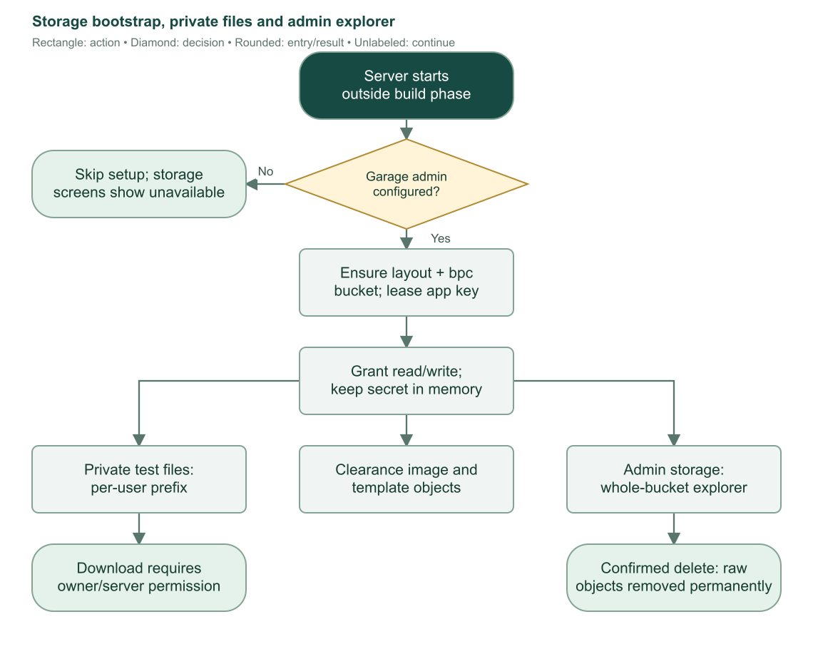

## 20.3 Administrator storage explorer

Settings > Storage is administrator-only. Overview and object listing load independently, allowing one panel to report an error while the other remains usable.

The overview displays cluster health, online storage nodes, quorum/partition information, layout version/staged changes, available/object/metadata bytes, bucket usage/quotas, website setting, unfinished uploads, and node capacity/filesystem/zone/tags/version/online/draining state where reported.

The explorer lists folders by object prefix with breadcrumbs and continuation paging. Paths must stay within valid S3 keys: no leading absolute slash, dot traversal, or control characters, and at most 1024 UTF-8 bytes. List requests use up to 100 entries.

Uploads allow arbitrary files up to 10 MiB. Filenames are sanitized and UUID-prefixed to prevent overwrite. General explorer/test uploads use octet-stream content type. Downloads stream through the server as attachments with safe UTF-8 filenames, private no-store, and no-sniff headers.

Deletion requires administrator role and explicit permanent-deletion confirmation. A file or folder must be an immediate child of the currently browsed prefix. Folder deletion recursively lists and deletes objects in batches, validating returned prefixes and advancing continuation tokens. Partial failure is possible and reported so remaining objects can be inspected/retried.

> The raw explorer does not protect objects merely because a clearance/template database row references them. Deleting a live reference image can leave a broken file link. Treat raw deletion as storage administration, and avoid uploads into a prefix while deleting it.

## 20.4 Increase node placement capacity

Only increases are supported. Select an online storage node, enter a larger decimal-GB capacity, and confirm. The server validates node ID, safe byte conversion, current layout version, absence of staged changes, and complete zone/tags. It rejects offline/draining nodes, stale layout, decreases, and values beyond reported filesystem size.

Under the database lease, it stages only that role's capacity change while preserving zone/tags, validates the pending layout twice, applies the next version, and confirms the resulting layout exactly. If the apply response is lost, it rereads Garage to determine whether the change committed. An uncertain result requires refreshing/reviewing pending state, not blindly applying again.

Configured placement capacity does not add physical disk, expand a filesystem, or create a hard disk quota. Operators must provision underlying storage separately where required.

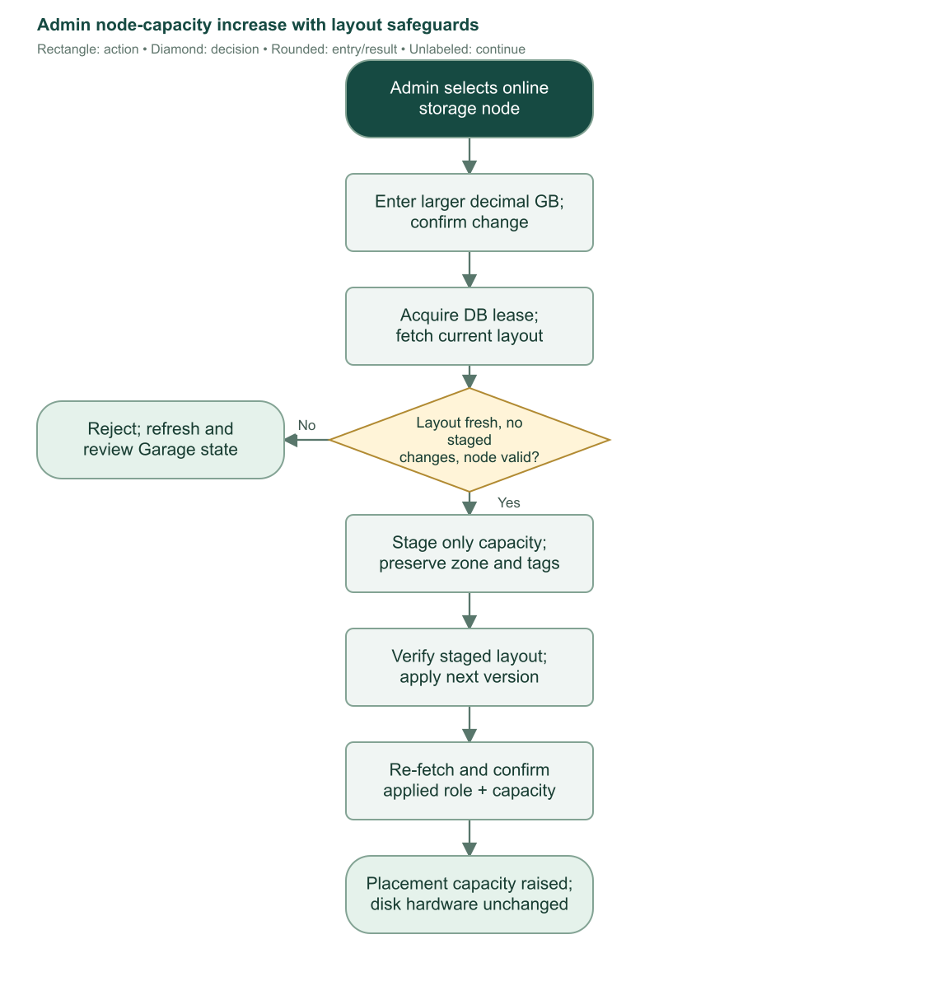

## 20.5 Diagnostic personal-file area

`/test/files` is a separate authenticated test page for all three account roles. Each user lists/uploads/downloads only their own `test-files/{encodedUserId}/{uuid}/{safeName}` objects, up to 10 MiB each. Repeated filenames do not overwrite old uploads. Listing uses up to 100 entries with continuation tokens.

Download checks the user's exact prefix and rejects traversal. This page is not integrated with production clearance review and has no administrator-style delete control. Missing storage configuration shows a setup message rather than exposing credentials.

Sources: S22, S25, S28.

# 21. Architecture, data ownership, deployment, and safeguards

## 21.1 Application layers

The application uses Svelte/SvelteKit pages and components, TypeScript, server loaders/endpoints, validated remote commands, SQLite through Drizzle/better-sqlite3, Better Auth, Garage S3-compatible storage, SMTP/Resend delivery, local Tesseract/Sharp image analysis, Gemini handwriting transcription, and PDFKit certificate generation. Package versions/ranges belong to `package.json` and the lockfile; this guide documents repository behavior rather than promising compatibility with another version.

Browser components own local drafts, confirmation dialogs, display filters, border adjustment, diagnostic image work, and navigation. The server owns authorization, student identity lookup, authoritative validation, transactions, state transitions, production OCR, storage credentials, and email delivery. Browser-supplied role, report, or grade visibility is never the source of authority.

The request hook resolves authentication and fills server locals. Protected routes/loaders and commands use those locals to validate role/ownership. Unknown failures become safe public errors while diagnostic details stay in server logs.

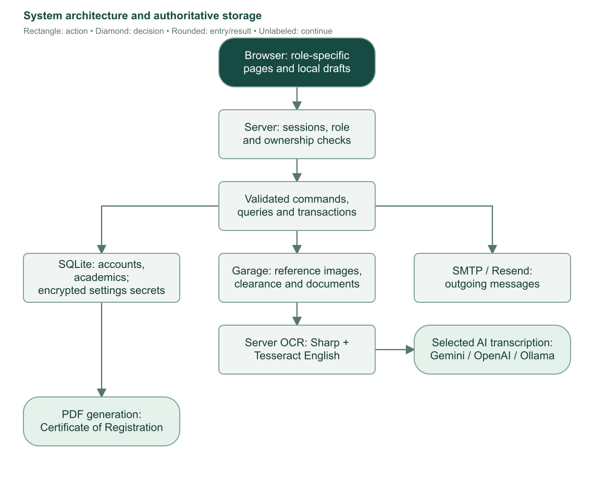

## 21.2 Main relationships and invariants

| Relationship/invariant                            | Why it matters                                                                           |
| ------------------------------------------------- | ---------------------------------------------------------------------------------------- |
| One student personal row per student user         | Prevents multiple student identities for one account.                                    |
| Student has one unique current-enrollment pointer | Current workflow follows explicit ownership rather than latest-date guessing.            |
| Enrollment references one student and curriculum  | Term registration owns its own academic assignment.                                      |
| Enrollment has many unique subject attempts       | One subject ID per enrollment; names/units saved historically.                           |
| Partial unique student/year/semester index        | At most one valid enrolled/completed attempt for a term; dropped/voided attempts exempt. |
| Program selects optional curriculum               | New ordinary enrollment needs a usable selected plan.                                    |
| Published curriculum subject snapshots            | Later catalog edits do not rewrite plan history.                                         |
| One saved clearance submission per enrollment     | Replacement updates evidence rather than retaining a full upload-attempt history.        |
| Revision field and original-value comparisons     | Stale forms cannot silently overwrite newer grades or lifecycle changes.                 |
| Restrictive academic foreign keys                 | Student/curriculum/subject deletion cannot discard referenced academic history.          |
| Nullable staff authors plus retained names        | Deleting staff access preserves academic evidence.                                       |

Enrollment status is one of enrolled, completed, dropped, voided. Grade finalization, clearance verification, and meeting completion are additional independent facts. A completed term can still be blocked from next enrollment by failed-grade follow-up; status alone is insufficient.

Database rows also include auth sessions/accounts/reset verification records/two-factor data, notification recipient and actor links, system settings, monthly student sequences, private Garage provisioning metadata, and correction audit snapshots. The `task` table is present but does not have a documented active enrollment feature in the current routes.

## 21.3 Transaction boundaries and concurrency

Account personal edits compare original field snapshots and save linked rows atomically. Student number allocation increments within a transaction. Enrollment creation inserts the enrollment and all subjects plus current pointer together. Grade saves compare original grades, while finalization compares the complete reviewed set. Correction/void/reopen use revision plus lifecycle checks and save before/after audits transactionally.

Expensive external work happens outside long database transactions. Meeting email uses a claim then records acceptance; OCR/image storage is followed by an immediate revision recheck; ordinary academic email follows committed state. These boundaries explain why an email failure does not roll back grades and why a stale OCR analysis may be rejected after processing.

Claims/leases coordinate specific shared operations. They do not create a general background job queue. Email is attempted by the request path, and there is no persistent automatic retry worker described by the current code.

## 21.4 Configuration names

| Setting name                                    | Purpose                                                                                                                  |
| ----------------------------------------------- | ------------------------------------------------------------------------------------------------------------------------ |
| `DATABASE_URL`                                  | SQLite database path; required by DB initialization/migration.                                                           |
| `ORIGIN`                                        | Public application origin used by authentication and deployment.                                                         |
| `BETTER_AUTH_SECRET`                            | Authentication signing/security secret.                                                                                  |
| `GARAGE_ADMIN_ENDPOINT`, `GARAGE_ADMIN_TOKEN`   | Private Garage Admin API configuration.                                                                                  |
| `GARAGE_API_ENDPOINT`, `GARAGE_REGION`          | S3-compatible endpoint and matching region. Region fallback is `garage`.                                                 |
| `BODY_SIZE_LIMIT`                               | Node request-body limit; Docker and Compose set `20M` for two encoded handwriting crops and bounded 10 MiB file uploads. |
| `GEMINI_API_KEY`                                | Optional one-time import into system settings. Administrators can instead save the key in Settings > Clearance.          |
| `INITIAL_ADMIN_EMAIL`, `INITIAL_ADMIN_PASSWORD` | Seed-process inputs for initial administrator creation when running that seed process.                                   |
| Saved email settings                            | SMTP/Resend sender/provider/secret values are stored privately in system settings, not in page data.                     |

Actual `.env` values, database credentials, generated account secrets, and object-store tokens were not copied into this guide. Compose currently forwards the declared core/Garage settings and body limit, but does not forward GEMINI_API_KEY. Save the key through Settings > Clearance, or explicitly supply it to the running container for one-time import; a host .env entry alone does not populate an undeclared container environment variable. Other seed inputs likewise need deployment wiring where absent.

## 21.5 Build and container startup

The project scripts expose development, production build, preview, type checking, lint/format, database migration/generation/studio/seed, and authentication-schema generation. These are maintainer tools, not student operations.

The Docker build uses Node 22 Alpine, installs the pinned package-manager version and dependencies, then builds the Node adapter output. The runtime image carries build output, dependencies, migrations, required seed/schema files, and the entrypoint. Production defaults listen on port 3000 and use `/app/data/local.db`.

Startup prepares the persistent data directory, gives the runtime node user access, applies pending SQL migrations, attempts seeding, and starts the Node application. Migration failure stops startup. Seed failure logs a warning and permits startup, with retry next time. Application initialization then performs configured Garage setup; a required Garage initialization failure can prevent serving requests.

Docker Compose mounts `./data` into `/app/data` and declares restart behavior. The checked workflow builds on pull requests to `main` and publishes `aetherknowledge/enrollment-system` latest/commit tags on `main` pushes or manual execution. Older README wording about another branch/image is not the authoritative workflow.

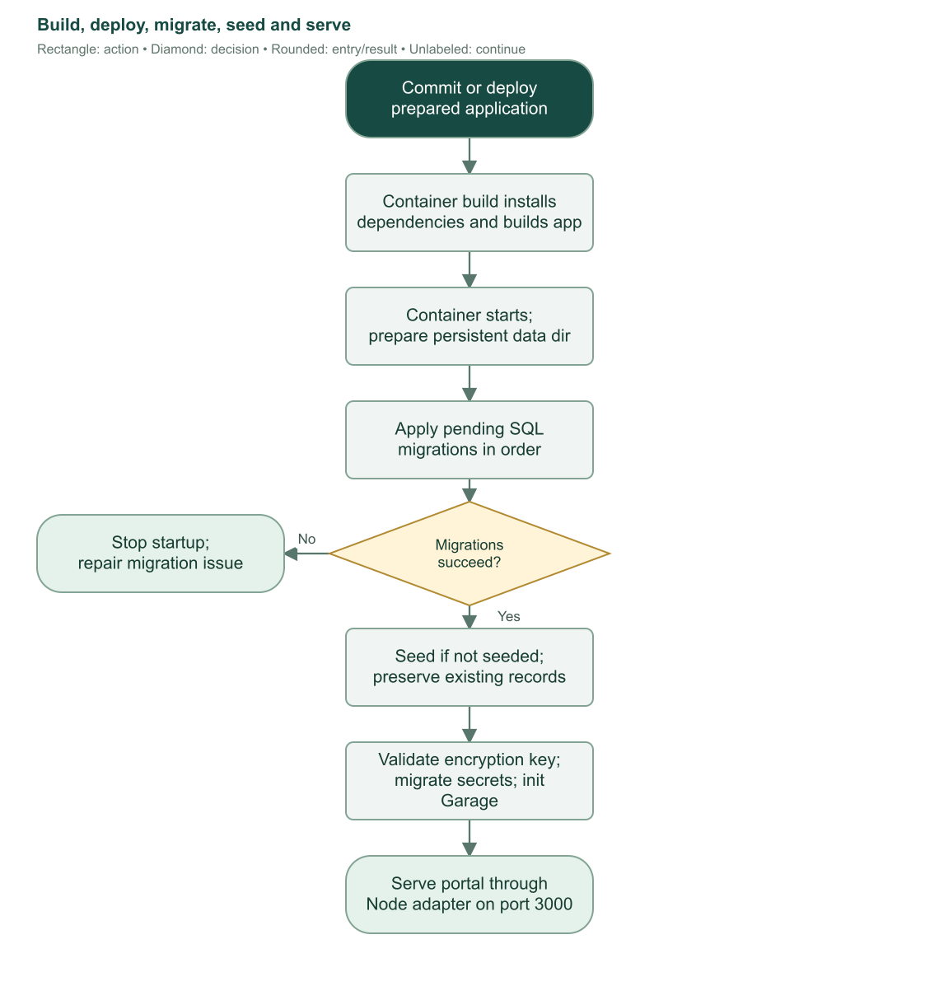

## 21.6 Seed behavior and sample data

The seed process checks singleton `seeded` and skips when already true. It creates/reuses sample programs BSIS, ACT, and DHRMT, 49 sample subjects, and three sample published curricula named 2026 Sample Curriculum. BSIS has 32 subject placements, ACT 23, and DHRMT 22, with 40 prerequisite links across the catalog. Every required subject is scheduled in an earlier term. These are demonstration curricula, not official academic requirements. It does not currently create sample student accounts or enrollments. Existing program selections, curriculum rows, and edited prerequisite rules are not overwritten on rerun. Prerequisite insertion occurs only inside newly created sample-curriculum branches; existing sample curricula are skipped, so rerun does not backfill the new rules. Migration 0038 adds an initially empty relation without inferring academic rules from codes or altering saved enrollments.

The initial admin uses seed environment inputs when present; the code contains development fallback credentials. Operational deployment should supply controlled values and secure/change the account rather than treat development defaults as institutional policy. The seed marks the selected initial admin as admin/setup complete and then sets seeded true.

## 21.7 Backup and operational preservation

A recoverable operational snapshot needs both SQLite data and Garage objects, plus separately managed configuration/secrets. The portal does not expose a built-in backup/restore screen. This guide does not claim a tested restore for the user's live deployment.

Use a consistent SQLite backup process or stop writes when copying its files; preserve whatever SQLite companion files are required by the chosen mode/process. Preserve Garage data and database-referenced keys together. Schema rollback is not equivalent to restoring deleted file objects or reversing a human-approved academic change.

Sources: S01, S03, S05, S22–S25, S28, S29.

# 22. Diagnostic tools and prototype boundaries

## 22.1 Standalone scan laboratory

`/test` labels itself a standalone prototype with no records changed. Visitors can inspect local/demo/example images, adjust borders, preview aligned form crops, review OCR evidence, and examine mark measurements. Browser OCR may download its language resources on first use. Signed-in visitors additionally receive current saved-template metadata and an identity test target when available.

The prototype has fixed geometry and fixed departments such as SG Adviser, PTCA, Adviser, Research, and Program Head. It can inspect expected personal details and both Cleared and Not Cleared regions. These fixed rules are not the configurable production office rules documented in Chapter 13.

Prototype Not Cleared ink at least 4% fails; contradictory both-checkbox evidence also fails. Low Cleared/signature ratios fail or review according to that prototype's thresholds. Those diagnostic values must not be quoted as the production version-2 checkbox/signature algorithm.

## 22.2 Handwriting identity experiment

The identity UI requires prior template pass and sign-in, crops fixed diagnostic name/student-number regions, and submits PNG crops to a same-origin server endpoint. Production instead uses its configured personal boxes and mandatory blank-reference writing-presence check. Changing image/corners invalidates earlier evidence. Cancellation is supported.

The server obtains expected identity from the session/database. Student accounts compare their own identity. Staff diagnostic accounts target the fixed test student number `MA-23016578`; if that record does not exist, the endpoint returns no target rather than searching an arbitrary real person.

The JSON body is bounded to 2 MiB and must contain exactly two base64 PNG crops. Each encoded field has a length bound; actual PNG headers and dimensions are checked, with each crop limited to 2400×1000 and two million pixels.

One handwriting request runs per server process. The shared service calls the saved provider (Gemini `generateContent`, OpenAI Responses API, or Ollama `/api/chat`), sends both field crops in one request, and requests structured JSON. Calls have a 60-second timeout. Reasoning text is ignored. Incomplete or unusable output produces warnings rather than inferred identity. Authentication keys and provider error details remain server-side.

Normalized comparison handles case, accents, punctuation, and spacing. Exact student-number evidence can pass if the name is not different. Gemini reads the numeric student-number suffix; comparison ignores an optional printed or handwritten `MA-` prefix, including a repeated prefix, while preserving leading zeros and rejecting other letter prefixes. A one-digit-close number or a sufficiently similar name supports review rather than full match. Model warnings force review. Request cancellation/outer 120-second timeout returns 408; the inner Gemini 60-second timeout and provider/network failures return an app-authored 503 while the outer signal is still live. Admin diagnostics return safe explanations explicitly so generic server-error masking does not hide them.

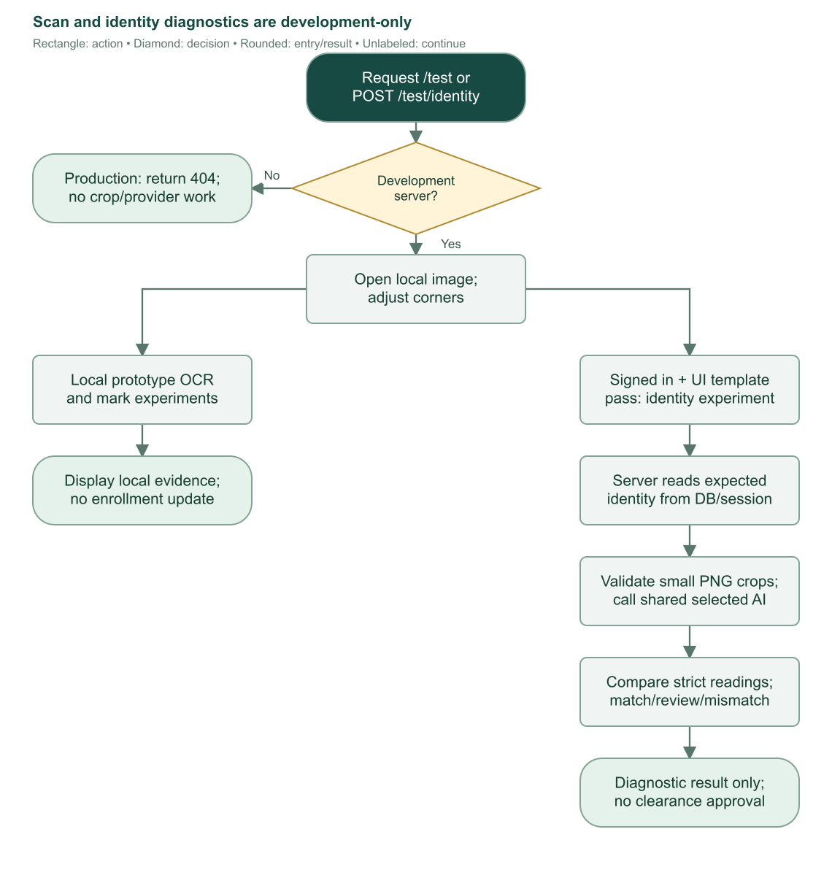

## 22.3 How to interpret diagnostic results

A prototype match means that experiment's expected image/text comparison succeeded. It does not set enrollment clearance true, create a requested submission, verify a signature, or authorize next enrollment. Production uses the same recognition/comparison logic only after its own authentication, template, office, and both-field writing-presence checks. A diagnostic result cannot bypass that pipeline or substitute fixed diagnostic crops for configured production regions.

`/test/files` similarly exercises authenticated personal file storage, not clearance upload. A successful file upload there does not appear in Enrollment requests.

Sources: S12–S15, S22, S28, S30.

# 23. Worked examples, recovery cases, and implemented limits

## 23.1 New student to second-semester enrollment

1. Registrar creates Maria Santos with valid personal information. The server assigns the current Manila month sequence student number and saves the account.
2. Setup email succeeds. Maria chooses a password and completes setup. If email had failed, the saved account would remain for resend.
3. Registrar selects BSIS, year 1, semester 1, SY 2026–2027, section A, reviews subjects, and saves. The enrollment becomes current.
4. Registrar saves grades. Maria sees Pending until finalization.
5. Registrar finalizes all passing grades. Maria sees the released results and can use the current-term clearance workflow.
6. Maria uploads a properly signed current-term form. All server checks pass, so it becomes ready. Maria explicitly requests review.
7. Registrar inspects the original image and verifies the requested submission. Status becomes completed and clearance true.
8. Registrar opens Next term. Defaults become year 1, semester 2, same school year/program/section. Registrar reviews and saves a new enrollment.
9. First enrollment remains history; current pointer now identifies the new record. The previous verified clearance leaves the current-request queue scope.

## 23.2 Failed subject at year rollover

After year 1 semester 2, a finalized 4.00 grade is failed. Even with verified clearance, ordinary next enrollment stays blocked until Registrar follow-up is completed. Sending a meeting email alone does not clear the block.

Staff sends the request, holds the actual discussion, and marks follow-up completed. Next enrollment then defaults to year 2 semester 1 and school-year start +1. Staff explicitly adds any retake from the outstanding list. The failed grade remains on the old subject attempt and in outstanding concerns until a later finalized pass resolves it.

If the only concern were INC, the meeting-completion gate would not apply, but the editor still requires acknowledgment and the outstanding requirement remains visible.

## 23.3 Incorrect enrollment versus actual withdrawal

If staff entered the wrong enrollment and it is unfinalized, correct its details or void it with a reason. Audit snapshots preserve what changed. If a student actually withdraws, drop the current enrolled term. Enroll again creates another attempt with restored same-term defaults; it does not erase or reactivate the old dropped record in place.

If grades are already finalized, an administrator must reopen before academic correction. Reopening resets follow-up and masks grades until rerelease, while preserving existing clearance and its verification for the same term.

## 23.4 Common blocked actions and resolution

| Symptom                                    | Meaning and next step                                                                                                |
| ------------------------------------------ | -------------------------------------------------------------------------------------------------------------------- |
| Setup invitation failed                    | Account may already be saved. Check provider settings and resend for existing account.                               |
| Duplicate email                            | Account exists under some role; search/correct that account rather than create another.                              |
| Grade controls locked                      | Check setup, current/historical permission, finalized flag, dropped/voided status.                                   |
| Conflict/reload message                    | Original values/revision changed. Reload and review the current record before retrying.                              |
| Next term blocked despite completed status | Check failed-grade completed follow-up and any saved uploaded-submission state.                                      |
| OCR busy                                   | Another check runs in that process; retry after it finishes.                                                         |
| Clearance shows review                     | Evidence is insufficient for an automatic pass; improve alignment/image/form or correct administrator region setup.  |
| Ready clearance cannot request             | Global template revision may have changed; upload against current settings.                                          |
| Requested clearance cannot replace         | Current-version request is awaiting staff review; staff must reject when correction is needed.                       |
| Template/clearance image missing           | Stored object may be absent/deleted. Administrator must inspect storage/reference state.                             |
| Meeting action temporarily blocked         | Another send claim is active; refresh and avoid duplicate delivery. Expired claims are retryable after their window. |
| Program unavailable                        | Check active status and usable selected published curriculum.                                                        |
| Curriculum cannot edit/delete              | Publication/archive/selection/enrollment references protect historical academic plans.                               |
| COR unavailable                            | Check ownership, enrolled/completed status, and nonempty subject list.                                               |
| Storage unavailable                        | Check configured endpoints, initialization, permissions, and connectivity.                                           |

## 23.5 Current limits and boundaries

The current routes do not provide a separate applicant review pipeline, student self-registration, instructor grade-entry role, cashier/payment/tuition ledger, timetable/room allocation, class seat capacity, automatic retake insertion, graduation processing, or automatic next-term enrollment. Staff remains responsible for those institutional decisions or external processes.

Clearance does not authenticate signatures. Production uses Gemini transcription to compare handwritten name/number with the student record; this supports staff review and does not prove document authenticity. The system stores one current submission per enrollment, not an append-only archive of every failed scan or upload replacement.

Required-document creation is staff-selected rather than automatic; no request waiver/cancel or verified-document reopening is implemented. Document requirements persist per student/kind across program changes, and final-term corrections are exempt from the new-enrollment document gate. Prerequisite rules are global mutable catalog rules rather than frozen curriculum snapshots. Native student history browsing and curriculum pages are no longer exposed; underlying staff history remains.

Profile is read-only, while guarded staff account editors are implemented. Two-factor setup/login is implemented. Administrator management is implemented. Do not rely on older notes that describe those latter features as unfinished.

Reports and dashboards describe recorded data and defined inclusion rules; they do not prove email receipt, meeting attendance, office authenticity, or official academic policy. These operational limits should guide staff review without being confused with missing error handling or authorization.

Sources: S01–S30.

# 24. Required academic documents and final-term gates

## 24.1 Actors, timing, and scope

Administrators and registrars use Required documents on the student's detail page. Students upload under Enrollment > Required documents. Supported request kinds are Form 137, SF10, and TOR. Staff selects one to three distinct kinds; every selected kind becomes required. Nothing automatically requests all three, and no stored requirements means no document block.

New requests are allowed only when a real student's current enrollment belongs to them, is neither dropped nor voided, has year level equal to its curriculum's final year, and semester exactly 1. The window is final-year semester 1 even for curricula with a different number of semesters. Setup completion and finalized grades are not request prerequisites. The server checks the supplied enrollment still matches current inside an immediate transaction.

Already requested kinds are skipped when the selection also includes a new kind. A selection containing only existing requests is rejected. There is no request cancel/delete/waiver control or verified-document reopening. Review of an existing request may continue outside the initial request window.

Requirements belong to the student, unique by user ID and document kind. They are not recreated each term/program. Original request-enrollment and due year/semester remain snapshots; a program/current-enrollment change does not reset already verified copies. The active gates use current/selected curriculum bounds rather than those stored due values.

## 24.2 Notification and reminders

Requesting newly selected items atomically records an in-app documents_requested event. Verification/rejection similarly records document_verified/document_rejected, including useful reviewer/reason text. These events follow existing role visibility: admin all, registrar attributed events, student own recipient events. There are no document emails and no upload-success notification.

The student's protected layout mounts a popup for requested/rejected items. The dashboard keeps a nonmodal notice until everything is verified, including uploaded items waiting for review. The popup deduplicates by user/request/revision using session storage and memory; focus changes and a 60-second visible-page interval refresh it. It is not a websocket or guaranteed real-time push channel.

Remind me later dismisses the current popup without recording a waiver or document acceptance. A new rejection revision can trigger a fresh reminder. When nothing is missing the popup closes, but an awaiting-verification dashboard notice can remain. The destination is `/user/enrollment#required-documents`.

## 24.3 Student upload and replacement

Students can upload only their own requested/rejected row with the current revision. Uploaded copies are locked while awaiting review, and verified copies are locked. To replace a pending uploaded copy, staff first rejects it with a reason. Replacement clears old review/rejection fields and needs new verification.

Upload eligibility checks the student's identity, request ownership/state, and revision. It does not reapply the original request window, current term/status, setup, or grade-finalization conditions; an existing requested/rejected item remains uploadable after academic state changes.

| Input               | Validation                                                                                                            |
| ------------------- | --------------------------------------------------------------------------------------------------------------------- |
| File count and size | One nonempty file per document request, at most 10 MiB. Combine multiple pages into a single supported PDF.           |
| PDF                 | `%PDF-n.n` header and `%%EOF` within the last 2048 bytes. Multiple pages allowed.                                     |
| JPEG/PNG/WebP       | Actual decoded format matches MIME, single image page, successful decode/statistics, maximum 40 million input pixels. |
| Other types         | Rejected. No ZIP or multiple-file bundle for one request.                                                             |

PDF checking is bounded structural validation. It does not fully parse or authenticate a transcript, OCR its content, scan malware, or enforce a page count. Staff determines document validity manually.

The server stores a unique Garage object under `required-documents/{encodedUserId}/{requestId}/{uuid}/{safeName}`, then rechecks ownership/revision/prior state in an immediate transaction. Success changes state to uploaded, increments revision, saves file metadata/time, and clears prior reviewer/reason fields. A conflict cleans only an unreferenced newly staged object where safe. Previous-file removal is best effort after successful replacement.

Rejected files remain downloadable until replaced. One current row/file per request does not provide immutable upload-version history. Database and object-store work are coordinated with rechecks and cleanup, not an atomic transaction across both systems.

## 24.4 Manual review and protected download

Admin/registrar reviews the saved copy from the student's detail panel. There is no separate global required-document queue. The server requires uploaded state, matching revision, and stored file, then applies the decision transactionally. Verify confirms staff reviewed a valid copy; reject needs a trimmed reason of 5–1000 characters.

Decision stores reviewer ID, retained reviewer name, timestamp, and revision increment. Student receives its in-app event. There is no document-specific automated identity/OCR approval, and verified rows cannot be reopened through current controls.

`/user/document-files/{id}` permits owning student or staff to download a stored file. Missing/foreign/no-file requests return 404. The response is a private no-store, no-sniff attachment through the storage helper, not a public file URL. Uploaded, rejected, and verified copies remain accessible according to ownership.

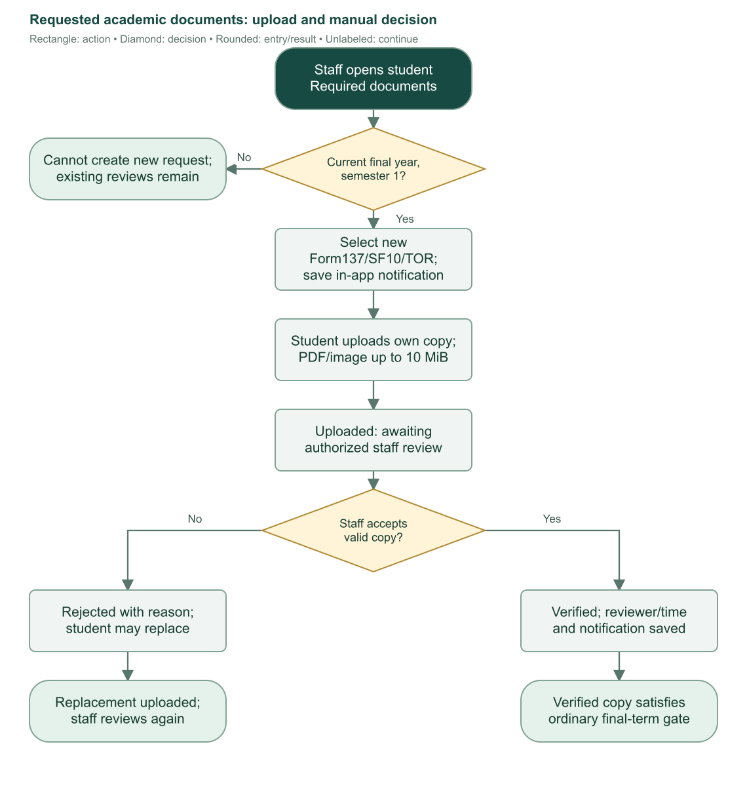

## 24.5 Two different progression gates

| Gate                             | Exact condition and required state                                                                                                                                                              |
| -------------------------------- | ----------------------------------------------------------------------------------------------------------------------------------------------------------------------------------------------- |
| Student clearance-review request | Current year equals current curriculum final year and current semester is at least `max(1, semesters - 1)`. Every existing requirement must be uploaded or verified. Requested/rejected blocks. |
| Ordinary staff enrollment save   | Target year equals selected curriculum final year and target semester equals selected curriculum final semester. Every existing requirement must be verified. Uploaded alone blocks.            |
| No request rows                  | Both document checks pass; no universal automatic all-three requirement.                                                                                                                        |
| Enrollment correction            | Explicitly exempt from document final-term gating in editor and server correction path. Subject prerequisites still apply.                                                                      |

For a two-semester plan, final-year semester 1 already activates the student request upload gate, preparing for final semester. With three semesters it starts at semester 2; with one semester it starts at semester 1. The request-creation window nevertheless stays semester 1. The gate can also apply to an eligible request while the student is already in the final semester.

The upload gate checks the student's explicit clearance request, not the act of analyzing/saving the clearance image. The verification gate applies through ordinary enrollment planning, including dropped-restoration saves targeting the final term. Correction deliberately uses a different path and is exempt; do not claim that every way of changing a final-term record enforces this document condition.

The editor waits for the required-document query before new final-term save. An unavailable/failed query blocks rather than assuming no requirements. It shows unverified kinds and links the staff document-review panel. Existing dashboard/report readiness still reflects its older grade/clearance/follow-up conditions and does not promise these newer document/subject gates are satisfied.

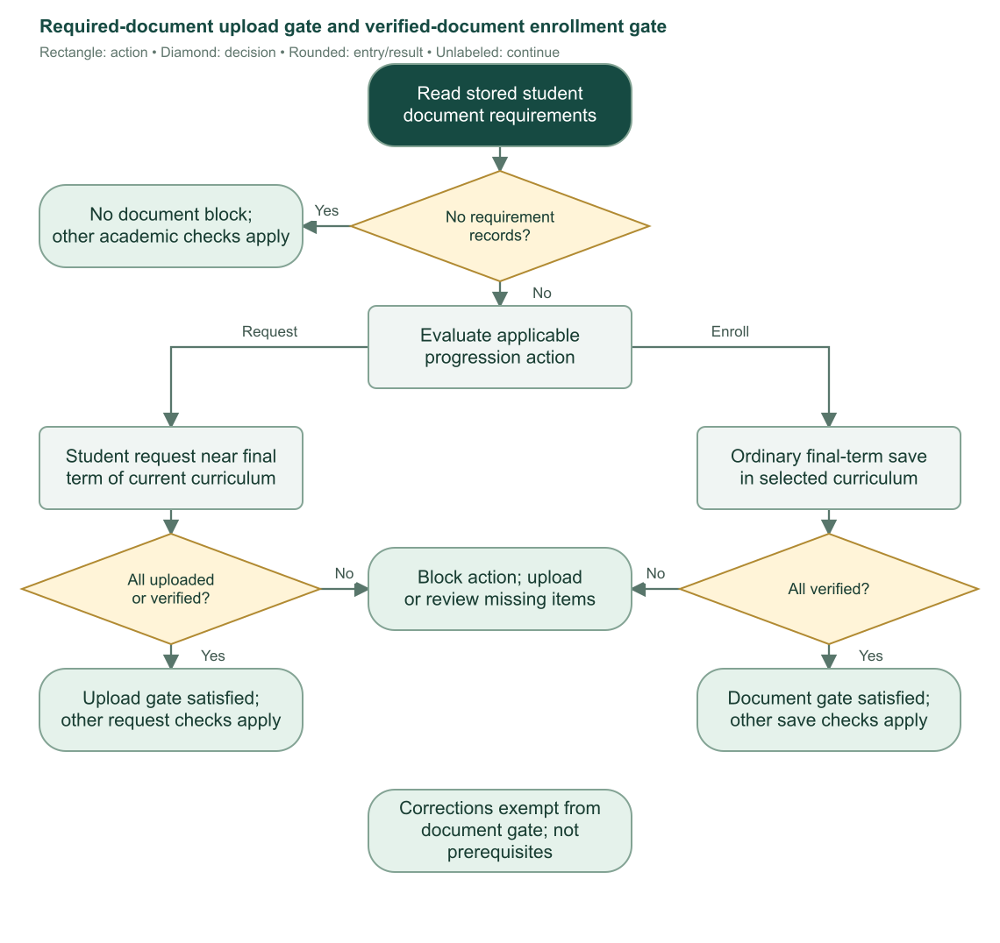

## 24.6 Persistence and migration

`required_document` stores kind, status, student user, original request-enrollment, requester/time, due snapshots, revision, optional unique object metadata, uploader time, reviewer identity/name/time, and rejection reason. States are requested, uploaded, verified, rejected. Uploaded/rejected/verified rows require file metadata. Restrictive student/enrollment references preserve requests; deleted staff references can become null while retained reviewer name remains.

Migration 0037 adds this table without automatically creating requirements for existing students. Its guarded rollback refuses to discard stored document rows or run with newer migrations applied. Migration 0038 separately adds initially empty prerequisite links; neither migration invents institutional policy. Restore/rollback planning must preserve stored requirements, rules, and Garage files rather than assume a schema downgrade reverses user actions.

Sources: S24, S29, S33, S35, S36.

# 25. Possible defense questions and suggested answers

Use these as practice answers and adapt them to the institution's approved process. They describe the checked source, not a claim that every feature has been deployed, experimentally evaluated, or approved as institutional policy. Demonstrate with prepared test accounts and nonprivate sample files. Do not quote accuracy percentages, production throughput, satisfaction scores, or legal certification without separate evidence.

## 25.1 Purpose, scope, and accounts

### Q01. What problem does the system address?

It coordinates account setup, term registration, grade release, clearance evidence, follow-ups, and academic-document requirements in one role-controlled portal. Its value is consistent state and visible next steps across those activities. Demonstrate a complete student journey rather than claiming a measured time saving that has not been studied.

### Q02. Who uses it, and why only three roles?

Administrators own staff access, catalogs, configuration, and exceptions; registrars operate student academic workflows; students access their current information and submit evidence. Instructor, cashier, and office approver roles are not implemented. This scope means staff enters grades and reviews signed-office evidence rather than those offices signing in separately.

### Q03. What distinguishes administrator and registrar access?

Both perform ordinary enrollment work. Administrators additionally manage staff/configuration/catalogs, handle historical grade changes, and reopen finalized records with reasons. Registrars cannot reopen finalized grades or edit historical grades. Both still obey prerequisite checks and lifecycle rules; administrator does not imply an unrestricted enrollment bypass.

### Q04. Why is public student registration disabled?

Current design lets authorized staff establish student identity and required personal data, then sends password setup to the recorded email. A student cannot self-assign a role, student number, or first enrollment. This is the implemented onboarding boundary, not a claim that public registration could never be appropriate elsewhere.

### Q05. How are student numbers assigned without duplicates?

The server atomically increments the current Manila year/month sequence and formats `MA-YYYYMM-NNNNNN`. Monthly numbering is separate from authentication user ID. The database enforces student-number uniqueness, and eligible student deletion does not recycle a previously allocated number.

### Q06. Why did student history and curriculum pages disappear?

Current student Enrollment intentionally returns only the explicit current record; curriculum pages are now staff-only. Historical academic records were retained for staff history, reports, and dashboard calculations. This is a current interface/access choice, not deletion of past registrations. Own historical COR authorization remains independently checked by its endpoint.

### Q07. Can students change their own personal records or enroll subjects?

Profile is read-only. Authorized staff edits personal records using original-value conflict checks. Students can change security settings and upload their own requested evidence, but staff chooses and saves enrollment subjects and units. Uploading or requesting review is separate from creating an enrollment.

## 25.2 Enrollment, grades, and term progression

### Q08. Can you explain the entire lifecycle briefly?

Staff creates account/student record, requests setup email, and saves first enrollment. After account setup, staff saves/finalizes grades. Student submits eligible clearance and explicitly requests review; staff verifies it and completes any mandatory failed-grade follow-up. Applicable documents and prerequisites are checked before staff saves the next enrollment as a new historical attempt/current record.

### Q09. Why use an explicit current-enrollment pointer?

It makes current workflow follow a deliberate student link rather than guess from timestamps. The server verifies the linked enrollment belongs to that student. Dropping, voiding, and reenrollment have different pointer effects, so current academic state can remain coherent while historical attempts are retained.

### Q10. What prevents duplicate enrollment in the same term?

The command validates existing attempts, and a partial unique database index covers student, school-year start, and semester for non-dropped/non-voided rows. Dropped/voided attempts remain historical but do not occupy that valid-term slot. The transaction saves subjects and current pointer together.

### Q11. Why separate saving grades from finalizing them?

Saving is a staff draft; students receive Pending rather than provisional values. Finalization compares the reviewed complete saved grade set, releases it, locks it, and creates a notification. Blank saved grades become INC. A later correction needs permitted administrator reopening rather than silent alteration of released results. Reopening preserves same-term clearance, so refinalizing can restore completed status without making the student repeat a valid approval.

### Q12. What is the difference between a failed grade and INC?

A finalized numeric grade above 3.00 is failed; a finalized blank is INC. Both can appear in concerns and retake selection. Current failed grades require completed Registrar follow-up before ordinary next enrollment; INC-only needs acknowledgment but not mandatory meeting completion. Neither outcome is automatically converted into a pass by a meeting.

### Q13. Does a completed enrollment guarantee next-term save?

No. Status/finalization/clearance are only part of readiness. Current failures may still need completed follow-up; selected subjects must meet prerequisites; requested documents must be verified for ordinary final-term enrollment; program, term, curriculum, and concurrency checks also apply. Dashboard readiness does not currently include every newer save condition.

### Q14. How is the next term calculated?

The previous curriculum's semester count determines rollover. Before its last semester, increment semester and keep school year/year level. At its end, default semester 1 and increment school-year start and year level. Carry program/section, load the selected usable curriculum, and clamp initial editor limits. Defaults remain reviewable and do not implement graduation.

### Q15. Why have correct, void, reopen, and drop as different actions?

Correct fixes allowed draft enrollment details; void preserves an incorrect attempt as invalid; reopen lets an administrator make finalized grades provisional again; drop records actual withdrawal. Reopening and same-term corrections preserve clearance; changing school year/semester invalidates its approval while retaining the file. Reopening resets academic follow-up and still requires grade refinalization. Their permissions, audit effects, and current-pointer behavior differ.

## 25.3 Subject prerequisites

### Q16. Why are prerequisites stored on subjects?

One global catalog rule governs every use of the subject across curricula/programs. Placement snapshots and subject eligibility are separate concerns. This avoids duplicating one requirement per plan, but means rule edits affect later enrollment/correction checks even for an old published curriculum; the current system does not version prerequisites with curricula.

### Q17. What evidence satisfies a prerequisite?

The latest valid attempt strictly before the target school-year/semester must be finalized with numeric grade 1.00–3.00. Dropped/voided attempts are excluded. Missing, Pending, Failed, and Incomplete block. Every configured direct prerequisite must pass; multiple prerequisites are not alternatives.

### Q18. Does any historical passing grade suffice?

No. A newer earlier-term attempt can supersede an older pass even when the newer attempt is Pending. A later finalized pass can restore eligibility. This differs from the outstanding-retake list, which intentionally considers latest finalized attempts. Demonstrate both calculations so their different purposes are clear.

### Q19. Can a prerequisite and its dependent be taken together?

Same-term enrollment alone cannot satisfy a prerequisite. Both subjects may be selected when qualifying earlier evidence already exists. Adding the prerequisite as an extra or retake does not itself establish that earlier pass. No co-requisite or administrator override field is implemented.

### Q20. How are circular dependencies prevented?

The guarded subject save rejects self, duplicate, and nonexistent references and traverses the proposed graph for paths back to the edited subject. Rule/details changes are transactional. Database constraints independently prevent duplicate/self/missing links but do not implement recursive cycle checking for arbitrary direct SQL edits.

### Q21. Why can Use term subjects or Add all retakes leave blocked rows?

Those controls preserve the intended selection rather than silently drop subjects. The editor displays unmet prerequisite reasons and disables save. Staff must remove blocked rows or resolve the required academic history. Server revalidation means a modified browser cannot bypass the same rule.

### Q22. Can an enrollment satisfy its own prerequisites during correction?

No. Correction validation excludes the entire corrected enrollment and uses the corrected target term. It requires valid earlier evidence outside that record. It also retains duplicate-term and chronological protections. A previously saved row/grade is not a self-issued exemption.

### Q23. Will existing installations automatically receive sample prerequisite rules?

Migration 0038 creates an empty relation rather than infer academic policy. Fresh sample seeding supplies demonstration links when creating sample curricula. Existing sample plans are skipped, preserving edits and preventing automatic backfill. Operators must configure approved rules for existing catalogs deliberately.

## 25.4 Required documents

### Q24. Does every student always need all three documents?

No. Staff selects Form 137, SF10, TOR, or a combination during final-year semester 1. Only stored requests become requirements, and zero requests means no document block. Every selected item is required; no alternatives/waiver control is implemented.

### Q25. Why are upload and staff verification different gates?

Upload shows a copy was submitted; staff verification records acceptance after human review. Near the final term, a student can request clearance review once requested copies are uploaded/verified. Ordinary final-term enrollment needs every requested item verified. This lets review proceed while preventing ordinary final registration on unaccepted copies.

### Q26. Is final year hard-coded to fourth year?

No. It uses curriculum yearLevels/semesters. Staff request creation is final-year semester 1. The student request upload gate starts when current final-year semester reaches `max(1, semesters - 1)`. New enrollment verification gate applies to selected curriculum final year and final semester.

### Q27. Can students replace an awaiting-verification or verified copy?

No. Upload accepts requested/rejected rows with matching revision. Staff rejects an awaiting copy with a reason before replacement; verified rows have no reopen control. This prevents replacing evidence after approval without another review, while also being a limitation if an accepted copy later needs correction.

### Q28. Are requirements recreated after a program change?

No. Uniqueness is per student user and kind; status survives term/program changes. Original request/due fields are snapshots. Current/target curriculum controls when gates apply. If the institution needs program-specific expiration or repeated requests, that is an extension rather than current behavior.

### Q29. Do academic-document uploads use the clearance OCR pipeline?

No. They use bounded file validation and manual staff review. PDFs receive header/end-marker checks; images receive decode/format/pixel checks. There is no document authenticity OCR, malware scanner, or automatic transcript acceptance. Multi-page content can be supplied as one PDF up to 10 MiB.

### Q30. Does the document gate apply to enrollment corrections?

Current correction UI and server path explicitly exempt it. Ordinary final-term enrollment, including a restored attempt targeting that term, applies the verified-document gate. Prerequisites still apply to corrections. This is an implemented boundary that must be stated honestly rather than claiming universal final-term gating.

### Q31. Does dismissing a popup remove the requirement or send email?

No. Popup dismissal is local reminder behavior. Stored requests/revisions remain, and dashboard notices continue until verification. Requests and staff decisions create in-app notifications only; upload itself creates no notification/email. The popup refresh uses focus and a visible-page interval, not guaranteed instant push.

## 25.5 Clearance, Gemini, and human review

### Q32. Does AI approve enrollment automatically?

No. Local image analysis and Gemini produce evidence. The student explicitly requests, authorized staff verifies the original clearance, and staff separately saves the next enrollment under academic/document/prerequisite checks. No model call can grant a role, create a grade, or independently register the student.

### Q33. Why combine local image checks with Gemini?

Local code checks form/term alignment, printed evidence, office ink, and actual added writing. Gemini transcribes configured handwriting crops, then deterministic server code compares values against the student record. Each mechanism addresses a different problem; combining them does not establish a measured accuracy or replace staff approval.

### Q34. What happens to a blank name or number field?

The blank-reference writing-presence check removes printed glyphs/prefixes, underlines, and specks and requires retained added strokes in both fields. Failure blocks the Gemini call and new submission. Presence proves writing-like strokes, not that the text is correct, readable, or authentic.

### Q35. What information reaches Google?

Two configured grayscale PNG name/number crops and transcription instructions. Expected database identity and the whole original clearance are excluded from that request. The crops contain personal information, so the accurate answer is limited data transfer, not that no personal data leaves the server. Provider retention/legal review needs separate evidence.

### Q36. Why is the expected name/number excluded from the prompt?

The model is asked to transcribe visible evidence rather than reproduce a supplied answer. The server independently obtains the expected identity from authenticated records and compares afterward. This reduces one source of confirmation bias, but it does not guarantee the model never misreads or invents text.

### Q37. What is the difference between automatic pass and Needs review?

Automatic pass needs the strict matched-identity result without warnings. Requestable evidence can instead have identity review after all mandatory local checks pass. It remains ready/requested in the same state model and requires explicit staff identity confirmation to verify. Template/office review is not covered by this exception.

### Q38. Can a wrong number still reach human review?

Yes. For example, an exact name with a different number can yield review. Staff must reconcile both name and number against the original and record before confirming, or reject with a correction reason. Review is an uncertainty path, not a model-certified match.

### Q39. Why does a number without MA- sometimes match exactly?

MA- is a fixed prefix, so comparison strips supported optional/repeated leading prefixes and compares numeric digits, preserving leading zeros. Exact digits are exact, not merely close. Arbitrary letter prefixes are not discarded. One-edit-close digits support review under the implemented length rules.

### Q40. What if Gemini times out or its key is missing?

The new analysis fails with a safe error rather than creating ready evidence. Missing key gives 503; a busy shared call gives 429; provider/network failures remain private. There is no automatic retry/provider fallback or outage-to-review bypass. Users retry; already-saved eligible reports remain usable without retranscription just to request/review them.

### Q41. Can a signature mark prove an office approved?

No. Added-ink detection measures marks beyond the blank reference; it does not authenticate a signature, stamp, or office authorization. Production also lacks a separate Not Cleared region. Staff must inspect the original for contradictory marks and legitimacy before accepting it.

### Q42. What evidence records a manual identity approval?

Verification requires `identityConfirmed=true` for a reviewable report and records verified state, reviewer ID/name/time, and the original automated report. There is no separate identity-confirmation column or dedicated identity audit event. Those existing fields show who accepted the reviewable evidence without rewriting the model findings to pretend automatic success.

### Q43. How do enhanced alignment and confidence thresholds help?

Printed anchors can propose corners when a border is weak; bounded fitting and coverage checks reject unsupported geometry. Printed wording is searched locally with confidence/term checks; optional visual correlation and office-frame checks have separate thresholds. These are implementation thresholds, not experimentally established system accuracy. User inspection and staff review still matter.

## 25.6 Data integrity, security, and outputs

### Q44. Why SQLite rather than a larger database server?

Current architecture uses an embedded relational database with transactions, constraints, and straightforward persistent-file deployment. This is simple for its present design. The code does not prove a particular concurrent-user capacity; a larger multi-instance workload would need measured contention/throughput and deployment review before asserting SQLite is sufficient.

### Q45. Why keep files in Garage rather than SQLite?

The database owns relationships, metadata, states, and revisions; the object store holds original/reference/document bytes. Unique keys avoid accidental overwrite, and downloads apply server permissions. Backups need both stores plus managed configuration; one database file alone cannot restore the evidence images.

### Q46. What prevents students accessing another student's file?

Server endpoints derive identity from session and check ownership or staff role. Foreign file identifiers return not found rather than exposing content. URLs or hidden navigation alone are not authorization. General test files additionally require the current user's exact storage prefix.

### Q47. How are passwords and account access protected?

Authentication handles credential hashing, sessions, reset tokens, bans, and TOTP/recovery codes. Public signup is disabled. Reset/setup tokens expire and are consumed, password reset revokes sessions, and email changes invalidate sessions/old links. Staff disable/revoke controls and role/ownership checks supplement authentication; none constitutes a blanket security certification.

### Q48. How do you prevent one staff member overwriting another's changes?

Account edits compare original values; academic and document transitions compare revisions/state; grade saves compare original grades; finalization compares the complete reviewed subject set. Immediate transactions recheck sensitive transitions. Conflicts require reload/review instead of silently accepting stale forms.

### Q49. What if a file upload succeeds but database save fails?

The server rechecks ownership/state after external work and cleans an unreferenced staging object when safe. It avoids deleting a file if the committed record may reference it. Previous-object deletion is best effort after replacement. This is coordinated recovery, not a distributed atomic transaction or complete file-version archive.

### Q50. What happens when confirmation email fails?

Saved accounts, enrollments, and grade changes normally remain. The system reports email outcome separately, and saved notifications can still be visible. Meeting sends use a specific claim/sent-state process. Provider acceptance is not proof of inbox delivery, and there is no persistent automatic email retry worker in current code.

### Q51. Why do reports sometimes count records differently from students?

One student may have multiple historical attempts, including dropped ones. Enrollment summary distinguishes records from distinct people; academic reports and roster outputs use their documented status filters. Selected historical class data comes from that term's enrollment while current corrected names can appear. Voided records are excluded from these academic scopes.

### Q52. Is COR the same as report Print / PDF?

No. COR is a dedicated server-generated PDF for an eligible owned/staff-accessible enrollment, with saved subject labels/units and current demographic/program data. Reports invoke browser printing of the generated selected report. Neither operation changes grades, enrollment status, or document verification.

## 25.7 Validation, limits, and demonstration

### Q53. How was this updated guide verified?

Repository changes were traced by subsystem against current source and cross-checked for contradictory old claims. Documentation generation checks package XML/relationships, links, styles, embedded images, and a local visual preview. This documentation task does not imply every application test, live service, or institution workflow was rerun or audited.

### Q54. Which tests should support a technical demonstration?

Relevant existing files include subject-prerequisites and enrollment-correction tests, required-document tests, clearance-checker/identity/presence/flow tests, and their selected browser scenarios. Show actual command results from the environment used for the defense. Listing tests or reading their assertions is not the same as claiming all currently pass.

### Q55. What proves the OCR or AI accuracy rate?

Source thresholds and example passes do not establish an accuracy rate. A defensible claim requires a labeled representative dataset, separate evaluation cases, match/review/mismatch and false-accept/reject metrics, image-condition breakdowns, and recorded model/configuration. Present those results only if the evaluation was actually performed.

### Q56. Is the system fully offline?

No. Database and local image processing can run locally, but production handwriting transcription calls Google Gemini and email calls its provider. Garage availability is required for evidence files. Some browser diagnostics may fetch OCR resources. Documented failure behavior is not an offline replacement for these dependencies.

### Q57. What deployment detail could make a working local Gemini feature fail in Docker?

The source reads a server-side Gemini key, but the current Compose environment list does not forward it. Deployment must provide it to the running container rather than assume the host's .env is automatically the container environment. Keep the key private; do not show live values in the defense.

### Q58. What limitations should be stated clearly?

No automatic graduation, tuition/payment ledger, timetable/seat allocation, instructor-role grade entry, automatic retake insertion, signature authentication, or universal document waiver/reopen/version-history flow is implemented. Document gates exempt corrections, and global prerequisites are mutable across curriculum versions. These boundaries should be explained rather than presented as completed features.

### Q59. What improvements would be reasonable next steps?

Possible evaluated extensions include institution-approved prerequisite versioning/exceptions, document correction/waiver/history policy, readiness indicators reflecting all gates, provider resilience, backup/restore exercises, and measured recognition/scaling studies. These are proposals, not existing functionality. Prioritize confirmed institutional needs and preservation of authorization/history over speculative expansion.

### Q60. What would you demonstrate to prove the complete workflow?

Use a prepared student and curriculum: show account setup, first enrollment, draft-hidden versus finalized grades, failed/INC behavior, blocked/satisfied prerequisite, document upload versus verification, matched/reviewable clearance, required staff identity acknowledgment, and final next-term save. Show a stale or forbidden action rejected and confirm old records remain. Use staged data when real academic progression would take too long for a live demonstration.

## 25.8 Evidence preparation checklist

1. Prepare separate administrator, registrar, and student test accounts; verify actual role restrictions with direct routes as well as navigation.
2. Use nonprivate approved sample documents and clear, misaligned, blank-field, mismatch, and reviewable clearance examples.
3. Prepare earlier-term prerequisite pass/failure/Pending examples; do not fabricate grades during a live official workflow.
4. Show required-document requested/uploaded/verified/rejected states and the different request/save gates.
5. Prepare service configuration privately; verify live connectivity ahead of time without displaying secrets.
6. Capture real focused test outcomes and record environment/model/source revision alongside any performance or accuracy evaluation.
7. Be ready to explain correction exemptions, mutable prerequisites, retained history, and why model evidence requires staff judgment.

Sources: S01–S36. Answers should be revised when implementation or institutional policy changes.

# Appendix A. Screen and endpoint reference

Dynamic braces identify a record ID placeholder. Account user IDs and student numbers are distinct identifiers.

| Route or screen                                           | Authorized audience and purpose                                                                |
| --------------------------------------------------------- | ---------------------------------------------------------------------------------------------- |
| `/`                                                       | Public landing page; portal information and dashboard/sign-in link.                            |
| `/login`                                                  | Public login and second-factor/recovery challenge; signed-in users redirected.                 |
| `/first-login`                                            | Token-based first password setup.                                                              |
| `/forgot-password`                                        | Public generic recovery request.                                                               |
| `/reset-password`                                         | Token-based password reset and attempted sign-in.                                              |
| `/user`                                                   | Protected workspace entry redirect/view leading to dashboard.                                  |
| `/user/dashboard`                                         | Role-specific staff or own-student dashboard.                                                  |
| `/user/admins`                                            | Admin-only administrator account management.                                                   |
| `/user/registrars`                                        | Admin-only registrar account management.                                                       |
| `/user/students`                                          | Staff student directory, create/edit, setup resend, eligible deletion, session revocation.     |
| `/user/students/{userId}`                                 | Staff student personal information, current enrollment and history.                            |
| `/user/students/{userId}/enroll`                          | Staff first/next/restoration enrollment editor.                                                |
| `/user/students/{userId}/enrollments/{enrollmentId}`      | Staff term details, grades, review, lifecycle actions, audit.                                  |
| `/user/students/{userId}/enrollments/{enrollmentId}/edit` | Permitted staff correction editor.                                                             |
| `/user/enrollment`                                        | Student own current enrollment only, released grades, clearance and required-document uploads. |
| `/user/enrollment/{enrollmentId}/cor`                     | Authorized staff or owning student private COR PDF.                                            |
| `/user/clearances`                                        | Staff Enrollment requests review queue.                                                        |
| `/user/clearance-template`                                | Authenticated supported roles fetch current reference, optional revision match.                |
| `/user/clearance-files/{id}`                              | Staff/owner retrieve saved original clearance image.                                           |
| `/user/document-files/{id}`                               | Staff/owner private download of a requested academic document copy.                            |
| `/user/programs`                                          | Staff catalog; admin writes.                                                                   |
| `/user/subjects`                                          | Staff catalog; admin writes.                                                                   |
| `/user/curriculum`                                        | Staff-only curriculum list; student requests forbidden.                                        |
| `/user/curriculum/new`                                    | Admin draft creation.                                                                          |
| `/user/curriculum/{curriculumId}`                         | Staff-only plan detail; student requests forbidden.                                            |
| `/user/curriculum/{curriculumId}/edit`                    | Admin unpublished/unarchived draft editing.                                                    |
| `/user/masterlist`                                        | Staff selected historical-term roster.                                                         |
| `/user/masterlist/rows`                                   | Staff next lazy roster batch.                                                                  |
| `/user/masterlist/export`                                 | Staff full matching roster CSV.                                                                |
| `/user/reports`                                           | Staff five academic report types.                                                              |
| `/user/reports/export`                                    | Staff matching report CSV.                                                                     |
| `/user/notifications`                                     | Role-scoped saved event inbox/activity log.                                                    |
| `/user/settings`                                          | Settings entry redirects to an appropriate settings page.                                      |
| `/user/settings/profile`                                  | Own read-only account/personal data.                                                           |
| `/user/settings/security`                                 | Own password/TOTP/recovery operations.                                                         |
| `/user/settings/email`                                    | Admin provider/sender configuration.                                                           |
| `/user/settings/clearance`                                | Admin reference, region definition, browser test.                                              |
| `/user/settings/storage`                                  | Admin whole-bucket browser, overview, confirmed deletion/capacity.                             |
| `/user/settings/storage/upload`                           | Admin bounded multipart file upload.                                                           |
| `/user/settings/storage/download`                         | Admin storage attachment stream.                                                               |
| `/test`                                                   | Standalone browser scan/diagnostic prototype; optional signed-in tools.                        |
| `/test/identity`                                          | Authenticated same-origin diagnostic handwriting POST.                                         |
| `/test/files`                                             | Authenticated private per-user test upload/list.                                               |
| `/test/files/download`                                    | Authenticated own-prefix download.                                                             |

`/user/applicants` has a remaining layout file but no implemented applicant page in the inspected route inventory. A metadata entry for a route name does not prove an implemented user workflow. Better Auth also handles its authentication API through the server hook; those library endpoints are separate from the application screen list.

# Appendix B. Server command and responsibility index

This inventory groups exported application commands/queries by owner. Direct Better Auth client operations also perform login, password changes, factor management, sign-out, and the staff ban/session APIs described earlier.

| Owner module                                       | Commands and responsibility                                                                                                                                    |
| -------------------------------------------------- | -------------------------------------------------------------------------------------------------------------------------------------------------------------- |
| `actions/user.remote.ts`                           | `createStudent`, `updateStudent`, `deleteStudent`: personal account lifecycle and protected deletion.                                                          |
| same                                               | `createRegistrar`, `updateRegistrar`, `deleteRegistrar`, `setRegistrarDisabled`: admin-managed registrar access.                                               |
| same                                               | `createAdmin`, `updateAdmin`, `deleteAdmin`, `setAdminDisabled`: administrator account management with self-protection.                                        |
| same                                               | `revokeAccountSessions`: role-scoped sign-out of target sessions.                                                                                              |
| same                                               | `resendMagicLink`: staff-initiated password-setup/reset invitation, despite historical name.                                                                   |
| same                                               | `enrollStudent`: validate/save term, subjects, current pointer, notification; attempt email.                                                                   |
| `actions/password.remote.ts`                       | `resetPasswordAndSignIn`, `completeFirstLogin`: consume token, set password, attempt sign-in, finish account flags.                                            |
| `actions/enrollment.remote.ts`                     | `correctEnrollment`, `voidEnrollment`, `reopenEnrollment`: guarded academic changes with reasons/audits.                                                       |
| `actions/grades.remote.ts`                         | `updateEnrollmentGrades`, `finalizeEnrollmentGrades`: drafts and reviewed release.                                                                             |
| same                                               | `verifyEnrollmentClearance`: approve exact requested image and complete current clearance.                                                                     |
| same                                               | `sendEnrollmentMeetingRequest`, `completeEnrollmentFollowUp`: delivery claim, sent state, completed discussion.                                                |
| same                                               | `dropEnrollment`: current actual withdrawal and invalidation.                                                                                                  |
| `actions/clearance.remote.ts`                      | `getStudentClearance`, `uploadClearance`, `requestEnrollment`: own current production clearance information, analysis/save, explicit request.                  |
| same                                               | `rejectClearance`: staff reasoned rejection of requested submission.                                                                                           |
| same                                               | `getClearanceSettings`, `uploadClearanceTemplate`, `saveClearanceAreas`: admin template and saved definition management.                                       |
| `actions/documents.remote.ts`                      | `getStudentDocuments`, `getStudentDocumentReview`: own student requirements and staff review data.                                                             |
| same                                               | `requestDocuments`, `reviewDocument`, `uploadDocument`: role/ownership-scoped requests, manual decisions, and file submission with revision checks.            |
| `actions/curriculum.remote.ts`                     | `createCurriculum`, `updateCurriculum`, `activateCurriculum`, `changeCurriculumState`, `deleteCurriculum`: plan lifecycle and publication.                     |
| `actions/program.remote.ts`                        | `createProgram`, `updateProgram`, `deleteProgram`, `setProgramStatus`: admin catalog and curriculum selection.                                                 |
| `actions/subject.remote.ts`                        | `createSubject`, `updateSubject`, `deleteSubject`, `setSubjectStatus`: admin subject catalog, transactional prerequisite graph validation, protected deletion. |
| `actions/settings.remote.ts`                       | `updateSystemSettings`: save validated email settings while preserving blank secrets.                                                                          |
| `actions/notifications.remote.ts`                  | `readNotifications`: supplied `id` marks that own event; omitted `id` marks all own unread events.                                                             |
| `actions/storage.remote.ts`                        | `deleteGarageEntry`, `increaseGarageCapacity`: administrator-only validated confirmed mutations.                                                               |
| `server/enrollment.ts`                             | Authoritative eligibility, allowed curriculum/subject mapping, outstanding finalized attempts.                                                                 |
| `server/enrollment-editor.ts`                      | Enrollment defaults and loading; restoration/ordinary progression.                                                                                             |
| `server/enrollment-corrections.ts`                 | Revisions, chronological protection, snapshots, correction/void/reopen ownership.                                                                              |
| `server/student-enrollment.ts`                     | Grade/lifecycle permissions and student-facing grade masking/history.                                                                                          |
| `server/clearance-workflow.ts`                     | Own-current eligibility, request state, queue, verification/rejection invariants.                                                                              |
| `server/clearance-upload.ts`                       | Server analysis/object save/recheck and safe replacement cleanup.                                                                                              |
| `server/clearance-checker.ts`                      | Production decoding, rectification, OCR, printed and office findings.                                                                                          |
| `server/handwriting.ts`, `clearance/identity*.ts`  | Shared Gemini transcription, normalized comparison, and production writing-presence evidence.                                                                  |
| `server/documents.ts`, `server/document-upload.ts` | Student-scoped requirements, upload/verified term gates, manual review, private file replacement.                                                              |
| `subject-prerequisites.ts`, `server/enrollment.ts` | Latest valid earlier attempt and all-direct-prerequisites checks; server enforcement for creation/restoration/correction.                                      |
| `server/masterlist.ts`, `server/reports.ts`        | Validated historical scope, data queries, output generation.                                                                                                   |
| `server/notifications.ts`, `server/email/*`        | Safe persisted events, role visibility, templates, provider delivery.                                                                                          |
| `server/garage/*`                                  | Provisioning lease, layout, S3 operations, explorer, overview/capacity.                                                                                        |

Dedicated catalog status commands exist even where the current interface saves active status through a full edit form. Commands listed here are implementation entry points; ordinary users operate the corresponding UI.

# Appendix C. Data dictionary and state ownership

| Table/record           | Important data and ownership                                                                                                                                                                |
| ---------------------- | ------------------------------------------------------------------------------------------------------------------------------------------------------------------------------------------- |
| `user`                 | Identity, name parts/display name, unique email, role, setup/email flags, ban state, factor flag, timestamps.                                                                               |
| `student`              | Student number primary key, unique user link, address/contact/birth/sex, unique current enrollment, creation time.                                                                          |
| `student_sequence`     | Year/month primary key and last allocated monthly number.                                                                                                                                   |
| `program`              | Unique code, name/description, active status, selected curriculum ID.                                                                                                                       |
| `subject`              | Unique catalog code, name/description, active status; no universal unit value.                                                                                                              |
| `subject_prerequisite` | Composite subject/required-subject pair, reverse index, self check, cascade/restrict links. Global mutable rules, not published curriculum snapshots.                                       |
| `curriculum`           | Program-code link, unique program/name pair, year/semester bounds, publication/archive state.                                                                                               |
| `curriculum_subject`   | Unique subject in a curriculum, placement, units, published name/code snapshots.                                                                                                            |
| `enrollment`           | Student/curriculum, section/year/semester/school-year, status, finalization/clearance, meeting/follow-up/drop times, revision.                                                              |
| `enrollment_subject`   | Unique subject per enrollment, source curriculum/extra, optional placement link, grade, name/code/units snapshot, staff/time.                                                               |
| `enrollment_audit`     | Corrected/voided/reopened event, actor ID/name, reason, before/after JSON snapshots, timestamp.                                                                                             |
| `clearance_template`   | Singleton 1; revision/object metadata, optional saved definition, uploader/time.                                                                                                            |
| `clearance_submission` | Unique enrollment; file/template/definition/corners/report snapshot including writing presence and identity result, request/reviewer/rejection state. Review need is not a separate status. |
| `required_document`    | Unique student user/kind, original request-enrollment/due snapshots, requested/uploaded/verified/rejected status, revision, current file metadata and reviewer/reason.                      |
| `notification`         | Recipient, optional actor/enrollment, event type, safe text, creation/read times.                                                                                                           |
| `system_settings`      | Singleton 1; seed flag, provider, sender, SMTP settings/password and Resend API key. Secrets are private.                                                                                   |
| `garage_storage`       | Endpoint, stable key name/ID, lease token/expiry. S3 secret stays in server memory.                                                                                                         |
| `session`              | Unique session token, user, expiry, client metadata. Cascades on user removal.                                                                                                              |
| `account`              | Auth provider account/credential data and hashed password handled by authentication.                                                                                                        |
| `verification`         | Expiring authentication verification/reset records.                                                                                                                                         |
| `two_factor`           | Factor secret, backup-code data, verification/lock bookkeeping.                                                                                                                             |
| `task`                 | Existing small task table without an active documented enrollment UI workflow.                                                                                                              |

The database and commands apply uniqueness, positive units/placement rules, grade range, status enums, and restrictive/cascading/set-null relationships according to their owners. Validated inputs complement those constraints; UI-only validation is not the enforcement boundary.

# Appendix D. Source map and glossary

Paths are repository-relative. Line references identify representative inspected entry points and may move as code changes.

| ID  | Source locations                                                                                                                                                                                                                                                                                                                                                                                                     |
| --- | -------------------------------------------------------------------------------------------------------------------------------------------------------------------------------------------------------------------------------------------------------------------------------------------------------------------------------------------------------------------------------------------------------------------- |
| S01 | `src/lib/schema.ts:1`, `src/lib/Roles.ts:1`, `src/lib/server/db/index.ts:1`. Core records, roles, database.                                                                                                                                                                                                                                                                                                          |
| S02 | `src/lib/components/Sidebar/navigation.ts:39`, `src/routes/user/+layout.server.ts:7`, `src/lib/components/Topbar/Topbar.svelte:1`. Role navigation/workspace.                                                                                                                                                                                                                                                        |
| S03 | `src/lib/server/auth.ts:18`, `src/lib/auth-permissions.ts:10`, `src/lib/server/auth-names.ts:22`, `src/hooks.server.ts:12`. Auth boundary/hooks.                                                                                                                                                                                                                                                                     |
| S04 | `src/routes/login/+page.svelte:16`, `src/routes/first-login/+page.svelte:13`, `src/routes/reset-password/+page.svelte:13`, `src/routes/user/settings/security/+page.svelte:65`. Login/password/TOTP UI.                                                                                                                                                                                                              |
| S05 | `src/lib/errors.ts:1`, `src/hooks.client.ts:1`, `src/lib/components/Popup/`, `src/lib/components/ThemeController/`. Safe errors/shared controls/theme.                                                                                                                                                                                                                                                               |
| S06 | `src/lib/actions/password.remote.ts:11`, `src/lib/server/email/account-setup.ts:1`, `src/routes/forgot-password/+page.svelte:13`. Tokens/setup/delivery tracking.                                                                                                                                                                                                                                                    |
| S07 | `src/lib/actions/user.remote.ts:32`, `src/lib/students.ts:5`, `src/lib/person-name.ts:3`, `src/routes/user/students/StudentDialog.svelte:37`. Account/student lifecycle.                                                                                                                                                                                                                                             |
| S08 | `src/lib/actions/program.remote.ts:12`, `src/lib/actions/subject.remote.ts:11`, `src/routes/user/programs/`, `src/routes/user/subjects/`. Catalogs.                                                                                                                                                                                                                                                                  |
| S09 | `src/lib/actions/curriculum.remote.ts:12`, `src/lib/server/curriculum.ts:35`, `src/routes/user/curriculum/`. Draft/publication/history.                                                                                                                                                                                                                                                                              |
| S10 | `src/lib/server/enrollment.ts:24`, `src/lib/server/enrollment-editor.ts:36`, `src/routes/user/students/EnrollmentEditor.svelte:35`. Enrollment/retakes/defaults.                                                                                                                                                                                                                                                     |
| S11 | `src/lib/actions/grades.remote.ts:34`, `src/lib/server/student-enrollment.ts:9`, `src/lib/enrollment-grades.ts:3`. Grades/meeting/drop/clearance flags.                                                                                                                                                                                                                                                              |
| S12 | `src/lib/actions/clearance.remote.ts:25`, `src/lib/server/clearance-template.ts:34`, `src/routes/user/settings/clearance/`. Admin template definition/setup.                                                                                                                                                                                                                                                         |
| S13 | `src/lib/server/clearance-upload.ts:31`, `src/lib/server/clearance-workflow.ts:42`, `src/routes/user/enrollment/StudentClearance.svelte:35`. Production submission/request/review.                                                                                                                                                                                                                                   |
| S14 | `src/lib/server/clearance-checker.ts:29`, `src/lib/clearance/definition.ts:107`, `src/lib/clearance/report.ts:14`, `src/lib/clearance/checkbox.ts:165`. OCR/geometry/mark thresholds.                                                                                                                                                                                                                                |
| S15 | `src/routes/user/clearances/+page.server.ts:6`, `src/routes/user/students/EnrollmentDetails.svelte:317`, `src/routes/user/clearance-files/[id]/+server.ts:10`. Queue/reviewer/file access.                                                                                                                                                                                                                           |
| S16 | `src/lib/server/enrollment-corrections.ts:22`, `src/lib/actions/enrollment.remote.ts:1`, `src/routes/user/students/EnrollmentRecordActions.svelte:126`. Changes/audit.                                                                                                                                                                                                                                               |
| S17 | `src/lib/server/staff-dashboard.ts:34`, `src/lib/server/enrollment-worklist.ts:8`, `src/lib/pages/Dashboard/Staff/Dashboard.svelte:133`. Staff metrics/queues.                                                                                                                                                                                                                                                       |
| S18 | `src/lib/server/student-dashboard.ts:6`, `src/lib/pages/Dashboard/Student/`, `src/routes/user/enrollment/`, `src/routes/user/settings/profile/`. Own academic views.                                                                                                                                                                                                                                                 |
| S19 | `src/lib/server/masterlist.ts:10`, `src/routes/user/masterlist/MasterlistTable.svelte:19`, `src/routes/user/masterlist/export/+server.ts:4`. Masterlist.                                                                                                                                                                                                                                                             |
| S20 | `src/lib/server/reports.ts:23`, `src/lib/reports.ts:1`, `src/routes/user/reports/+page.svelte:116`, `src/lib/server/csv.ts:1`. Reports/exports.                                                                                                                                                                                                                                                                      |
| S21 | `src/lib/server/notifications.ts:12`, `src/lib/actions/notifications.remote.ts:8`, `src/lib/email.ts:6`, `src/routes/user/notifications/`. Events/visibility.                                                                                                                                                                                                                                                        |
| S22 | `src/lib/server/garage/index.ts:13`, `src/lib/server/garage/files.ts:39`, `src/lib/server/garage/credentials.ts:15`. Provisioning/files/lease.                                                                                                                                                                                                                                                                       |
| S23 | `src/lib/server/email/index.ts:10`, `src/lib/server/email/templates.ts:124`, `src/lib/server/settings.ts:5`, `src/lib/actions/settings.remote.ts:12`. Email configuration/delivery.                                                                                                                                                                                                                                  |
| S24 | `src/lib/schema.ts:176`, `src/lib/schema.ts:210`, `src/lib/schema.ts:275`, `src/lib/server/staff-accounts.ts:11`. Persistence/constraints/lists.                                                                                                                                                                                                                                                                     |
| S25 | `src/lib/server/garage/admin.ts:14`, `src/lib/server/garage/explorer.ts:23`, `src/lib/server/garage/layout.ts:72`, `src/routes/user/settings/storage/`. Storage admin/capacity.                                                                                                                                                                                                                                      |
| S26 | `src/lib/server/filters.ts:20`, `src/lib/components/Filter/fields.ts:18`, `src/lib/components/Table/TableValues.ts:1`. Common filters/pagination.                                                                                                                                                                                                                                                                    |
| S27 | `src/lib/server/cor.ts:15`, `src/lib/server/cor-pdf.ts:13`, `src/routes/user/enrollment/[enrollmentId]/cor/+server.ts:6`. Certificate output.                                                                                                                                                                                                                                                                        |
| S28 | `src/routes/test/files/+page.server.ts:12`, `src/lib/server/garage/files.ts:126`, `README.md`. Diagnostic personal storage/configuration notes.                                                                                                                                                                                                                                                                      |
| S29 | `Dockerfile:1`, `docker-entrypoint.sh:1`, `docker-compose.yml:1`, `scripts/migrate.mjs:1`, `src/lib/server/db/seed.ts:1`, `.github/workflows/docker-publish.yml:1`, `src/env.ts:1`. Runtime/seed/configuration.                                                                                                                                                                                                      |
| S30 | `src/routes/test/+page.svelte:220`, `src/routes/test/IdentityCheck.svelte:51`, `src/routes/test/identity.server.ts:11`, `src/lib/clearance/identity.ts`, `src/lib/server/handwriting.ts`. Diagnostic scan/identity.                                                                                                                                                                                                  |
| S31 | `src/lib/server/handwriting.ts:14`, `src/lib/clearance/identity.ts:38`, `src/lib/clearance/identity-presence.ts:61`, `src/lib/clearance/report.ts:17`. Gemini, comparison, writing presence, submit/review helpers.                                                                                                                                                                                                  |
| S32 | `src/lib/clearance/anchors.ts:69`, `src/lib/clearance/scan.client.ts:425`, `src/lib/clearance/BorderEditor.svelte:57`, `src/lib/clearance/definition.ts:124`, `src/lib/clearance/checkbox.ts:16`. Current alignment, definition, and mark checks.                                                                                                                                                                    |
| S33 | `src/lib/server/documents.ts:15`, `src/lib/server/document-upload.ts:17`, `src/lib/actions/documents.remote.ts:16`, `src/lib/components/documents/`, `src/routes/user/document-files/[id]/+server.ts:10`. Required documents and exact gates.                                                                                                                                                                        |
| S34 | `src/lib/subject-prerequisites.ts:16`, `src/lib/actions/subject.remote.ts:29`, `src/lib/server/enrollment.ts:27`, `src/lib/server/enrollment-corrections.ts:179`, `src/lib/server/db/seed-data.ts:63`, `drizzle/0038_subject_prerequisites.sql:1`. Prerequisite graph, enforcement, samples, migration.                                                                                                              |
| S35 | `src/routes/user/enrollment/+page.server.ts:6`, `src/lib/components/EnrollmentHistory.svelte:70`, `src/lib/components/Sidebar/navigation.ts:58`, `src/routes/user/curriculum/+page.server.ts:13`, `src/routes/user/curriculum/[curriculumId]/+page.server.ts:7`. Current-only student page and staff-only curriculum.                                                                                                |
| S36 | `tests/subject-prerequisites.test.mjs`, `tests/enrollment-corrections.test.mjs`, `tests/required-documents.test.mjs`, `tests/required-documents.browser.mjs`, `tests/clearance-checker.test.ts`, `tests/clearance-identity-presence.test.ts`, `tests/clearance-identity.test.mjs`, `tests/clearance-review.browser.mjs`. Relevant regression evidence; this documentation update does not imply a new full test run. |

| Term                       | Definition                                                                                                                      |
| -------------------------- | ------------------------------------------------------------------------------------------------------------------------------- |
| Actor                      | Account responsible for a saved event/action.                                                                                   |
| Current pointer            | Student row's explicit link to its current enrollment.                                                                          |
| Draft                      | Unsaved local edit, or saved but unfinalized data, depending on context.                                                        |
| Finalized                  | Saved grades released and locked until permitted admin reopening.                                                               |
| INC                        | Incomplete; a finalized subject attempt with no numeric grade.                                                                  |
| Snapshot                   | Historical copy of names/codes/units or before/after state that later edits do not automatically rewrite.                       |
| Revision                   | Counter/token compared during save to reject stale state.                                                                       |
| Lease/claim                | Temporary ownership marker coordinating concurrent provisioning or meeting sends.                                               |
| OCR                        | Optical character recognition of text from an image.                                                                            |
| Rectification              | Transforming photographed form corners into aligned reference geometry.                                                         |
| TOTP                       | Time-based one-time password generated by an authenticator app.                                                                 |
| COR                        | Certificate of Registration PDF for an eligible saved enrollment.                                                               |
| Provider acceptance        | Email send request was accepted by SMTP/Resend; not inbox receipt.                                                              |
| Voided                     | Incorrect enrollment preserved but excluded from valid-term operation.                                                          |
| Dropped                    | Actual withdrawal attempt preserved historically.                                                                               |
| Ready clearance            | Eligible saved evidence awaiting explicit request; identity may match or require staff review.                                  |
| Requested clearance        | Evidence submitted for staff review, not automatic enrollment.                                                                  |
| Identity review            | Requestable machine findings requiring explicit staff confirmation of original name/number; not an extra submission state.      |
| Prerequisite               | Direct global subject requirement satisfied by the latest qualifying earlier finalized pass.                                    |
| Uploaded academic document | File provided but awaiting manual acceptance; enough for the applicable student request upload gate, not final-term staff save. |
